# LSM Lab: GPU-offloaded RocksDB compaction

LSM Lab moves RocksDB 11.8 compaction onto an NVIDIA GPU and measures what
that buys the database. The GPU reads, decompresses, merges and garbage-collects
the input, then builds, compresses and checksums the output data blocks. RocksDB
keeps file cuts, indexes, filters, metadata and installation. Output is
checked against native RocksDB for every stored key version and through point
lookups.

## Results at a glance

Current results (methodology v3: native RocksDB tuned with the same search as ours, every
hypothesis registered before the runs, every run checked against native RocksDB):

- **A compaction uses 9–16× less CPU.** Host CPU per GiB compacted: 8.8× less for
  128-byte values with LZ4, 14.2× for 32-byte values, 15.5× with ZSTD.
- **One compaction runs 8–12× faster:** 8.0× (128 B, LZ4), 11.7× (32 B, LZ4), 10.7×
  (128 B, ZSTD).
- **One GPU does the compaction work of 15–18 CPU cores** (15 with LZ4, 17.7 with ZSTD),
  while using only 1.3–2 host cores.
- **The whole database handles 1.5–1.8× more writes with 1.7–2.2× less CPU per write**,
  and never stalls. With 16 cores the p99.9 write latency is 9 ms against 210 ms.
- **Why not 10× for the whole database:** compaction is no longer the bottleneck.
  RocksDB's own write path (memtable insert and write queue, about 2.3 µs per write)
  and flush remain on the CPU. That caps the whole-database gain near 2×.
- **Tail latency is mixed.** p99 is lower at every load (up to 7× at 90% of native's
  maximum), but at 50–70% load one of two runs had a single pause of about 0.5 s whose
  cause is still unknown, so p99.9 there is worse than native's
  ([details](#current-results-methodology-v3)).
- **It beats earlier GPU and FPGA compaction designs** rebuilt in the same RocksDB on
  the same machine (v1 methodology; [details](#4-compared-with-earlier-gpu-and-fpga-designs)).
- **Offloading only compression, this project's original design, is not enough:** at
  most 1.2× faster, with no benefit to the database.

Measured on Zyra: 4 × Xeon Gold 5220, RTX A6000, data on `/dev/shm`.
Native RocksDB is built with hardware CRC32C.

### Three levels of offload

A compaction:

1. reads, decompresses and parses its input files;
2. sorts all entries and drops outdated versions;
3. packs the survivors into data blocks;
4. compresses and checksums each block;
5. writes the blocks into files, with an index, a Bloom filter and metadata.

| Design | On the GPU | On the CPU |
|---|---|---|
| Native RocksDB | none | 1–5 |
| GPU compression only (original design) | 4 | 1, 2, 3, 5 |
| GPU merge | 1, 2, 4 | 3, 5 |
| GPU merge + block building | 1–4 | 5 (plus an index entry per block and filter construction) |

Details: [docs/gpu-compaction.md](docs/gpu-compaction.md).

### Current results (methodology v3)

What changed since the earlier campaigns, and why the numbers differ from sections 1–5:

- **Native RocksDB is tuned properly.** The earlier campaigns left RocksDB at one
  subcompaction, which slowed its largest compactions. Both designs now use settings
  chosen by the same search and rule ([configs/system/tuned.json](configs/system/tuned.json)).
  This raised native's throughput by about 1.4× at 4 cores (349k to 489k writes/s) and
  1.5× at 32 cores, and is why the whole-database ratios below are lower than in
  sections 2–4.
- **Our host-side work is much smaller.** Profiling only the measured compaction showed
  the host was busy with file writes, Bloom filters and allocation, not the GPU. Blocks
  are now written in whole runs, filter bits are set on the GPU, sorted runs are merged
  instead of sorted, and checksums use a whole GPU warp ([publication/AUDIT.md](publication/AUDIT.md)
  items 24–30).
- **Both designs run with `allow_fallocate = false`**, a RocksDB option that stops tmpfs
  zeroing every page before it is written.

**One compaction** (a bottom level plus 8 overlapping level-0 files, 0.6–0.7 GiB; median of
3 warm runs, log scale):

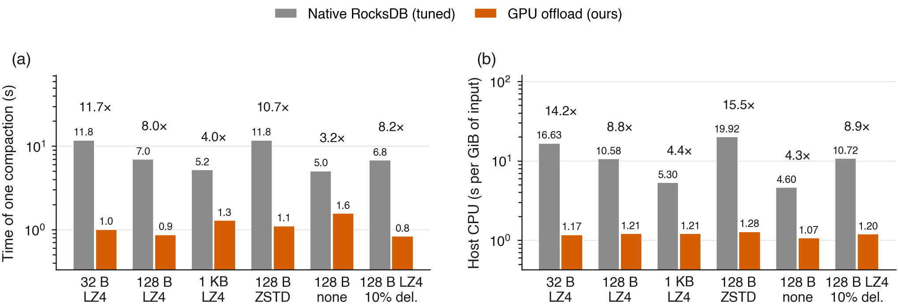

| Workload | One job: native → ours | Faster | Host CPU per GiB: native → ours | Less CPU |
|---|---|---|---|---|
| 32 B values, LZ4 | 11.77 → 1.01 s | **11.7×** | 16.63 → 1.17 s | **14.2×** |
| 128 B values, LZ4 | 6.96 → 0.87 s | **8.0×** | 10.58 → 1.21 s | **8.8×** |
| 128 B values, ZSTD | 11.81 → 1.11 s | **10.7×** | 19.92 → 1.28 s | **15.5×** |
| 128 B values, LZ4, 10% deletes | 6.80 → 0.83 s | 8.2× | 10.72 → 1.20 s | 8.9× |
| 1 KB values, LZ4 | 5.18 → 1.29 s | 4.0× | 5.30 → 1.21 s | 4.4× |
| 128 B values, no compression | 5.05 → 1.57 s | 3.2× | 4.60 → 1.07 s | 4.3× |

The gain is largest where compaction is most expensive on a CPU: small values (more keys
per byte) and stronger compression. With 1 KB values or no compression, native
compaction is already cheap per byte, and ours is limited by copying data through memory.

**How many cores one GPU replaces** (8 subcompactions on 8 cores, 2.5–2.6 GiB of input):

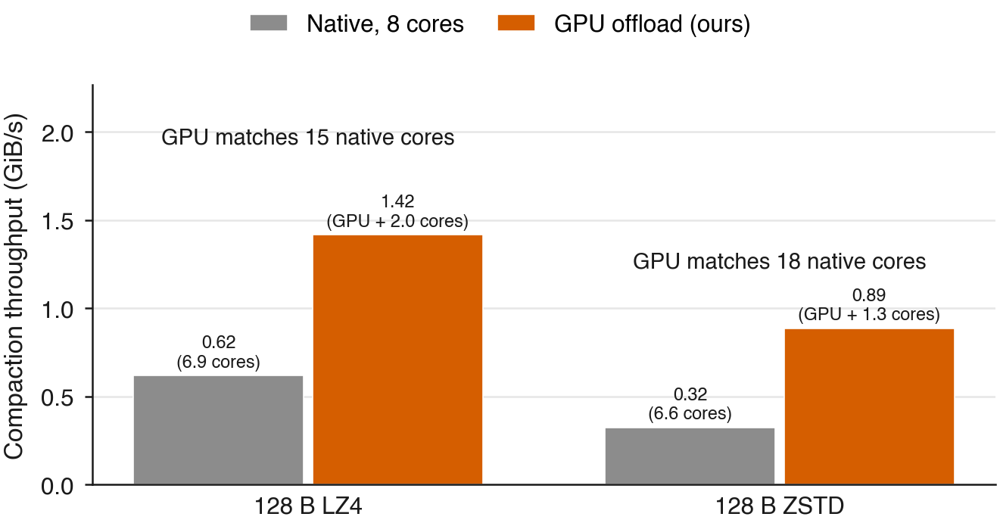

The GPU compacts 1.42 GiB/s of LZ4 input and 0.89 GiB/s of ZSTD input, while the host
uses 2.0 and 1.3 cores. One native core compacts 0.094 and 0.050 GiB/s, so the GPU does
the work of **15 and 18 native cores**. Native on 8 cores reaches 0.62 and 0.32 GiB/s.

**The whole database** (50 M keys, batched writes, 2-minute warm-up, 5-minute measurement,
median of 2 runs):

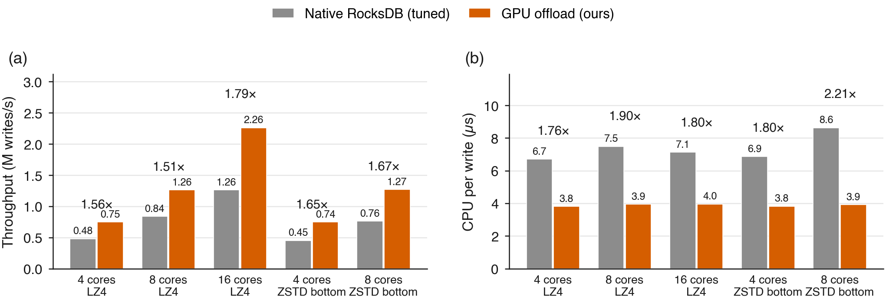

| Setup | Cores | Native | Ours | Throughput | CPU per write: native → ours |
|---|---|---|---|---|---|
| LZ4 | 4 | 489k writes/s | 746k | **1.53×** | 6.6 → 3.8 µs (1.74×) |
| LZ4 | 8 | 835k | 1,258k | **1.51×** | 7.5 → 4.0 µs (1.90×) |
| LZ4 | 16 | 1,265k | 2,261k | **1.79×** | 7.1 → 4.0 µs (1.80×) |
| LZ4 above, ZSTD at the bottom | 4 | 454k | 746k | **1.64×** | 6.8 → 3.8 µs (1.79×) |
| LZ4 above, ZSTD at the bottom | 8 | 756k | 1,266k | **1.67×** | 8.7 → 3.9 µs (2.23×) |

Our compaction now costs about 0.8 µs of CPU per write, against 3.5–5.5 µs for native.
What is left is RocksDB's write path (memtable insert and write queue, about 2.3 µs per
write) and flush (0.7 µs for ours, whose flush compression runs on the GPU; 1.0 µs for
native). That is why the whole database gains about 2× rather than 10×.
Ours never throttled writes; native was throttled for 0.7–6.3% of the time.

**Tail latency at a fixed load** (open loop: writes are issued on a schedule, and latency
counts from the scheduled time; 8 cores, 3-minute measurement, 2 runs per point):

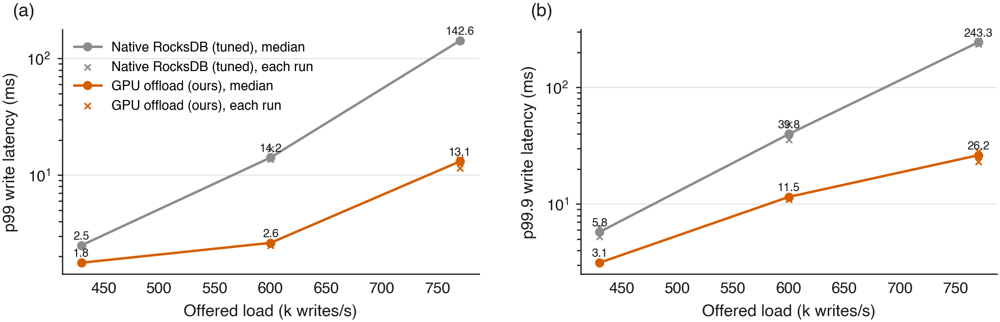

- **p99 is lower at every load:** 1.9 against 2.5 ms at 430k writes/s, 3.9 against
  15.7 ms at 600k, and 14.7 against 102.8 ms at 770k (90% of native's maximum).
- **p99.9 is mixed.** At 770k it is 39 against 172 ms. At 430k and 600k, one of our two
  runs was better than native (3.4 and 10.5 ms). The other had one pause of all writers
  lasting about 0.3–0.6 s, which alone sets the p99.9 (73 and 290 ms).
- **The pause is not explained yet.** RocksDB recorded no write stall, the machine was
  otherwise idle, and two more traced runs had no pause. The pre-registered hypothesis
  (p99.9 at least 2.5× lower at these loads) is therefore not supported.

All numbers: [publication/data/v3/summary.md](publication/data/v3/summary.md). The
hypotheses and their outcomes: [publication/PREREGISTRATION.md](publication/PREREGISTRATION.md)
("Methodology v3").

### Earlier results (methodology v1)

Sections 1–5 below come from the earlier campaigns. Their native baseline used RocksDB's
default of one subcompaction, which slowed native's largest compactions, so their
whole-database ratios are higher than a fairly tuned native gives. The comparisons between
GPU designs, and the RDMA and replication results, are unaffected by this.

### 1. Single compactions

One full compaction, reading 0.6–1.1 GiB (a bottom level plus 8 overlapping
level-0 files), with 16-byte keys. Median of 3 warm runs.

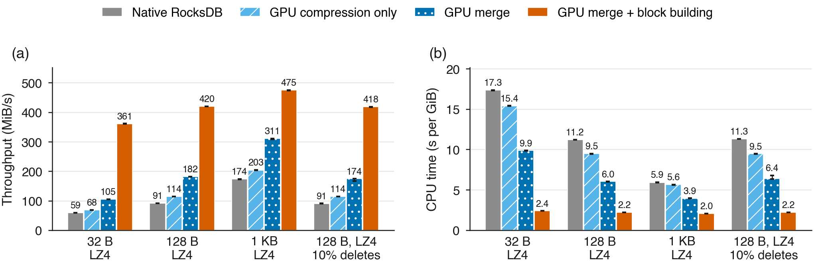

**Figure 1a.** Isolated compaction, LZ4 workloads. (a) Compaction throughput in MiB of input per second; (b) whole-process CPU time per GiB of input. Bars are medians of 3 warm runs; whiskers span min-max. 16-byte keys, 4 KiB blocks.

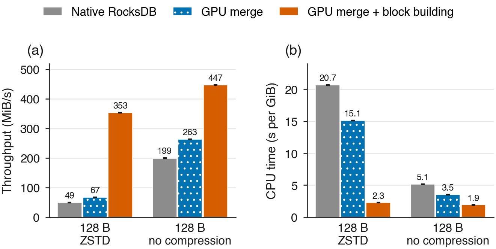

**Figure 1b.** The same for ZSTD and no compression. GPU compression only offloads LZ4 alone; with these settings it runs exactly as native RocksDB, so it is not shown.

Throughput in MiB of input per second / CPU time in seconds per GiB:

| Workload | Native RocksDB | GPU compression only | GPU merge | **GPU merge + block building** |
|---|---|---|---|---|
| 32 B, LZ4 | 59 MiB/s / 17.3 s | 68 / 15.4 | 105 / 9.9 | **361 MiB/s / 2.4 s** |
| 128 B, LZ4 | 91 / 11.2 | 114 / 9.5 | 182 / 6.0 | **420 / 2.2** |
| 1 KB, LZ4 | 174 / 5.9 | 203 / 5.6 | 311 / 3.9 | **475 / 2.0** |
| 128 B, ZSTD | 49 / 20.7 | n/a | 67 / 15.1 | **353 / 2.3** |
| 128 B, no compression | 199 / 5.1 | n/a | 263 / 3.5 | **447 / 1.9** |
| 128 B, LZ4, 10% deletes | 91 / 11.3 | 114 / 9.5 | 174 / 6.4 | **418 / 2.2** |

Native RocksDB's cost grows as values shrink, because most of its work is per
key; ZSTD is the most expensive codec. With full offload the cost stays near
2 CPU-seconds per GiB for every value size and codec, including jobs with
deletes. Compression alone is a small part of the work.

### 2. Whole database, batched writes

50 M keys with 128-byte values. RocksDB and four client threads are confined
to 4 cores on the GPU's NUMA node. Each run has 30 s of warm-up and 120 s of
measurement, writing 100 puts per batch with no write-ahead log. Throughput
counts the time to issue the writes **and** finish all the compaction they
caused.

> **What is the WAL?** The write-ahead log (WAL) is a file RocksDB appends
> every write to before acknowledging it. A new write lives only in memory
> until RocksDB later writes it into its regular files, so after a crash
> RocksDB replays the log to recover it. With the WAL **on** (RocksDB's
> default), every write costs an extra log append. With it **off**, writes
> are cheaper but anything still in memory is lost in a crash. Applications
> turn it off when they can regenerate the data, as in bulk loading, or when
> another layer, such as a replicated log, already guarantees durability.
> Turning it off makes each write cheap, so compaction becomes most of the
> work: the case where offloading compaction matters most.

> **What is catch-up compaction?** While writes arrive, RocksDB may let
> merging fall behind and leave unmerged files piling up. When the writes
> stop, it still has to merge them; that leftover work is catch-up
> compaction. We time it after every run and include it in throughput, so a
> design cannot look faster just by postponing work.

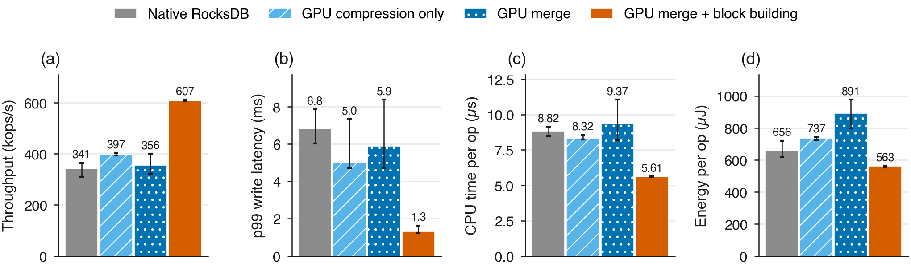

**Figure 2.** Whole database with batched writes (100 puts per batch, WAL off) on 4 cores, 50 M keys with 128-byte values. (a) Throughput including the time to finish all resulting compaction; (b) compaction still pending when writes stop; (c) p99 write latency; (d) CPU time per operation. Background jobs: native 4, GPU compression only 2, GPU merge + block building 4. Single runs.

| Design | Bg jobs | Ops/s | Catch-up after run | CPU per op | p99 write | Writers stalled |
|---|---|---|---|---|---|---|
| Native RocksDB | 4 | 349,389 | 68.5 s | 9.06 µs | 7.08 ms | 7% |
| GPU compression only | 2 | 162,752 | 111.8 s | 9.65 µs | 24.1 ms | 17% |
| **GPU merge + block building** | 4 | **602,465 (1.72×)** | **3.4 s** | **5.59 µs** | **1.11 ms** | **0%** |

Batching makes compaction the bottleneck: native RocksDB spends 65–71% of its CPU
on compaction and makes writers wait. Each design is shown at its best
background-job setting; GPU compression only was run with 2 jobs only.

### 3. Single writes and postponed compaction

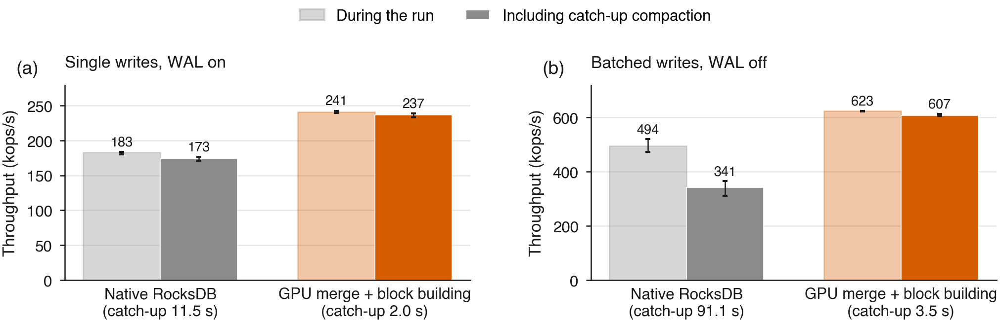

**Figure 3.** Throughput measured only while writes run (light) and including catch-up compaction (solid), for (a) single writes with the WAL on and (b) batched writes with the WAL off.

| Writes | Design | Ops/s during run | Ops/s including catch-up | Catch-up | CPU per op |
|---|---|---|---|---|---|
| Single (WAL on) | Native RocksDB | 210,432 | 120,733 | 114.1 s | 22.1 µs |
| Single (WAL on) | **GPU merge + block building** | 237,358 | **231,862 (1.92×)** | **3.5 s** | **16.2 µs** |
| Batched | Native RocksDB | 468,607 | 349,389 | 68.5 s | 9.1 µs |
| Batched | **GPU merge + block building** | 613,751 | **602,465 (1.72×)** | **3.4 s** | **5.6 µs** |

Native RocksDB lets compaction fall behind during a run and pays for it
afterwards. Measured only while writes are running, the GPU version looks
13–31% faster; counted to the end of catch-up it is 1.7–1.9× faster.

### 4. Compared with earlier GPU and FPGA designs

Earlier GPU and FPGA compaction systems (LUDA 2020, Zhou et al. MSST'24, gLSM
TOS'24, gParaKV SC'25, Alibaba's FPGA design FAST'20) run on other stores and
hardware, so their published speedups cannot be compared with ours directly.
We rebuilt each design inside this RocksDB:

- **GPU work:** each rebuild uses our GPU code for the steps that design
  offloads.
- **CPU work:** every step it does not offload uses RocksDB's own CPU code,
  including compression, which none of these designs puts on the GPU.
- **Benefit of the doubt:** where the choice matters, the rebuild is set up
  to favour the earlier design. Its input is decompressed on 4 parallel
  threads, and LUDA's CPU-assisted sort is replaced by our GPU sort.
- **Same checks:** every design passes the same exact check against native
  RocksDB.

| Design | Stands in for | GPU | CPU (RocksDB's code) |
|---|---|---|---|
| GPU sort/merge | gLSM, gParaKV | unpack, sort, merge | decompress input, block building, compression, checksums |
| GPU pipeline, CPU compression | LUDA, MSST'24, FPGA (FAST'20) | unpack, sort, merge, deletes, block building, filter hashes | decompress input, compress and checksum output |
| **Ours** | | all of the above, plus LZ4/ZSTD decompression and compression and checksums | file cuts, index, footer, file writes |

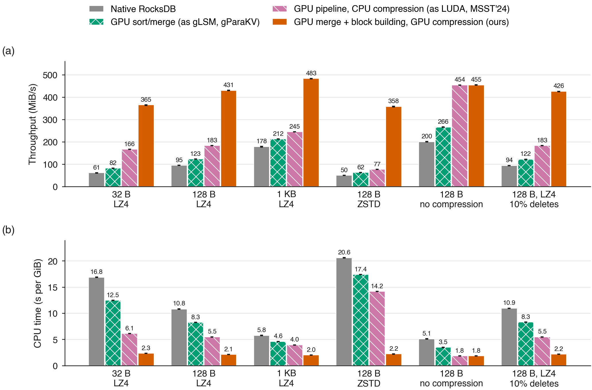

**Figure 10.** One full compaction (0.6–1.1 GiB of input) for each rebuilt design. (a) Throughput in MiB of input per second; (b) whole-process CPU time per GiB of input. Medians of 3 warm runs; whiskers span min-max.

Throughput in MiB/s / CPU seconds per GiB (CPU saved compared with native):

| Workload | Native RocksDB | GPU sort/merge | GPU pipeline, CPU compression | **Ours** |
|---|---|---|---|---|
| 32 B, LZ4 | 60 / 16.9 | 86 / 12.4 (1.4×) | 182 / 6.1 (2.8×) | **369 / 2.3 (7.3×)** |
| 128 B, LZ4 | 93 / 11.0 | 132 / 8.2 (1.3×) | 205 / 5.4 (2.0×) | **436 / 2.1 (5.3×)** |
| 1 KB, LZ4 | 180 / 5.7 | 247 / 4.6 (1.2×) | 293 / 3.9 (1.4×) | **491 / 2.0 (2.9×)** |
| 128 B, ZSTD | 50 / 20.5 | 65 / 17.3 (1.2×) | 81 / 14.2 (1.4×) | **360 / 2.2 (9.3×)** |
| 128 B, LZ4, 10% deletes | 94 / 10.9 | 131 / 8.3 (1.3×) | 205 / 5.4 (2.0×) | **430 / 2.1 (5.1×)** |
| 128 B, no compression | 201 / 5.1 | 268 / 3.4 (1.5×) | 460 / 1.8 (2.8×) | 462 / 1.8 (2.8×) |

With no compression, the GPU pipeline design and ours are identical: in
their own setting, the earlier designs are as good as ours. Once compression
is on, as in a normal RocksDB setup, compression dominates what is left on
the CPU, and only moving it to the GPU removes it. The gap is widest with
ZSTD (9.3× against 1.4×).

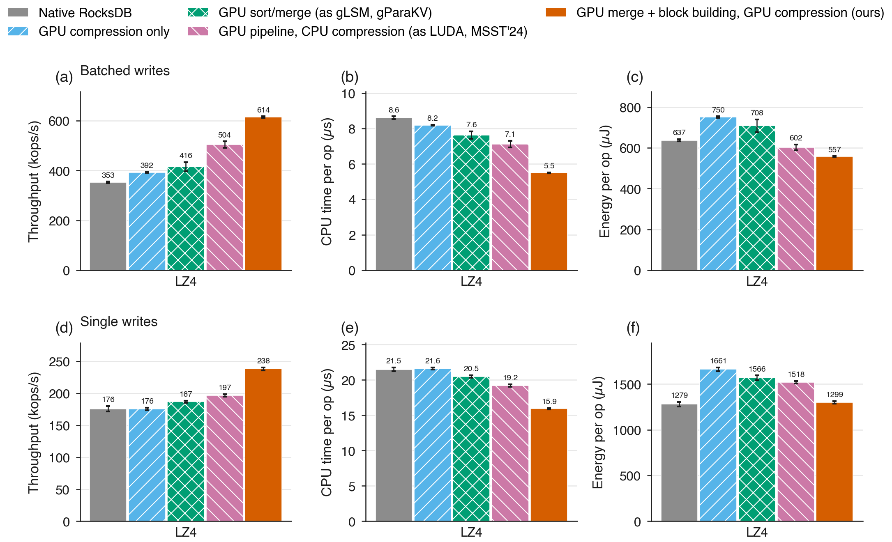

**Figure 11.** Whole database on 4 cores (50 M keys, 128-byte values) with LZ4, ZSTD and no compression, for (a–c) batched writes and (d–f) single writes: throughput including catch-up compaction, CPU time per operation, and energy per operation (CPU package, DRAM and GPU). Medians with 95% bootstrap CIs over 5 repetitions (LZ4) or 3 (ZSTD, no compression); each design at its best background-job setting. GPU compression only applies to LZ4.

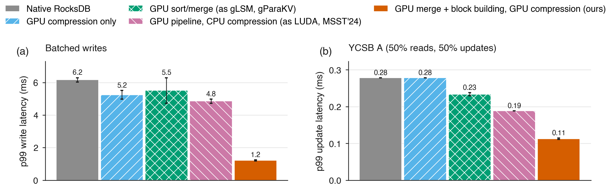

**Figure 13.** LZ4, 4 cores: (a) p99 write latency with batched writes; (b) p99 update latency on YCSB A.

Throughput in kops/s (gain over native, paired within each repetition):

| Workload | Native RocksDB | GPU sort/merge | GPU pipeline, CPU compression | **Ours** |
|---|---|---|---|---|
| Batched writes, LZ4 | 350 | 397 (1.14×) | 496 (1.41×) | **616 (1.75×)** |
| Batched writes, ZSTD | 209 | 235 (1.16×) | 246 (1.17×) | **475 (2.27×)** |
| Batched writes, no compression | 424 | 401 (0.98×) | 576 (1.34×) | 586 (1.40×) |
| Single writes, LZ4 | 177 | 189 (1.06×) | 199 (1.12×) | **237 (1.34×)** |
| Single writes, ZSTD | 131 | 140 (1.09×) | 157 (1.20×) | **229 (1.76×)** |
| Single writes, no compression | 189 | 203 (1.07×) | 224 (1.18×) | 226 (1.18×) |
| YCSB A, LZ4 | 198 | 214 (1.10×) | 235 (1.20×) | **274 (1.38×)** |

Batched writes with LZ4:

| Metric | Native RocksDB | GPU sort/merge | GPU pipeline, CPU compression | **Ours** |
|---|---|---|---|---|
| p99 write | 6.3 ms | 5.0 ms | 4.7 ms | **1.25 ms** |
| Energy per write | 640 µJ | 740 µJ | 609 µJ | **555 µJ** |

- **Throughput:** with LZ4 or ZSTD, ours gains 1.8–6.4× more over native than
  the best earlier design.
- **ZSTD:** with ZSTD, our database (475k writes/s) is faster than native
  RocksDB with the cheaper LZ4 (350k).
- **No compression:** ours and the GPU pipeline design are within their
  confidence intervals of each other. The advantage comes from moving
  compression to the GPU.
- **Tail latency:** ours is the only design that cuts p99 write latency
  substantially.
- **Energy:** the earlier designs add GPU power without enough speedup and
  often use more energy per operation than plain RocksDB. With compression
  on, ours uses the least energy, apart from LZ4 single writes, where it
  matches native. With no compression, native uses the least energy.
- **Reads:** p99 read latency on YCSB A is about 0.03 ms for every design.

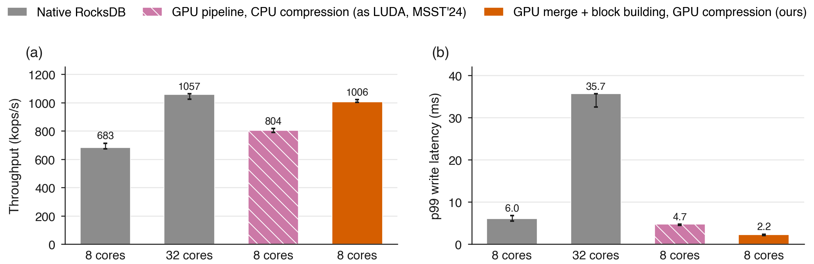

**Figure 12.** Batched LZ4 writes: native RocksDB on 8 and 32 cores against the GPU pipeline design and ours on 8 cores. (a) Throughput; (b) p99 write latency.

On 8 cores, ours reaches 1,006k writes/s, about native RocksDB on 32 cores
(1,057k), with 2.2 ms p99 write latency against 35.7 ms. The GPU pipeline
design reaches 804k. Native RocksDB on 32 cores uses less energy per write
(233 µJ against 370 µJ).

**gParaKV head-to-head (gParaKV's own code and YCSB driver).** gParaKV (SC'25)
is the only earlier system with public code. We ran it unmodified (its
persistent-memory pool emulated in DRAM) and connected RocksDB, with and
without our offload, to gParaKV's own YCSB driver
([bench/ycsbc/](bench/ycsbc/)). Everything runs on the same 4 cores and GPU,
with one client thread. Medians of 3 runs:

| Values | System | Load kops/s | YCSB A kops/s | CPU seconds |
|---|---|---|---|---|
| 128 B | gParaKV | 321 | 238 | 350 |
| 128 B | RocksDB, LZ4 | 242 | 178 | 543 |
| 128 B | **RocksDB + ours, LZ4** | 242 | 182 | **346** |
| 1 KB | gParaKV | 265 | 251 | 105 |
| 1 KB | RocksDB BlobDB (key/value separation) | 195 | 168 | 219 |
| 1 KB | RocksDB + ours, LZ4 | 192 | 160 | 221 |

gParaKV is faster under its own driver. It stores values in a separate log
outside the LSM tree, stores data uncompressed, and is built on LevelDB, a
different design point from RocksDB. With one client, this driver does not
saturate RocksDB's compaction, so our offload mainly lowers CPU (by 36% at
128 B) rather than raising throughput. Key/value separation and our offload
are complementary; bringing our GPU path to RocksDB's BlobDB files is future
work.

The plan and hypotheses are in
[publication/PREREGISTRATION.md](publication/PREREGISTRATION.md) (H8–H12).

### 5. Remote compaction and replication over RDMA

Compaction can also run on a shared compaction server over 100 Gb/s RDMA (RoCE), and a
replicated database can compact once for all replicas
([docs/remote-compaction.md](docs/remote-compaction.md)).

- **Remote compaction.** The database node keeps RocksDB's compaction job and file
  writing, and sends each merge with its input blocks to the server, with no shared
  filesystem. If the server is lost, the job falls back to local compaction.
- **Replication.** Backups either mirror the primary's files and never compact (compact
  once), or apply every write and compact themselves (per-replica).
- **Correctness.** Every run below matched native RocksDB, and after every replicated run
  each backup's data matched the primary's.

**Hardware so far:** the database node (Nasus, 4 cores) and one other machine (Jax) are
linked by ConnectX-6 Dx cards at 100 Gb/s. No machine on the cluster has both a GPU and an
RDMA card, so **all results in this section use CPU compaction on the server**; GPU
compaction over RDMA is still to be measured.

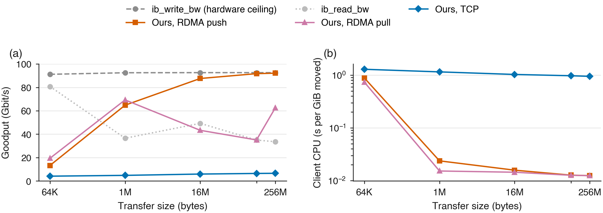

**Figure 14.** Moving one request and its reply of the same size between the two machines.
(a) Data rate; (b) CPU the sending machine spends per GiB moved. Medians of 3 runs.
`ib_write_bw` and `ib_read_bw` are the hardware's reference benchmarks.

- **Speed:** our RDMA transport reaches 92 Gb/s for large transfers, the same as the
  hardware benchmark.
- **CPU cost:** it uses 0.012 CPU-seconds per GiB moved, about 80× less than TCP. TCP
  manages only 6–7 Gb/s.

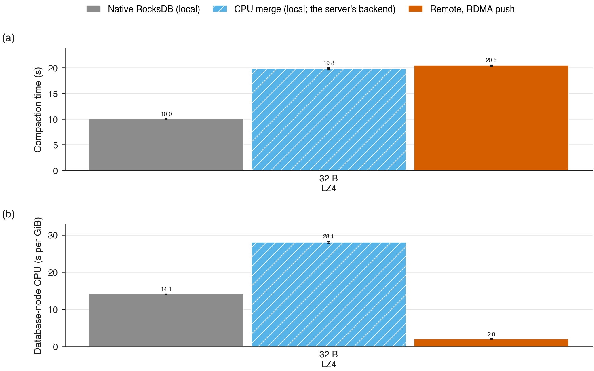

**Figure 15.** One full compaction started on the database node. (a) Compaction time;
(b) the database node's whole-process CPU per GiB of input. "CPU merge (local)" is the
merge the server runs, measured on the database node itself. Medians of 3 warm runs;
whiskers span min-max.

- **CPU saved on the database node:** with compaction done remotely over RDMA, the
  database node spends 1.7–2.0 CPU-seconds per GiB, against 4.7–15.0 for native RocksDB
  (2.6–7.6× less). The work left is reading the input blocks and writing the returned
  files.
- **RDMA against TCP:** TCP needs about twice that (3.2–3.6 CPU-seconds per GiB) and is
  10–25% slower.
- **Network cost:** compaction time over RDMA is within 2–12% of running the same merge
  locally.
- **Total time:** compaction takes about twice as long as native RocksDB. That comes from
  the server's merge code, a reference implementation about 2× slower than RocksDB's
  own, not from the network.
- **One outlier:** the RDMA push run with deletes (14.9 s) was slowed on the server side
  by another user's load on the shared server machine.

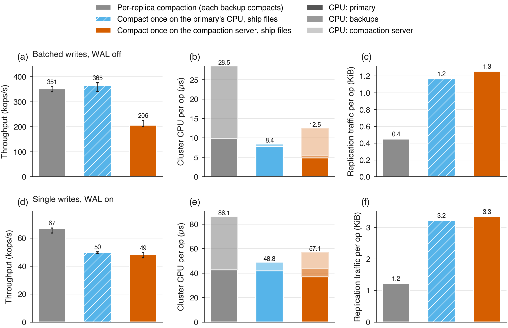

**Figure 16.** A primary on 4 cores of the database node with 2 backups on the other
machine, 50 M keys, 30 s warm-up and 120 s measurement. (a, d) Throughput including
catch-up compaction; (b, e) CPU per operation summed over the primary, the backups and the
compaction server; (c, f) replication traffic per operation. Medians of 5 runs.

| Writes | Design | kops/s | Cluster CPU per op | Traffic per op |
|---|---|---|---|---|
| Batched, WAL off | Per-replica compaction | 351 | 28.5 µs | 0.4 KiB |
| | **Compact once (primary's CPU), ship files** | **365** | **8.4 µs (3.4× less)** | 1.2 KiB |
| | Compact once on the compaction server | 206 | 12.5 µs | 1.3 KiB |
| Single, WAL on | Per-replica compaction | 67 | 86.1 µs | 1.2 KiB |
| | **Compact once (primary's CPU), ship files** | 50 | **48.8 µs (1.8× less)** | 3.2 KiB |
| | Compact once on the compaction server | 49 | 57.1 µs | 3.3 KiB |

- **Batched writes:** compacting once and shipping the files cuts total cluster CPU per
  write by 3.4×, at the same throughput, for about 3× more network traffic.
- **Single writes:** compacting once cuts total cluster CPU per write by 1.8× but is 25%
  slower. Physical replication ships each WAL append inside RocksDB's single-writer WAL
  path, so the network round trips are serialised; logical replication sends writes from
  every thread in parallel.
- **Compaction server:** compacting once on the server is slower here because its CPU
  merge is slower than RocksDB's own. A GPU server is the configuration still to measure.

### Correctness

- **Single compactions:** every run compares a digest of every stored key
  version, and of up to 200,000 point lookups, against native RocksDB. Point
  lookups exercise the GPU-built Bloom filters. All runs match.
- **Whole database:** every run verifies all 50 M keys and values after
  catch-up compaction.
- **Edge cases:** the differential tests cover snapshots, subcompactions,
  uncompressed data, keys up to 200 bytes, values up to 5 KB, and deletes
  (which correctly fall back to the merge-only path). The GPU code, including run
  merging, warp checksums and GPU Bloom filters, passes `compute-sanitizer` memcheck,
  racecheck and synccheck with no errors or hazards.
- **Built output in runs:** SST files written in runs differ from files written block by
  block only in per-file random bytes (session IDs and checksum context).

## Repository

| Path | Contents |
|---|---|
| `src/gpu/`, `include/lsm_lab/` | GPU merge and block building (`cuda_merge.cu`), CPU reference (`merge_cpu.cpp`), output compression (`cuda_transform.cu`), Metal backend, RocksDB integration headers |
| `src/remote/` | Remote compaction (`remote_merge`) and replication over TCP and RDMA |
| `cmake/ApplyEnginePatch.cmake` | Version-locked patch that adds the offload hooks to RocksDB |
| `apps/` | `lsm_compaction_bench`, `lsm_system_bench`, `lsm_compaction_server`, `lsm_replica_server`, `lsm_rpc_bench`, `lsm_burn`, and the harness services (`lsm_db`, `lsm_worker`, `lsm_loadgen`, `lsm_admin`, `lsm_telemetry`, `lsm_gpu_check`) |
| `tools/` | `labctl` harness: plans, runs, audits and analysis |
| `publication/` | Results, raw data, figures, and the scripts that produce them |
| `configs/` | Dataset and experiment configurations |
| `docs/` | Design and operating documentation |
| `tests/` | C++ (CTest) and Python tests |

## Build

```sh
bash scripts/bootstrap.sh
cmake --preset dev
cmake --build --preset dev
ctest --preset dev --output-on-failure
```

For the GPU build (Linux, CUDA 12, nvCOMP fetched by
`scripts/bootstrap-cuda.sh`) add `-DLSM_ENABLE_CUDA=ON
-DCMAKE_CUDA_ARCHITECTURES=native -DLSM_ROCKSDB_PORTABLE=0`. Prerequisites:
Git, curl, CMake 3.25+, a C++20 compiler and Python 3.12+. RocksDB is fetched
at the commit pinned in [toolchains.lock.json](toolchains.lock.json).

## Reproduce

```sh
export LSM_DISABLE_GPU_INPUT=1 LSM_CUDA_SYNC=blocking LSM_GPU_OUTPUT_MIN_BLOCK_BYTES=1024
publication/compaction_sweep.sh artifacts/compaction                     # isolated compaction
build/dev/lsm_system_bench --phase preload --dir /dev/shm/$USER/sys/golden --records 50000000 --threads 8
LSM_BUILD_DIR=build/dev python3 publication/system_campaign.py artifacts/database \
  --golden /dev/shm/$USER/sys/golden --grid configs/system/batched-ingest.json
python3 publication/make_figures.py                                      # figures from publication/data/
```

## Documentation

- [docs/gpu-compaction.md](docs/gpu-compaction.md): what is offloaded, how it plugs into RocksDB, eligibility, configuration and limits
- [docs/remote-compaction.md](docs/remote-compaction.md): remote compaction and replication over TCP and RDMA, and their results
- [docs/runbook.md](docs/runbook.md): building, benchmarks, the `labctl` harness, hardware gates
- [docs/telemetry.md](docs/telemetry.md): resource and energy telemetry
- [publication/](publication/): results, methodology audit and data
