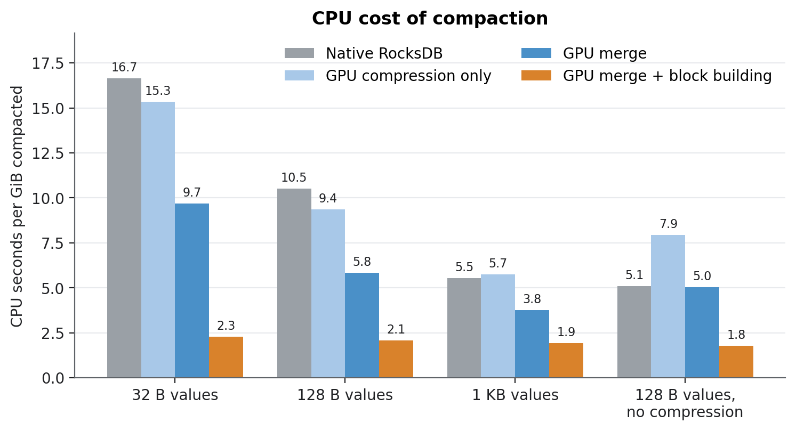
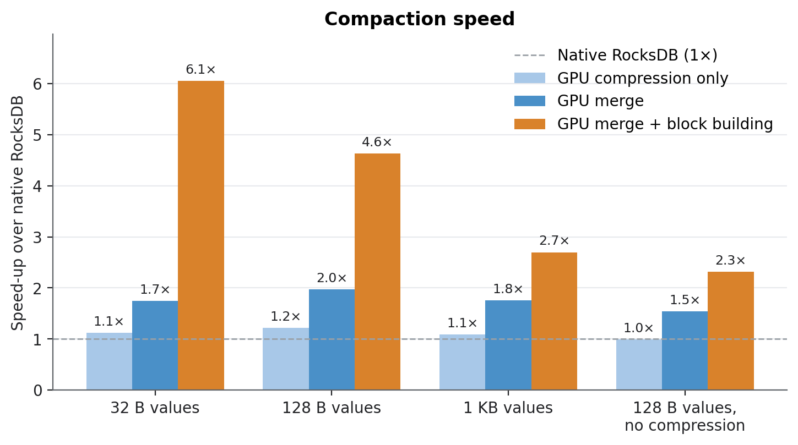
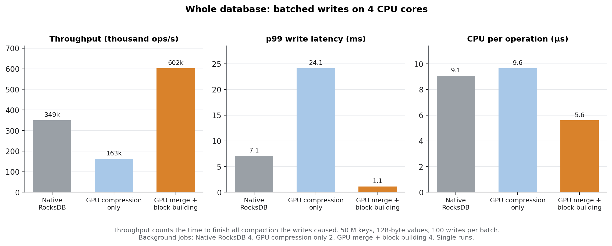
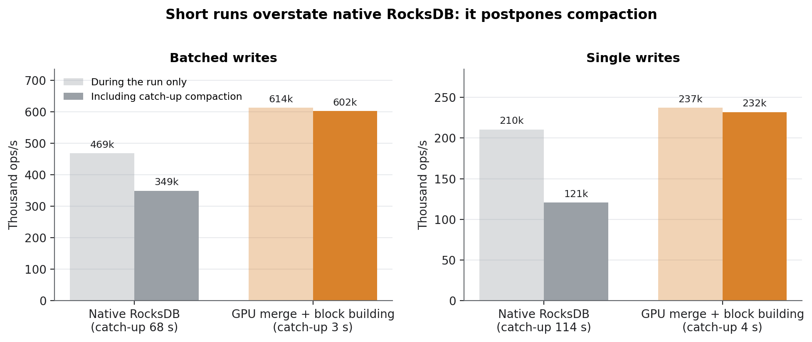

# LSM Lab: GPU-offloaded RocksDB compaction

LSM Lab moves RocksDB 11.8 compaction onto an NVIDIA GPU and measures what
that buys the database. The GPU reads, decompresses, merges and garbage-collects
the input, then builds, compresses and checksums the output data blocks. RocksDB
keeps file cuts, indexes, filters, metadata and installation. Output is
checked against native RocksDB for every stored key version and through point
lookups.

## Results at a glance

- **Single compactions run 2.3–6.1× faster and use 2.9–7.3× less CPU**, with
  output identical to native RocksDB.
- **With batched writes the whole database handles 1.72× more writes**
  (602k vs 349k ops/s). p99 write latency drops from 7.1 ms to 1.1 ms, and
  writers never stall.
- **With single writes it handles 1.92× more** (232k vs 121k ops/s).
- **Native RocksDB postpones compaction** and needs 68–114 s to catch up
  after a 2.5-minute run; the GPU version needs 3–4 s. Throughput measured
  only during a run overstates native RocksDB by 34–74%.
- **Offloading only compression, this project's original design, is not
  enough:** at most 1.2× faster, with no benefit to the database.

Measured on Zyra: 4 × Xeon Gold 5220, RTX A6000, data on `/dev/shm`.
Native RocksDB is built with hardware CRC32C. Full write-up:
[publication/RESULTS.md](publication/RESULTS.md); plain-language version:
[publication/PLAIN-SUMMARY.md](publication/PLAIN-SUMMARY.md); every number:
[publication/data/summary.md](publication/data/summary.md).

### Three levels of offload

A compaction:

1. reads, decompresses and parses its input files;
2. sorts all entries and drops outdated versions;
3. packs the survivors into data blocks;
4. compresses and checksums each block;
5. writes the blocks into files, with an index, a Bloom filter and metadata.

| Design | On the GPU | On the CPU |
|---|---|---|
| Native RocksDB | none | 1–5 |
| GPU compression only (original design) | 4 | 1, 2, 3, 5 |
| GPU merge | 1, 2, 4 | 3, 5 |
| GPU merge + block building | 1–4 | 5 (plus an index entry per block and filter construction) |

Details: [docs/gpu-compaction.md](docs/gpu-compaction.md).

### 1. Single compactions

One full compaction, reading 0.64–0.97 GiB (a bottom level plus 8 overlapping
level-0 files), with 16-byte keys. Median of 3 warm runs.





| Values | Native | Compression only | Merge | **Merge + block building** |
|---|---|---|---|---|
| 32 B | 11.8 s, 16.7 CPU-s/GiB | 1.12× faster | 1.74× | **6.06× faster, 2.3 CPU-s/GiB (7.3× less)** |
| 128 B | 6.9 s, 10.5 CPU-s/GiB | 1.22× | 1.97× | **4.63×, 2.1 CPU-s/GiB (5.2× less)** |
| 1 KB | 5.4 s, 5.5 CPU-s/GiB | 1.09× | 1.76× | **2.70×, 1.9 CPU-s/GiB (2.9× less)** |
| 128 B, no compression | 5.6 s, 5.1 CPU-s/GiB | 0.99× | 1.54× | **2.32×, 1.8 CPU-s/GiB (2.9× less)** |

Native RocksDB's cost grows as values shrink, because most of its work is per
key. With full offload the cost stays near 2 CPU-seconds per GiB for every
value size. Compression alone is a small part of the work.

### 2. Whole database, batched writes

50 M keys with 128-byte values. RocksDB and four client threads are confined
to 4 cores on the GPU's NUMA node. Each run has 30 s of warm-up and 120 s of
measurement, writing 100 puts per batch with no write-ahead log. Throughput
counts the time to issue the writes **and** finish all the compaction they
caused.



| Design | Bg jobs | Ops/s | Catch-up after run | CPU per op | p99 write | Writers stalled |
|---|---|---|---|---|---|---|
| Native RocksDB | 4 | 349,389 | 68.5 s | 9.06 µs | 7.08 ms | 7% |
| GPU compression only | 2 | 162,752 | 111.8 s | 9.65 µs | 24.1 ms | 17% |
| **GPU merge + block building** | 4 | **602,465 (1.72×)** | **3.4 s** | **5.59 µs** | **1.11 ms** | **0%** |

Batching makes compaction the bottleneck: native RocksDB spends 65–71% of its CPU
on compaction and makes writers wait. Each design is shown at its best
background-job setting; GPU compression only was run with 2 jobs only.

### 3. Single writes and postponed compaction



| Writes | Design | Ops/s during run | Ops/s including catch-up | Catch-up | CPU per op |
|---|---|---|---|---|---|
| Single (WAL on) | Native RocksDB | 210,432 | 120,733 | 114.1 s | 22.1 µs |
| Single (WAL on) | **GPU merge + block building** | 237,358 | **231,862 (1.92×)** | **3.5 s** | **16.2 µs** |
| Batched | Native RocksDB | 468,607 | 349,389 | 68.5 s | 9.1 µs |
| Batched | **GPU merge + block building** | 613,751 | **602,465 (1.72×)** | **3.4 s** | **5.6 µs** |

Native RocksDB lets compaction fall behind during a run and pays for it
afterwards. Measured only while writes are running, the GPU version looks
13–31% faster; counted to the end of catch-up it is 1.7–1.9× faster.

### Correctness

- **Single compactions:** every run compares a digest of every stored key
  version, and of up to 200,000 point lookups, against native RocksDB. Point
  lookups exercise the GPU-built Bloom filters. All runs match.
- **Whole database:** every run verifies all 50 M keys and values after
  catch-up compaction.
- **Edge cases:** the differential tests cover snapshots, subcompactions,
  uncompressed data, keys up to 200 bytes, values up to 5 KB, and deletes
  (which correctly fall back to the merge-only path). The GPU code passes
  `compute-sanitizer` with no errors.

### Not yet established

- **Repetition:** whole-database results are single runs; five repetitions in
  randomized order are needed.
- **Energy:** measured only during the run, the GPU version uses about 15%
  more energy per operation. That window excludes native RocksDB's catch-up,
  so no energy claim is made until energy is measured through it.
- **Scope:** results come from one machine with memory-backed storage,
  synthetic uniform-random overwrites and no reads.
- **Coverage gaps:**
  - jobs with deletes use the merge-only path;
  - ZSTD is not offloaded;
  - very large jobs can fall back to the CPU when nvCOMP rejects the batch.

## Repository

| Path | Contents |
|---|---|
| `src/gpu/`, `include/lsm_lab/` | GPU merge and block building (`cuda_merge.cu`), CPU reference (`merge_cpu.cpp`), output compression (`cuda_transform.cu`), Metal backend, RocksDB integration headers |
| `cmake/ApplyEnginePatch.cmake` | Version-locked patch that adds the offload hooks to RocksDB |
| `apps/` | `lsm_compaction_bench`, `lsm_system_bench`, `lsm_burn`, and the harness services (`lsm_db`, `lsm_worker`, `lsm_loadgen`, `lsm_admin`, `lsm_telemetry`, `lsm_gpu_check`) |
| `tools/` | `labctl` harness: plans, runs, audits and analysis |
| `publication/` | Results, raw data, figures, and the scripts that produce them |
| `configs/` | Dataset and experiment configurations |
| `docs/` | Design and operating documentation |
| `tests/` | C++ (CTest) and Python tests |

## Build

```sh
bash scripts/bootstrap.sh
cmake --preset dev
cmake --build --preset dev
ctest --preset dev --output-on-failure
```

For the GPU build (Linux, CUDA 12, nvCOMP fetched by
`scripts/bootstrap-cuda.sh`) add `-DLSM_ENABLE_CUDA=ON
-DCMAKE_CUDA_ARCHITECTURES=native -DLSM_ROCKSDB_PORTABLE=0`. Prerequisites:
Git, curl, CMake 3.25+, a C++20 compiler and Python 3.12+. RocksDB is fetched
at the commit pinned in [toolchains.lock.json](toolchains.lock.json).

## Reproduce

```sh
export LSM_DISABLE_GPU_INPUT=1 LSM_CUDA_SYNC=blocking LSM_GPU_OUTPUT_MIN_BLOCK_BYTES=1024
publication/compaction_sweep.sh artifacts/compaction                     # isolated compaction
build/dev/lsm_system_bench --phase preload --dir /dev/shm/$USER/sys/golden --records 50000000 --threads 8
LSM_BUILD_DIR=build/dev python3 publication/system_campaign.py artifacts/database \
  --golden /dev/shm/$USER/sys/golden --grid configs/system/batched-ingest.json
python3 publication/make_figures.py                                      # figures from publication/data/
```

## Documentation

- [docs/gpu-compaction.md](docs/gpu-compaction.md): what is offloaded, how it plugs into RocksDB, eligibility, configuration and limits
- [docs/runbook.md](docs/runbook.md): building, benchmarks, the `labctl` harness, hardware gates
- [docs/telemetry.md](docs/telemetry.md): resource and energy telemetry
- [publication/](publication/): results, methodology audit and data
