# LSM Lab: GPU-offloaded RocksDB compaction

RocksDB keeps its data sorted by constantly merging files in the background. This
merging, called **compaction**, is the largest CPU cost of a write-heavy database. LSM Lab
moves compaction in RocksDB 11.8 onto an NVIDIA GPU.

- **On the GPU:** reading, decompressing, merging and cleaning up the input files, then
  building, compressing and checksumming the new files' data blocks and Bloom filters.
- **Still in RocksDB:** deciding where files start and end, the index and metadata, and
  installing the new files.
- **Checked:** every result is checked against unmodified RocksDB, key by key.

## Results at a glance

- **1.5 to 1.8× more writes with about 2× less CPU per write** for the whole database,
  and no write stalls, against RocksDB tuned by the same search.
- **One GPU does the compaction work of 15 to 18 CPU cores.**
- **2.0 to 6.5× less compaction CPU than earlier GPU and FPGA designs**, rebuilt inside
  production RocksDB with compression on.
- **Compaction on a GPU in another machine over RDMA is 4 to 6.4× faster** than RocksDB
  doing it locally, and the whole database run this way gives **1.75× more writes with
  2.04× less CPU** on the database machine.
- **On a second machine, 1.70× more writes with 2.06× less CPU**; on its NVMe drive both
  designs hit the drive's limit, and ours keeps a 1.46× CPU saving there.

Ours is compared with RocksDB as it ships, tuned for the same machine by the same search
as ours, on the same cores.

| What was measured | Result | Section |
|---|---|---|
| One compaction | **8 to 12× faster, 9 to 16× less CPU** with small values; 3 to 4× with 1 KB values or no compression | [1](#1-one-compaction) |
| GPU capacity | One GPU does the compaction work of **15 to 18 CPU cores**, using 1.3 to 2 cores of its own | [2](#2-one-gpu-replaces-1518-cpu-cores) |
| Whole database | **1.5 to 1.8× more writes**, 1.8 to 2.2× less CPU per write, no write stalls | [3](#3-the-whole-database) |
| Write latency at a fixed load | 99.9th percentile **1.75×, 3.8× and 9.6× lower** at 50%, 70% and 90% of RocksDB's maximum rate | [4](#4-write-latency-at-a-fixed-load) |
| Reads | Read-heavy work within 5% of RocksDB; read latency halves where compaction is busy | [5](#5-reads) |
| A machine shared with other work | The gain grows from 1.80× to **2.48×** as other work takes more of the CPU | [6](#6-a-machine-shared-with-other-work) |
| Cost | 16 cores with a GPU write **1.41× more than 32 cores without, at half the cost per write**. Below about 12 cores, more cores are cheaper | [7](#7-what-it-costs-and-what-it-saves) |
| Real-world workloads | **1.4 to 1.8× faster** when write-heavy; 1.05 to 1.10× when read-heavy | [8](#8-real-world-workloads-and-a-real-disk) |
| Real disks | NVMe machine: **1.70× more writes, 2.06× less CPU** with data in memory; on its NVMe drive both designs hit the drive's limit, so 1.07× more writes and 1.46× less CPU. SATA SSD: equal throughput, half the CPU | [8](#8-real-world-workloads-and-a-real-disk) |
| Earlier GPU and FPGA designs | In RocksDB with compression: **2.0 to 6.5× less CPU**, up to 1.9× more writes | [9](#9-compared-with-earlier-gpu-and-fpga-designs) |
| GPU in another machine (RDMA) | One compaction **4 to 6.4× faster** than RocksDB on the database machine, which uses **5.5 to 11× less CPU**. Whole database: **1.75×** writes, **2.04×** less CPU per write | [10](#10-compaction-on-another-machine-over-rdma) |

What this does not show is in [section 11](#11-what-this-does-not-show).

**Why the whole database gains about 2×, not 10×:** once compaction is on the GPU, most
of the remaining CPU goes to RocksDB accepting writes (about 2.3 µs of the 3.9 µs per
write), which no design here offloads.

**Reading the numbers.**

- **Ratios compare ours with RocksDB**, worded so a bigger number is better for ours: "3×
  less CPU" means RocksDB used three times as much. A ratio below 1× means ours was worse.
- **CPU per write** is the CPU time of every thread in the database, divided by the writes
  it completed.
- **99th and 99.9th percentile** latency, written p99 and p99.9, is the time within which
  99% and 99.9% of writes finished. They show the slowest writes, which averages hide.
- **A stall** is RocksDB deliberately slowing writers because compaction has fallen behind.
- **Cores** are the physical CPU cores the database is limited to. The GPU is in addition.
- **Median of N runs:** each configuration was run N times and the middle result is shown.

Measured on one server: 4 × Intel Xeon Gold 5220, NVIDIA RTX A6000, data in memory
(`/dev/shm`) unless stated.

## How it works

A compaction:

1. reads, decompresses and parses its input files;
2. sorts all entries and drops outdated versions;
3. packs the survivors into data blocks;
4. compresses and checksums each block;
5. writes the blocks into files, with an index, a Bloom filter and metadata.

| Design | Steps on the GPU | Steps on the CPU |
|---|---|---|
| RocksDB | none | 1–5 |
| GPU compression only (this project's first design) | 4 | 1, 2, 3, 5 |
| GPU sort/merge (as gLSM, gParaKV) | parts of 1, and 2 | decompression, 3, 4, 5 |
| GPU pipeline, CPU compression (as LUDA, MSST'24, Alibaba's FPGA design) | parts of 1, 2, 3 | decompression, 4, 5 |
| **Ours** | **1–4, and the Bloom filter** | file cuts, index, metadata, writing the file |

Offloading compression alone made a compaction only 1.2–1.3× faster. The large gains
need the whole job on the GPU. Details: [docs/gpu-compaction.md](docs/gpu-compaction.md).

## Results

### 1. One compaction

**A single compaction runs 8 to 12× faster and uses 9 to 16× less CPU with small values.
With 1 KB values or no compression, RocksDB is already cheaper, and the gain is 3 to 4×.**

*Setup:* one full compaction of a bottom level plus 8 overlapping newer files (0.6–0.7 GiB),
16-byte keys. Median of 3 runs; the figure uses a log scale.

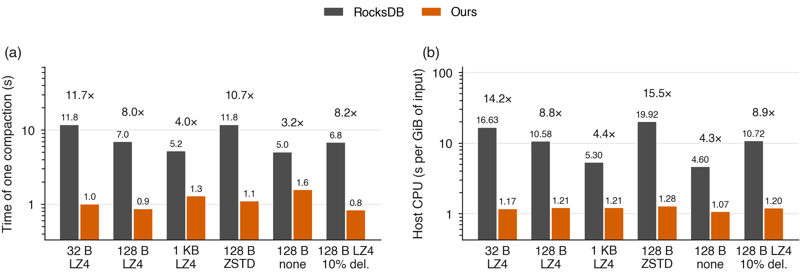

| Workload | Time, RocksDB | Time, ours | Faster | CPU-s per GiB, RocksDB | CPU-s per GiB, ours | Less CPU |
|---|---|---|---|---|---|---|
| 32 B values, LZ4 | 11.77 s | 1.01 s | **11.7×** | 16.6 | 1.17 | **14.2×** |
| 128 B values, LZ4 | 6.96 s | 0.87 s | **8.0×** | 10.6 | 1.21 | **8.8×** |
| 128 B values, ZSTD | 11.81 s | 1.11 s | **10.7×** | 19.9 | 1.28 | **15.5×** |
| 128 B values, LZ4, 10% deletes | 6.80 s | 0.83 s | 8.2× | 10.7 | 1.20 | 8.9× |
| 1 KB values, LZ4 | 5.18 s | 1.29 s | 4.0× | 5.3 | 1.21 | 4.4× |
| 128 B values, no compression | 5.05 s | 1.57 s | 3.2× | 4.6 | 1.07 | 4.3× |

Our cost stays near 1.2 CPU-seconds per GiB in every case. RocksDB's cost depends on the
data:

- it is highest with small values, where it has more keys to handle per byte;
- it is highest with ZSTD, the most expensive codec;
- with large values or no compression it is already cheap, so the gain is smaller.

### 2. One GPU replaces 15–18 CPU cores

*Setup:* eight compactions at once on 8 cores (2.5–2.6 GiB of input).

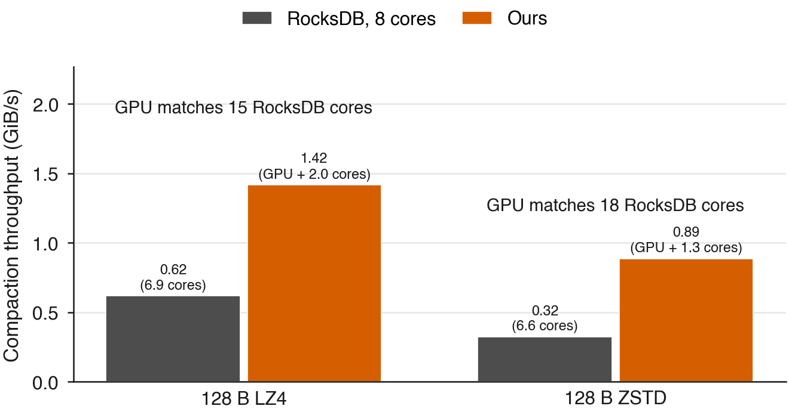

- **The GPU's rate:** 1.42 GiB/s with LZ4 and 0.89 GiB/s with ZSTD, using 2.0 and 1.3
  CPU cores.
- **One RocksDB core's rate:** 0.094 and 0.050 GiB/s.
- **So one GPU does the work of 15 (LZ4) and 18 (ZSTD) CPU cores.**

### 3. The whole database

**The whole database handles 1.5 to 1.8× more writes and uses 1.8 to 2.2× less CPU per
write.**

*Setup:* 50 million keys with 128-byte values, writes in batches of 100. Two minutes of
warm-up, then five minutes measured. Median of 5 runs.

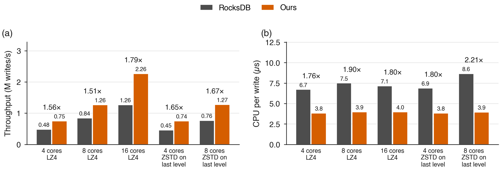

| Compression | Cores | Writes/s, RocksDB | Writes/s, ours | More writes | CPU per write, RocksDB | CPU per write, ours | Less CPU |
|---|---|---|---|---|---|---|---|
| LZ4 | 4 | 480k | 748k | **1.56×** | 6.7 µs | 3.8 µs | 1.76× |
| LZ4 | 8 | 837k | 1,260k | **1.51×** | 7.5 µs | 3.9 µs | 1.90× |
| LZ4 | 16 | 1,262k | 2,260k | **1.79×** | 7.1 µs | 4.0 µs | 1.80× |
| LZ4, ZSTD on the last level | 4 | 452k | 745k | **1.65×** | 6.9 µs | 3.8 µs | 1.80× |
| LZ4, ZSTD on the last level | 8 | 759k | 1,268k | **1.67×** | 8.6 µs | 3.9 µs | 2.21× |

Where the CPU goes, per write:

| | RocksDB | Ours |
|---|---|---|
| Compaction | 3.5–5.5 µs | 0.8 µs |
| Flushing memory to files | 1.0 µs | 0.7 µs |
| Accepting the write | 2.3 µs | 2.3 µs |

- RocksDB had to slow writers down for up to 6% of the time; ours never did.
- With 16 cores, 99.9% of writes finished within 9 ms with ours, against 210 ms with
  RocksDB.

### 4. Write latency at a fixed load

**The slowest writes finish 1.75 to 9.6× sooner at p99.9, and the gap grows as the database
gets busier.**

*Setup:* writes arrive on a fixed schedule, and latency counts from when each write was
due, so a slow-down cannot hide. 8 cores, 3 minutes measured, 5 runs per point.

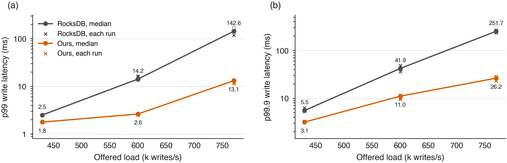

| Load | p99, RocksDB | p99, ours | Lower | p99.9, RocksDB | p99.9, ours | Lower |
|---|---|---|---|---|---|---|
| 430k writes/s (50% of RocksDB's maximum) | 2.5 ms | 1.8 ms | 1.4× | 5.5 ms | 3.2 ms | 1.75× |
| 600k (70%) | 14.2 ms | 2.6 ms | 5.4× | 41.9 ms | 11.0 ms | 3.8× |
| 770k (90%) | 142.6 ms | 13.1 ms | 10.9× | 251.7 ms | 26.2 ms | 9.6× |

The closer the database runs to its limit, the more compaction gets in the way of RocksDB's
writes, and the bigger the gap.

### 5. Reads

**Moving compaction does not hurt reads.** Read-heavy work is unchanged, and where
compaction is busy, reads get faster.

*Setup:* YCSB, a standard key-value benchmark, on 4 cores. Median of 3 runs. The Bloom
filters are built on the GPU and checked by 200,000 point lookups after every compaction.

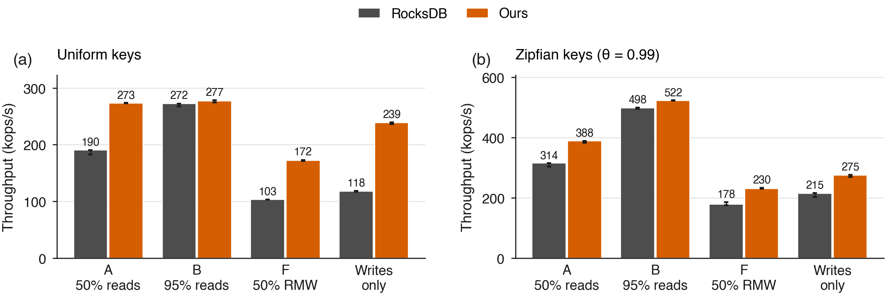

| Workload | Ops/s, RocksDB | Ops/s, ours | More ops | p99 read, RocksDB | p99 read, ours |
|---|---|---|---|---|---|
| B, read-heavy (95% reads), uniform | 272k | 277k | 1.02× | 0.025 ms | 0.025 ms |
| B, read-heavy, Zipfian | 498k | 522k | 1.05× | 0.019 ms | 0.018 ms |
| A, half reads, uniform | 190k | 273k | 1.44× | 0.029 ms | 0.027 ms |
| A, half reads, Zipfian | 314k | 388k | 1.24× | 0.022 ms | 0.020 ms |
| F, read-modify-write, uniform | 103k | 172k | 1.67× | 0.147 ms | 0.074 ms |
| F, read-modify-write, Zipfian | 178k | 230k | 1.31× | 0.090 ms | 0.051 ms |

- **Read-heavy work is unchanged:** within 5% on throughput and equal on read latency. This
  was registered in advance as a no-harm check.
- **Read latency improves where compaction is busy.** With read-modify-write it halves,
  because RocksDB's reads no longer compete with compaction for the same cores.

**Cheap compaction buys a read-friendlier database.** Reads get faster if the database keeps
fewer, more tightly merged levels, but that costs more compaction, which is why RocksDB does
not do it by default. On the GPU it is affordable (4 cores, median of 3 runs):

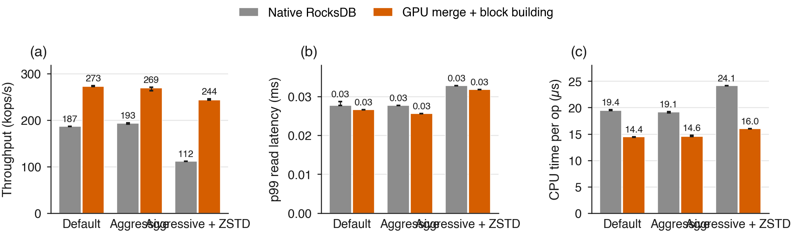

| Settings | Ops/s, RocksDB | Ops/s, ours | More ops | p99 read, RocksDB | p99 read, ours |
|---|---|---|---|---|---|
| Default | 187k | 273k | 1.46× | 0.028 ms | 0.027 ms |
| Read-optimised (L0 trigger 2, level multiplier 6) | 193k | 269k | 1.39× | 0.028 ms | 0.026 ms |
| Read-optimised, ZSTD | 112k | 244k | 2.18× | 0.033 ms | 0.032 ms |

### 6. A machine shared with other work

**When other programs compete for the same cores, the gain grows: 2.17× with 40% of each
core taken, 2.48× with 80%.**

*Setup:* benchmarks usually get the whole machine; real databases do not. Here a separate
process burns a fixed share of every core the database is pinned to. 4 cores, median of 3
runs.

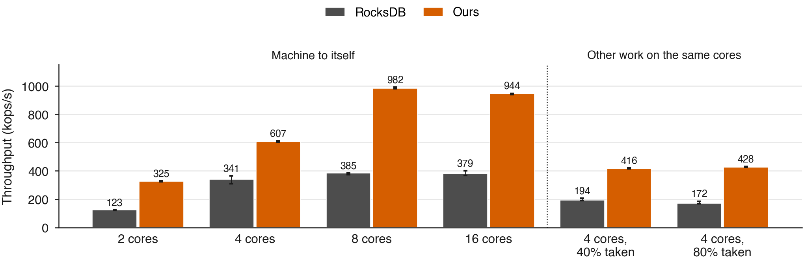

| Other work | RocksDB | Ours | More writes | RocksDB stalled | Ours stalled |
|---|---|---|---|---|---|
| 40% of each core | 194k writes/s | 416k | **2.17×** | 6% | 0% |
| 80% of each core | 172k | 428k | **2.48×** | 10% | 2% |

- **The busier the machine, the more the offload is worth.** On the same 4 cores with no
  competing process the gain is 1.80× (the `main` campaign, run separately), against 2.48×
  under heavy competition.
- **Ours barely notices.** Going from 40% to 80% stolen CPU costs RocksDB 11% of its
  throughput and ours nothing measurable, because its compaction is not on those cores.
- **This is the one place energy clearly favours the GPU:** 0.58–0.68× RocksDB's energy per
  operation here, against 0.69–1.19× in the `main`, `equal-cost`, `ycsb` and prior-design
  campaigns.

### 7. What it costs, and what it saves

**Sixteen cores with a GPU write 1.41× more than thirty-two cores without one, at half the
cost per write. Below about 12 cores, buying more cores is cheaper.**

*Setup:* the whole-database runs of [section 3](#3-the-whole-database) (tuned settings,
batched LZ4 writes, five minutes measured, median of 5 runs), priced at AWS EC2 on-demand
rates: Linux, us-east-1, retrieved 2026-11-09 from
[ec2instances.info](https://instances.vantage.sh/aws/ec2/c7i.xlarge), which republishes the
AWS Price List API. A physical core is $0.08925/h (c7i.xlarge at $0.1785/h for 4 vCPUs = 2
physical cores). A GPU is priced as its instance less its two cores; the L4 is $0.6263/h.
Every input is in [publication/prices.json](publication/prices.json).

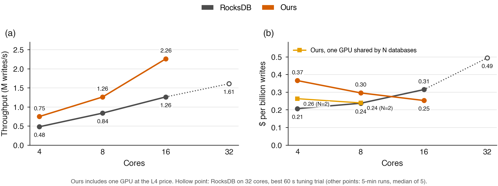

| Design | Cores | Writes/s | $/hour | $ per billion writes |
|---|---|---|---|---|
| RocksDB | 4 | 480k | 0.357 | 0.207 |
| RocksDB | 8 | 837k | 0.714 | 0.237 |
| **Ours + L4** | **16** | **2,260k** | **2.054** | **0.252** |
| Ours + L4 | 8 | 1,260k | 1.340 | 0.295 |
| RocksDB | 16 | 1,262k | 1.428 | 0.314 |
| Ours + L4 | 4 | 748k | 0.983 | 0.365 |
| RocksDB | 32 | 1,607k | 2.856 | 0.494 |

- **For high throughput, the GPU halves the cost per write.** Ours on 16 cores writes
  2.26M/s for $0.252 per billion. RocksDB's best on 32 cores is 1.61M/s for $0.494 per
  billion: 1.41× fewer writes at 1.96× the cost per write.
- **For low throughput, cores are cheaper.** At 4 and 8 cores RocksDB costs less per write
  ($0.207 and $0.237 against $0.365 and $0.295), because the GPU's fixed price is not yet
  paid back. The lines cross between 8 and 16 cores (about 12 by interpolation).
- **RocksDB's 32-core point is the weakest number here:** it is the best of five
  60-second tuning trials (1.52 to 1.61M), not a five-minute run. Taking the best trial
  favours RocksDB.
- **Sharing one GPU closes most of the low-core gap.** With two databases on one GPU, each
  paying half, ours costs $0.263 per billion at 4 cores (from $0.365) and $0.239 at 8 cores
  (from $0.295): parity with RocksDB at 8 cores, still 27% dearer at 4. Four databases per
  GPU are not cheaper: measured under CUDA MPS at 8 cores each, the GPU served 3.13M
  writes/s in total, but each database kept only 62% of its single-database throughput,
  so it costs $0.31 per billion. The two-database points are estimates, from the share kept
  in an earlier shared-GPU run (95%) applied to the tuned single-database throughput; the
  measured MPS runs will replace them.

**How much the GPU choice matters.** The measured card is an RTX A6000, which AWS does not
rent, so the table prices the cheapest current-generation NVIDIA GPU instance. Larger and
more expensive cards, with ours on 16 cores against RocksDB on 32:

| GPU priced | $/hour total | $ per billion | Cheaper per write than RocksDB on 32 cores |
|---|---|---|---|
| L4, 24 GiB ([g6.xlarge](https://instances.vantage.sh/aws/ec2/g6.xlarge)) | 2.054 | 0.252 | **1.96×** |
| A10G, 24 GiB ([g5.xlarge](https://instances.vantage.sh/aws/ec2/g5.xlarge)) | 2.256 | 0.277 | 1.78× |
| L40S, 48 GiB ([g6e.xlarge](https://instances.vantage.sh/aws/ec2/g6e.xlarge)) | 3.111 | 0.382 | 1.29× |

**The GPU would have to cost $2.59/hour before the advantage disappears**, more than any of
these cards.

**When it does not pay.** If 0.8M writes/s or less is enough, RocksDB on a few cores is the
cheapest choice measured ($0.207 per billion on 4 cores). On a SATA SSD, where the disk
saturates for both designs, the GPU does not pay at all
([section 8](#8-real-world-workloads-and-a-real-disk)).

### 8. Real-world workloads and a real disk

**Write-heavy workloads modelled on real RocksDB users run 1.4 to 1.8× faster; read-heavy
ones gain little. On a SATA SSD the disk becomes the limit, and only the CPU saving
remains.**

*Setup:* workloads modelled on real RocksDB users ([docs/workloads.md](docs/workloads.md)),
and the same database on a SATA SSD. Median of 3 runs.

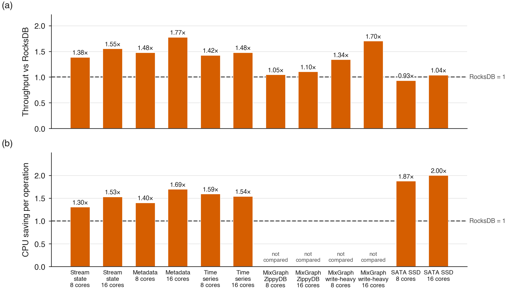

| Workload | 8 cores: more ops | 8 cores: less CPU | 16 cores: more ops | 16 cores: less CPU |
|---|---|---|---|---|
| Stream-processing state (as in Flink, Kafka Streams) | 1.38× | 1.30× | 1.55× | 1.53× |
| Storage metadata (as in Ceph, TiKV) | 1.48× | 1.40× | 1.77× | 1.69× |
| Time series, with old data deleted | 1.42× | 1.59× | 1.48× | 1.54× |
| Meta's ZippyDB model (85% reads) | 1.05× | not compared | 1.10× | not compared |
| Meta's ZippyDB model, write-heavy (50% writes) | 1.34× | not compared | 1.70× | not compared |
| SATA SSD (disk 100% busy for both) | 0.93× | 1.87× | 1.04× | 2.00× |

- **Meta's models** come from Meta's published study of its RocksDB workloads (FAST'20).
  They run in RocksDB's own `db_bench` with our compaction plugged in. Its clients keep
  every core busy in both designs, so only throughput is compared.
- **Who gains most:** gains follow how much of the work is writing; read-heavy work gains
  little.
- **On the SSD:** the disk sets the speed for both designs. Ours still halves the CPU,
  and with 16 cores 99.9% of writes finished within 84 ms against 336 ms.

**On NVMe.** The main test server has no NVMe drive, so these runs use a second server:
one 10-core Xeon Silver 4210R, an NVIDIA RTX PRO 6000 Blackwell and a 477 GB NVMe drive.
Both designs were tuned on this machine by the same registered search, at 8 cores (the
machine has 10). Batched writes, LZ4, 50 million keys, two minutes of warm-up then five
measured, every key verified. Median of 3 runs, paired 95% bootstrap intervals.

| Same machine, 8 cores | RocksDB | Ours | |
|---|---|---|---|
| **Data in memory:** writes/s | 0.948M | 1.620M | **1.70×** [1.62, 1.72] |
| **Data in memory:** CPU per write | 7.73 µs | 3.72 µs | **2.06× less** [1.91, 2.08] |
| **NVMe drive:** writes/s | 0.909M | 0.975M | 1.07× [1.06, 1.12] |
| **NVMe drive:** CPU per write | 5.91 µs | 4.06 µs | **1.46× less** [1.45, 1.49] |
| **NVMe drive:** share of the drive's measured limit | 95% | 103% | |

- **The machine is not the limit, the drive is.** With data in memory, ours gains 1.70×,
  as on the main server. On the NVMe drive, both designs move as many bytes as the drive
  can take: its measured limit (`fio`, same read/write mix) is 922 MB/s at RocksDB's mix
  and 741 MB/s at ours. A faster compactor cannot add throughput past that.
- **The CPU saving survives at the drive's limit:** 1.46× less CPU per write.
- **Costs on the drive.** Ours writes about 20% more bytes per byte of user data (write
  amplification 3.8 to 4.0 against 3.2 to 3.3). With identical settings, ours finishes each
  compaction sooner, so each one merges less new data and the same bytes are rewritten
  more often; ours adds no bytes to any single compaction. Its 99.9th-percentile write
  latency is 54.5 against 52.4 ms.
- **One asymmetry in ours' favour, being re-measured.** In these runs RocksDB reads
  compaction input directly from the drive, while our GPU path reads it through the page
  cache. A run with the same I/O path for both is registered and will replace these NVMe
  numbers.
- **Correct on this hardware:** every key was verified in every run, and a separate
  single-compaction check matched RocksDB in all 16 repetitions with no CPU fallback.

Raw data, iostat samples and the drive measurements are in
[publication/data/malphite-nvme/](publication/data/malphite-nvme/).

### 9. Compared with earlier GPU and FPGA designs

**In production RocksDB with compression on, ours uses 2.0 to 6.5× less compaction CPU than
earlier GPU and FPGA designs and reaches up to 1.93× their writes, because it also moves
compression to the GPU.**

*Setup:* earlier GPU and FPGA compaction systems run on other databases and hardware, so
their published numbers cannot be compared with ours directly. We rebuilt each design
inside RocksDB 11.8, on this machine, with RocksDB's normal LZ4 or ZSTD compression:

- **Their GPU steps** use our GPU code.
- **Their CPU steps** use RocksDB's own code, including compression, which none of them
  moves to the GPU.
- **Benefit of the doubt:** where the choice matters, the rebuild favours the earlier
  design (for example, it decompresses on 4 parallel threads).
- **Same checks:** every design passes the same exact check against RocksDB.

The designs are listed in [How it works](#how-it-works).

**One compaction** (median of 3 runs):

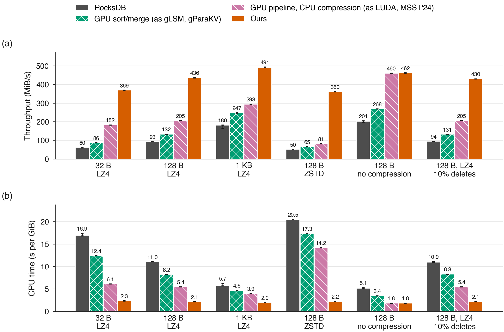

| Workload | CPU-s per GiB, best earlier design | CPU-s per GiB, ours | Less CPU |
|---|---|---|---|
| 32 B values, LZ4 | 6.1 | 2.3 | **2.7×** |
| 128 B values, LZ4 | 5.4 | 2.1 | **2.6×** |
| 128 B values, ZSTD | 14.2 | 2.2 | **6.5×** |
| 1 KB values, LZ4 | 3.9 | 2.0 | 2.0× |

**The whole database** (4 cores; each earlier design run with RocksDB's tuned settings and
with ours, best shown; median of 3 runs, every run verified):

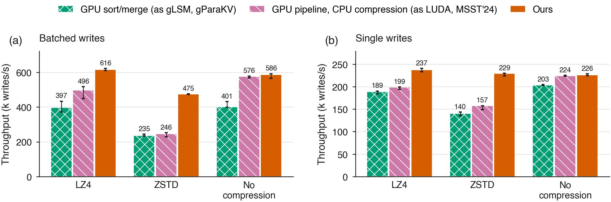

| Writes | Compression | Best earlier design | Ours | Ours vs best earlier |
|---|---|---|---|---|
| Batches of 100 | LZ4 | 592k writes/s | 756k | **1.28×**, 1.56× less CPU per write |
| Batches of 100 | ZSTD | 246k | 475k | **1.93×** |
| One at a time | LZ4 | 199k | 237k | **1.19×** |
| One at a time | ZSTD | 157k | 229k | **1.46×** |

The batched LZ4 row is the tuned rerun. The ZSTD and one-at-a-time rows, and the figure,
are still from the default-settings run until their tuned rerun finishes.

Compression is most of what the earlier designs leave on the CPU, so the gap is widest
with ZSTD. Our advantage depends on compression being on (see
[What this does not show](#11-what-this-does-not-show)).

Runs of gParaKV's and LUDA's own code are not in production RocksDB (both are built on
LevelDB and run without compression), so they are reported in
[publication/RELATED-WORK.md](publication/RELATED-WORK.md) rather than here.

### 10. Compaction on another machine over RDMA

**Sending a compaction to a GPU in another machine over RDMA finishes it 4 to 6.4× faster
than RocksDB does on the database machine, and that machine spends 5.5 to 11× less CPU on
it.** Running the whole database this way, with every compaction sent to the remote GPU, gives
1.75× RocksDB's write throughput with half the database machine's CPU per write.

*Setup:* compaction can also run on another machine over a 100 Gb/s RDMA network, and a
replicated database can compact once for all its copies
([docs/remote-compaction.md](docs/remote-compaction.md)).

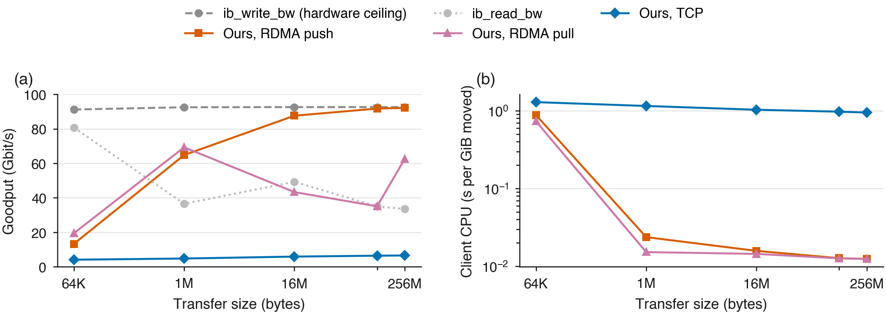

**Moving the data.** Our RDMA transport reaches 92 Gb/s, the network's full speed. It uses
0.012 CPU-seconds per GiB moved, about 80× less than TCP, which manages 6–7 Gb/s.

**Compacting on a GPU in another machine.** The database runs on one machine (pyke, 96
cores) and sends each compaction over 100 Gb/s RDMA to a GPU server on another (malphite,
RTX PRO 6000 Blackwell). The link measured 92 Gb/s between them. The same jobs were also
sent to malphite's CPU over the same link. Median of 4 runs; every compaction matched
RocksDB exactly.

| Workload | RocksDB on the database machine | Remote GPU over RDMA | Faster | Database machine's CPU per GiB, RocksDB / remote GPU | Less CPU |
|---|---|---|---|---|---|
| 128 B values, LZ4 | 3.66 s | **0.92 s** | **4.0×** | 5.66 / 1.02 s | **5.5×** |
| 32 B values, LZ4 | 6.38 s | **1.12 s** | **5.7×** | 9.11 / 1.11 s | **8.2×** |
| 128 B values, ZSTD | 6.77 s | **1.05 s** | **6.4×** | 11.63 / 1.06 s | **11×** |

- **A remote CPU is not enough.** Sent to malphite's 10-core CPU over the same link, the
  same compactions take 9.6 to 17.7 s, slower than RocksDB locally, because the server's
  merge is a simple reference version. The database machine saves the same CPU either way.
- **Same CPU saving as before, now with speed.** An earlier testbed had no machine with
  both a GPU and an RDMA card, so jobs went over RDMA to a relay and then over 1 Gb/s
  Ethernet to the GPU. That saved the database machine the same CPU (1.3 to 1.4 s per GiB)
  but took 11.5 to 13.6 s per compaction, almost all of it on the 1 Gb/s hop. The direct
  link removes that hop.
- **Different machines.** The two testbeds use different machines and GPUs (the earlier
  GPU was an RTX A6000), so compare ratios within a testbed, not times across them.
- **Not yet measured:** several databases sharing one remote GPU, and whether RDMA beats
  TCP on the direct link.

**The whole database over the direct link.** The database on pyke sends every compaction
to the GPU server on malphite. Same settings for both designs (50 M records, 4 writer
threads, 4 background jobs, 4 subcompactions, batches of 100, WAL off, 30 s warm-up plus
120 s); median of 3 repetitions in shuffled order. All 50 million keys and values were
correct after every run.

| | RocksDB on pyke | Remote GPU over RDMA | |
|---|---:|---:|---:|
| Writes/s | 459k | **802k** | **1.75×** |
| Database machine's CPU per write | 8.23 µs | **4.04 µs** | **2.04× less** |
| Database machine's compaction CPU | 421 s | **143 s** | **2.95× less** |
| Including the GPU server's CPU (51 s) | 8.23 µs | **4.46 µs** | **1.84× less** |

The earlier relay run (below) was held to 210k writes/s by its 1 Gb/s hop; over the
direct link the remote GPU is faster than RocksDB on its own machine.

The figure shows both testbeds. The top four rows of each workload are the earlier relay
testbed, where the 1 Gb/s hop dominates; the two rows below the dashed line are the direct
link (pyke and malphite), RocksDB and the remote GPU on the same machines. Compare rows
within a testbed, not across the line.

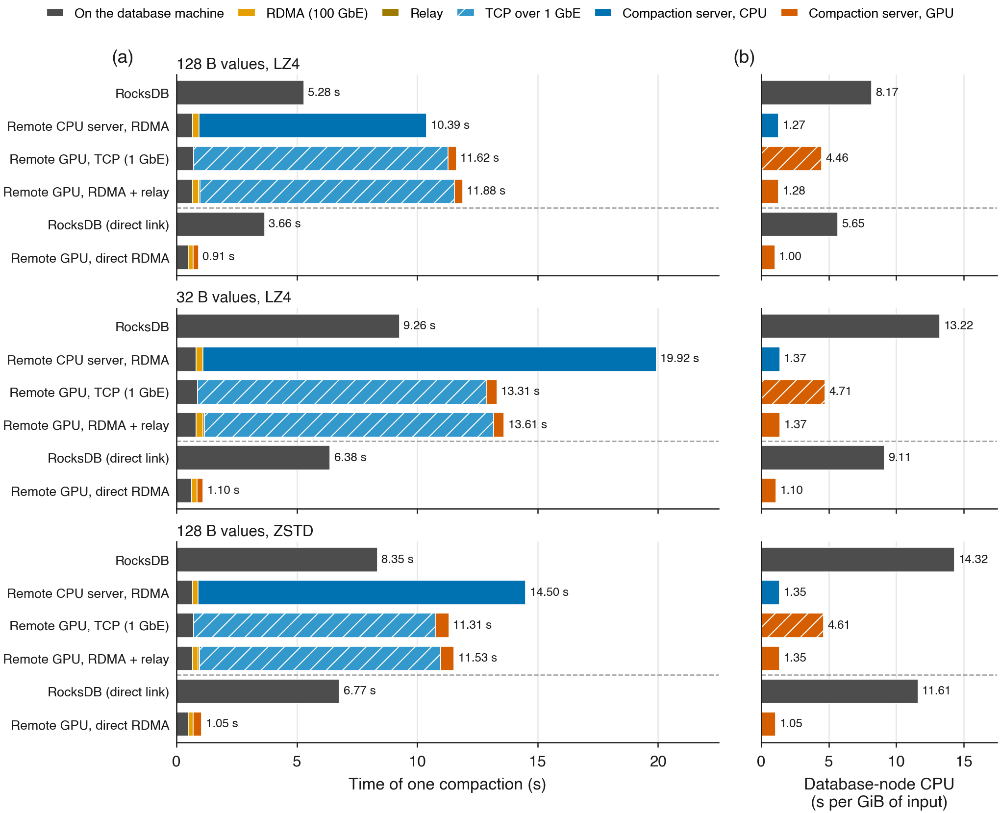

**Relay testbed: the database machine's CPU per GiB compacted.**

| Workload | RocksDB | Remote GPU over RDMA | Less CPU |
|---|---|---|---|
| 128 B values, LZ4 | 8.2 s | **1.3 s** | **6.4×** |
| 32 B values, LZ4 | 13.2 s | **1.4 s** | **9.6×** |
| 128 B values, ZSTD | 14.3 s | **1.4 s** | **10.6×** |

That is about the same as when the GPU sits in the same machine (1.2–1.3 s per GiB).
Sending the same work over TCP costs 3.4–3.5× more (4.5–4.7 s per GiB). On this testbed
RDMA and TCP finish within 3% of each other, because the 1 Gb/s hop dominates both.

- **The whole database through the relay.** With every compaction sent through the relay
  to the GPU, all 50 million keys and values were correct after each run, and no
  compaction fell back to the database machine. The 1 Gb/s link was the limit: writers
  had to wait 18% of the time, so the database took 210k writes/s against 545k for
  RocksDB, while its machine used 4.0 µs of CPU per write against 6.4. Over the direct
  link the same run gives 802k against 459k (above).

**Remote CPU servers and replication** (earlier testbed, details and figures in
[docs/remote-compaction.md](docs/remote-compaction.md)):

- **A remote CPU compaction server** cuts the database machine's compaction CPU 2.6 to
  7.6× over six workloads, but each compaction takes about twice as long as in RocksDB,
  because the server's merge is a simple reference version.
- **Compacting once for 2 backups** and shipping the files cuts the whole cluster's CPU
  per write 3.4× for batched writes (8.4 against 28.5 µs, at the same throughput), for
  about 3× more network traffic. With single writes it cuts CPU 1.8× but is 25% slower,
  because every log write is shipped to the backups inside RocksDB's write path, one
  write group at a time.

### 11. What this does not show

- **Storage-bound systems.** Most results put the data in memory (`/dev/shm`). When the
  drive is the limit, throughput gains are capped by the drive: equal on a SATA SSD (0.93×
  on 8 cores, 1.04× on 16), 1.07× on NVMe. The CPU saving remains (1.46 to 2.0×).
- **Costs.** About 20% more bytes written per user byte on disk (section 8); 1 GiB of
  pinned host memory per GPU engine plus GPU memory; and four databases sharing one GPU
  kept 77.1% of their throughput, below our registered 80% target.
- **Compaction without compression.** Our advantage over earlier designs comes from moving
  compression to the GPU. With compression off, which production RocksDB rarely runs,
  ours and the best earlier design use the same CPU.
- **Energy.** Energy is recorded per trial, but no claim is made. Whole-run energy per
  operation ranges from 0.69× to 1.19× RocksDB's across the `main`, `equal-cost`, `ycsb`
  and prior-design campaigns, depending on codec and write pattern, and the measurement
  window ends before RocksDB's 68 s of catch-up compaction, which favours RocksDB. A fair
  figure needs energy integrated to the end of catch-up.
- **Remote compaction, one pair of machines.** The whole database over direct RDMA was run
  on one pair of machines with one setting (4 cores' worth of threads, LZ4). Sharing one
  remote GPU among several databases, and RDMA against TCP on the direct link, are
  untested.
- **Key-value separation.** Designs that keep values outside the sorted files, such as
  gParaKV, move far fewer bytes through compaction. They are not part of production
  RocksDB's default path, and combining value separation with our offload is untested.
- **Read-heavy work.** The gain tracks how much compaction a workload creates. Meta's
  read-heavy model (85% reads) gains 1.05×, against 1.70× for its write-heavy variant.
- **One machine.** Apart from the NVMe and RDMA runs, all results come from a single
  server and a single RTX A6000, on Linux. Other GPUs, other CPU counts and other RocksDB
  versions are untested.
- **Registered thresholds we missed.** Three preregistered predictions did not hold, and
  the numbers above are the measured outcome rather than the registered one. 99.9th
  percentile write latency at 430k writes/s was 1.75× lower against a registered 2.5×.
  Compact-once replication cut cluster CPU 1.8× for single writes against a registered 2×.
  Parallel broadcast replication did not change throughput at all. All three are recorded
  with their reasons in [publication/PREREGISTRATION.md](publication/PREREGISTRATION.md).

### How we measured

- **Same tuning for both:** RocksDB and ours each get the best settings from the same
  search over threads, background jobs and RocksDB options
  ([configs/system/tuned.json](configs/system/tuned.json)).
- **Registered in advance:** every hypothesis and threshold was written down and committed
  before the runs, including the three that failed and the ones this hardware cannot test
  ([publication/PREREGISTRATION.md](publication/PREREGISTRATION.md)).
- **Fixed duration:** runs last a fixed time, and the order of runs is randomised.
- **Every problem recorded:** problems we found in our own measurements, and their fixes,
  are in [publication/AUDIT.md](publication/AUDIT.md).
- **Where the numbers come from:** the main campaigns in
  [publication/data/v3/summary.md](publication/data/v3/summary.md); the others in their
  own folders under [publication/data/](publication/data/), linked from each section.

### Correctness

- **Single compactions:** every run compares every stored key version, and 200,000 point
  lookups (which use the GPU-built Bloom filters), against RocksDB. All match.
- **Whole database:** every run checks each read as it happens, and all keys and values
  at the end.
- **Edge cases:** tests cover snapshots, parallel compactions, uncompressed data, long
  keys, large values and deletes.
- **GPU code:** passes NVIDIA's `compute-sanitizer` memory, race and synchronisation checks
  with no errors.

## Repository

| Path | Contents |
|---|---|
| `src/gpu/`, `include/lsm_lab/` | GPU merge and block building (`cuda_merge.cu`), CPU reference (`merge_cpu.cpp`), output compression (`cuda_transform.cu`), Metal backend, RocksDB integration headers |
| `src/remote/` | Remote compaction (`remote_merge`) and replication over TCP and RDMA |
| `cmake/ApplyEnginePatch.cmake` | Version-locked patch that adds the offload hooks to RocksDB |
| `apps/` | `lsm_compaction_bench`, `lsm_system_bench`, `lsm_compaction_server`, `lsm_replica_server`, `lsm_rpc_bench`, `lsm_burn`, and the harness services (`lsm_db`, `lsm_worker`, `lsm_loadgen`, `lsm_admin`, `lsm_telemetry`, `lsm_gpu_check`) |
| `tools/` | `labctl` harness: plans, runs, audits and analysis |
| `publication/` | Results, raw data, figures, and the scripts that produce them |
| `configs/` | Dataset and experiment configurations |
| `docs/` | Design and operating documentation |
| `tests/` | C++ (CTest) and Python tests |

## Build

```sh
bash scripts/bootstrap.sh
cmake --preset dev
cmake --build --preset dev
ctest --preset dev --output-on-failure
```

For the GPU build (Linux, CUDA 12, nvCOMP fetched by
`scripts/bootstrap-cuda.sh`) add `-DLSM_ENABLE_CUDA=ON
-DCMAKE_CUDA_ARCHITECTURES=native -DLSM_ROCKSDB_PORTABLE=0`. Prerequisites:
Git, curl, CMake 3.25+, a C++20 compiler and Python 3.12+. RocksDB is fetched
at the commit pinned in [toolchains.lock.json](toolchains.lock.json).

## Reproduce

On a Linux machine with an NVIDIA GPU, after the GPU build:

```sh
python3 publication/v3_grids.py configs/system/tuned.json   # experiment grids from the tuned settings
ONLY="isolated headline bottomzstd openloop stream metadata timeseries mixgraph ssd" \
  LSM_BUILD_DIR=build/dev publication/v3_chain.sh artifacts/v3   # about 30 hours
python3 publication/make_figures_v3.py                       # figures 17-21 from publication/data/v3/
python3 publication/make_figures.py                          # figures 10-16 and 22
```

## Documentation

- [docs/gpu-compaction.md](docs/gpu-compaction.md): what is offloaded, how it plugs into RocksDB, eligibility, configuration and limits
- [docs/remote-compaction.md](docs/remote-compaction.md): remote compaction and replication over TCP and RDMA, and their results
- [publication/RELATED-WORK.md](publication/RELATED-WORK.md): earlier GPU, FPGA and remote compaction designs, measured head to head on this harness
- [docs/runbook.md](docs/runbook.md): building, benchmarks, the `labctl` harness, hardware gates
- [docs/telemetry.md](docs/telemetry.md): resource and energy telemetry
- [publication/](publication/): results, methodology audit and data
