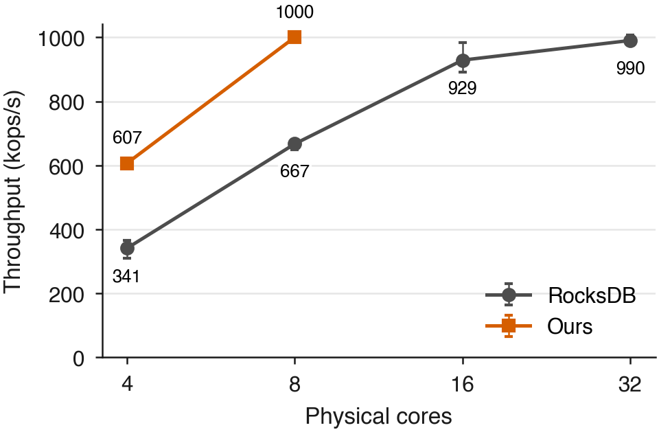
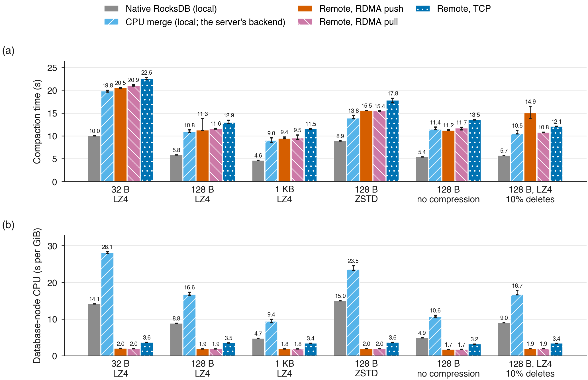
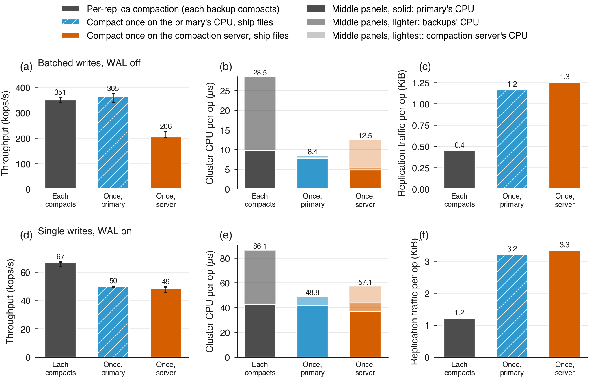

# LSM Lab: GPU-offloaded RocksDB compaction

RocksDB keeps its data sorted by constantly merging files in the background. This
merging, called **compaction**, is the largest CPU cost of a write-heavy database. LSM Lab
moves compaction in RocksDB 11.8 onto an NVIDIA GPU.

- **On the GPU:** reading, decompressing, merging and cleaning up the input files, then
  building, compressing and checksumming the new files' data blocks and Bloom filters.
- **Still in RocksDB:** deciding where files start and end, the index and metadata, and
  installing the new files.
- **Checked:** every result is checked against unmodified RocksDB, key by key.

## Results at a glance

Ours is compared with RocksDB as it ships, tuned for the same machine by the same search
as ours, on the same cores.

- **A compaction uses 9–16× less CPU** (8.8× with 128-byte values and LZ4, 14.2× with
  32-byte values, 15.5× with ZSTD).
- **A compaction finishes 8–12× sooner.**
- **One GPU does the compaction work of 15–18 CPU cores**, using 1.3–2 cores of its own.
- **The whole database handles 1.5–1.8× more writes and uses 1.8–2.2× less CPU per
  write.** It never has to slow writers down.
- **Write latency is lower at every load:** 1.75×, 3.8× and 9.6× lower at the 99.9th
  percentile when the database runs at 50%, 70% and 90% of RocksDB's maximum rate.
- **Reads do not suffer:** a read-heavy workload stays within 5% of RocksDB with equal read
  latency, and read latency halves where compaction is busy. Cheap compaction also makes a
  read-optimised database affordable.
- **On a machine shared with other work the gain grows** from 1.80× to 2.48×, and RocksDB's
  write stalls all but disappear.
- **Eight cores with the GPU match thirty-two without it,** at a 17× lower 99th-percentile
  write latency. But a GPU dedicated to one database only pays above about 16 cores.
- **It beats earlier GPU and FPGA designs** rebuilt in the same RocksDB: 2.0–6.5× less
  compaction CPU and up to 1.9× more throughput, because ours also moves compression to
  the GPU. Without compression it does not beat them
  ([publication/RELATED-WORK.md](publication/RELATED-WORK.md)).
- **Real-world workloads run 1.4–1.8× faster:** a stream-processing state store, storage
  metadata, a time series, and Meta's write-heavy production model. A read-heavy Meta
  model (85% reads) runs 1.05–1.10× faster.
- **On a SATA SSD the disk is the limit** for both, so throughput is equal, but ours uses
  half the CPU and finishes 99.9% of writes in 84 ms against 336 ms.
- **Compaction can run on a GPU in another machine over RDMA.** The database machine then
  uses 6–11× less CPU per GiB compacted. How long such a compaction takes is not
  established: no machine available to us has both a GPU and an RDMA card.

What this does not show is in [section 11](#11-what-this-does-not-show).

**Why the whole database gains about 2×, not 10×:** once compaction is on the GPU, most
of the remaining CPU goes to RocksDB accepting writes (about 2.3 µs of the 3.9 µs per
write), which no design here offloads.

Measured on one server: 4 × Intel Xeon Gold 5220, NVIDIA RTX A6000, data in memory
(`/dev/shm`) unless stated.

## How it works

A compaction:

1. reads, decompresses and parses its input files;
2. sorts all entries and drops outdated versions;
3. packs the survivors into data blocks;
4. compresses and checksums each block;
5. writes the blocks into files, with an index, a Bloom filter and metadata.

| Design | Steps on the GPU | Steps on the CPU |
|---|---|---|
| RocksDB | none | 1–5 |
| GPU compression only (this project's first design) | 4 | 1, 2, 3, 5 |
| GPU sort/merge (as gLSM, gParaKV) | parts of 1, and 2 | decompression, 3, 4, 5 |
| GPU pipeline, CPU compression (as LUDA, MSST'24, Alibaba's FPGA design) | parts of 1, 2, 3 | decompression, 4, 5 |
| **Ours** | **1–4, and the Bloom filter** | file cuts, index, metadata, writing the file |

Offloading compression alone made a compaction only 1.2–1.3× faster. The large gains
need the whole job on the GPU. Details: [docs/gpu-compaction.md](docs/gpu-compaction.md).

## Results

### 1. One compaction

One full compaction of a bottom level plus 8 overlapping newer files (0.6–0.7 GiB),
16-byte keys. Median of 3 runs; log scale.


| Workload | Time: RocksDB → ours | Faster | CPU per GiB: RocksDB → ours | Less CPU |
|---|---|---|---|---|
| 32 B values, LZ4 | 11.77 → 1.01 s | **11.7×** | 16.6 → 1.17 s | **14.2×** |
| 128 B values, LZ4 | 6.96 → 0.87 s | **8.0×** | 10.6 → 1.21 s | **8.8×** |
| 128 B values, ZSTD | 11.81 → 1.11 s | **10.7×** | 19.9 → 1.28 s | **15.5×** |
| 128 B values, LZ4, 10% deletes | 6.80 → 0.83 s | 8.2× | 10.7 → 1.20 s | 8.9× |
| 1 KB values, LZ4 | 5.18 → 1.29 s | 4.0× | 5.3 → 1.21 s | 4.4× |
| 128 B values, no compression | 5.05 → 1.57 s | 3.2× | 4.6 → 1.07 s | 4.3× |

Our cost stays near 1.2 CPU-seconds per GiB in every case. RocksDB's cost depends on the
data:

- it is highest with small values, where it has more keys to handle per byte;
- it is highest with ZSTD, the most expensive codec;
- with large values or no compression it is already cheap, so the gain is smaller.

### 2. One GPU replaces 15–18 CPU cores

Eight compactions at once on 8 cores (2.5–2.6 GiB of input):


- **The GPU's rate:** 1.42 GiB/s with LZ4 and 0.89 GiB/s with ZSTD, using 2.0 and 1.3
  CPU cores.
- **One RocksDB core's rate:** 0.094 and 0.050 GiB/s.
- **So one GPU does the work of 15 (LZ4) and 18 (ZSTD) CPU cores.**

### 3. The whole database

50 million keys with 128-byte values, writes in batches of 100. Two minutes of warm-up,
then five minutes measured. Median of 5 runs.


| Compression | Cores | RocksDB | Ours | More writes | CPU per write: RocksDB → ours |
|---|---|---|---|---|---|
| LZ4 | 4 | 480k writes/s | 748k | **1.56×** | 6.7 → 3.8 µs (1.76× less) |
| LZ4 | 8 | 837k | 1,260k | **1.51×** | 7.5 → 3.9 µs (1.90× less) |
| LZ4 | 16 | 1,262k | 2,260k | **1.79×** | 7.1 → 4.0 µs (1.80× less) |
| LZ4, ZSTD on the last level | 4 | 452k | 745k | **1.65×** | 6.9 → 3.8 µs (1.80× less) |
| LZ4, ZSTD on the last level | 8 | 759k | 1,268k | **1.67×** | 8.6 → 3.9 µs (2.21× less) |

Where the CPU goes, per write:

| | RocksDB | Ours |
|---|---|---|
| Compaction | 3.5–5.5 µs | 0.8 µs |
| Flushing memory to files | 1.0 µs | 0.7 µs |
| Accepting the write | 2.3 µs | 2.3 µs |

- RocksDB had to slow writers down for up to 6% of the time; ours never did.
- With 16 cores, 99.9% of writes finished within 9 ms with ours, against 210 ms with
  RocksDB.

### 4. Write latency at a fixed load

Writes arrive on a fixed schedule, and latency counts from when each write was due, so
a slow-down cannot hide. 8 cores, 3 minutes measured, 5 runs per point.


| Load | 99th percentile: RocksDB → ours | 99.9th percentile: RocksDB → ours |
|---|---|---|
| 430k writes/s (50% of RocksDB's maximum) | 2.5 → 1.8 ms (1.4×) | 5.5 → 3.2 ms (1.75×) |
| 600k (70%) | 14.2 → 2.6 ms (5.4×) | 41.9 → 11.0 ms (3.8×) |
| 770k (90%) | 142.6 → 13.1 ms (10.9×) | 251.7 → 26.2 ms (9.6×) |

The closer the database runs to its limit, the more compaction gets in the way of RocksDB's
writes, and the bigger the gap.

### 5. Reads

Compaction decides how the data is laid out, so moving it could have hurt reads. It does not.
The Bloom filters are built on the GPU and checked by 200,000 point lookups after every
compaction. YCSB on 4 cores, median of 3 runs:


| Workload | RocksDB | Ours | Throughput | 99th-percentile read |
|---|---|---|---|---|
| B, read-heavy (95% reads), uniform | 272k ops/s | 277k | 1.02× | 0.025 → 0.025 ms |
| B, read-heavy, Zipfian | 498k | 522k | 1.05× | 0.019 → 0.018 ms |
| A, half reads, uniform | 190k | 273k | 1.44× | 0.029 → 0.027 ms |
| A, half reads, Zipfian | 314k | 388k | 1.24× | 0.022 → 0.020 ms |
| F, read-modify-write, uniform | 103k | 172k | 1.67× | 0.147 → 0.074 ms |
| F, read-modify-write, Zipfian | 178k | 230k | 1.31× | 0.090 → 0.051 ms |

- **Read-heavy work is unchanged:** within 5% on throughput and equal on read latency. This
  was registered in advance as a no-harm check.
- **Read latency improves where compaction is busy.** With read-modify-write it halves,
  because RocksDB's reads no longer compete with compaction for the same cores.

**Cheap compaction buys a read-friendlier database.** Reads get faster if the database keeps
fewer, more tightly merged levels, but that costs more compaction, which is why RocksDB does
not do it by default. On the GPU it is affordable (4 cores, median of 3 runs):


| Settings | RocksDB | Ours | Throughput | 99th-percentile read |
|---|---|---|---|---|
| Default | 187k ops/s | 273k | 1.46× | 0.028 → 0.027 ms |
| Read-optimised (L0 trigger 2, level multiplier 6) | 193k | 269k | 1.39× | 0.028 → 0.026 ms |
| Read-optimised, ZSTD | 112k | 244k | 2.18× | 0.033 → 0.032 ms |

### 6. A machine shared with other work

Benchmarks usually get the whole machine; real databases do not. Here a separate process
burns a fixed share of every core the database is pinned to (4 cores, median of 3 runs):


| Other work | RocksDB | Ours | More writes | RocksDB stalled | Ours stalled |
|---|---|---|---|---|---|
| 40% of each core | 194k writes/s | 416k | **2.17×** | 6% | 0% |
| 80% of each core | 172k | 428k | **2.48×** | 10% | 2% |

- **The busier the machine, the more the offload is worth.** On the same 4 cores with no
  competing process the gain is 1.80× (the `main` campaign, run separately), against 2.48×
  under heavy competition.
- **Ours barely notices.** Going from 40% to 80% stolen CPU costs RocksDB 11% of its
  throughput and ours nothing measurable, because its compaction is not on those cores.
- **This is the one place energy clearly favours the GPU:** 0.58–0.68× RocksDB's energy per
  operation, against a 0.69–1.19× range everywhere else.

### 7. What it costs

**In cores.** Eight cores with the GPU match thirty-two without it, with a far better tail
(median of 5 runs):



| Design | Cores | Writes/s | CPU per write | 99th-percentile write |
|---|---|---|---|---|
| RocksDB | 8 | 667k | 9.20 µs | 7.08 ms |
| RocksDB | 16 | 929k | 8.48 µs | 19.92 ms |
| RocksDB | 32 | 990k | 9.69 µs | 37.75 ms |
| **Ours** | **8** | **1,000k** | **5.91 µs** | **2.23 ms** |

**In money.** AWS on-demand, Linux, us-east-1, October 2026. A core is $0.0903/h
(c7i.xlarge); the GPU is $0.6242/h (g6.xlarge less its two cores, an approximation because
the measured GPU is an RTX A6000):

| Design | Cores | Writes/s | $ per billion writes |
|---|---|---|---|
| RocksDB | 4 | 341k | **0.29** |
| RocksDB | 8 | 667k | 0.30 |
| **Ours** | **8** | **1,000k** | **0.37** |
| RocksDB | 16 | 929k | 0.43 |
| Ours | 4 | 607k | 0.45 |
| RocksDB | 32 | 990k | 0.81 |

**A GPU dedicated to one database only pays above about 16 cores.** Below that, buying cores
is cheaper per write: the GPU costs about as much as seven cores, and one database cannot
keep it busy, using only 1.3–2 cores' worth of its capacity. The case for a GPU is therefore
either a database that needs 16 or more cores of compaction, or one GPU shared between
several databases. **Sharing has not been measured** (see
[section 11](#11-what-this-does-not-show)).

### 8. Real-world workloads and a real disk

Workloads modelled on real RocksDB users ([docs/workloads.md](docs/workloads.md)), and the
same database on a SATA SSD. Median of 3 runs.


| Workload | 8 cores: throughput, CPU per operation | 16 cores |
|---|---|---|
| Stream-processing state (as in Flink, Kafka Streams) | 1.38×, 1.30× less | 1.55×, 1.53× less |
| Storage metadata (as in Ceph, TiKV) | 1.48×, 1.40× less | 1.77×, 1.69× less |
| Time series, with old data deleted | 1.42×, 1.59× less | 1.48×, 1.54× less |
| Meta's ZippyDB model (85% reads) | 1.05× | 1.10× |
| Meta's ZippyDB model, write-heavy (50% writes) | 1.34× | 1.70× |
| SATA SSD (disk 100% busy for both) | 0.93×, 1.87× less | 1.04×, 2.00× less |

- **Meta's models** come from Meta's published study of its RocksDB workloads (FAST'20).
  They run in RocksDB's own `db_bench` with our compaction plugged in. Its clients keep
  every core busy in both designs, so only throughput is compared.
- **Who gains most:** gains follow how much of the work is writing; read-heavy work gains
  little.
- **On the SSD:** the disk sets the speed for both designs. Ours still halves the CPU,
  and with 16 cores 99.9% of writes finished within 84 ms against 336 ms.

### 9. Compared with earlier GPU and FPGA designs

Earlier GPU and FPGA compaction systems run on other databases and hardware, so their
published numbers cannot be compared with ours directly. We rebuilt each design inside
this RocksDB, on this machine:

- **Their GPU steps** use our GPU code.
- **Their CPU steps** use RocksDB's own code, including compression, which none of them
  moves to the GPU.
- **Benefit of the doubt:** where the choice matters, the rebuild favours the earlier
  design (for example, it decompresses on 4 parallel threads).
- **Same checks:** every design passes the same exact check against RocksDB.

The designs are listed in [How it works](#how-it-works). These comparisons were measured
before our latest host-side improvements, so our numbers here are conservative.

**One compaction** (median of 3 runs):


| Workload | CPU per GiB: best earlier design → ours | Less CPU |
|---|---|---|
| 32 B values, LZ4 | 6.1 → 2.3 s | **2.7×** |
| 128 B values, LZ4 | 5.4 → 2.1 s | **2.6×** |
| 128 B values, ZSTD | 14.2 → 2.2 s | **6.5×** |
| 1 KB values, LZ4 | 3.9 → 2.0 s | 2.0× |
| 128 B values, no compression | 1.8 → 1.8 s | same |

**The whole database** (4 cores, same settings for every design; median of 5 runs with
LZ4, 3 with the others):


| Writes | Compression | Best earlier design | Ours | Ours vs best earlier |
|---|---|---|---|---|
| Batches of 100 | LZ4 | 496k writes/s | 616k | **1.24×**, 3.8× lower 99th-percentile latency |
| Batches of 100 | ZSTD | 246k | 475k | **1.93×** |
| Batches of 100 | none | 576k | 586k | same |
| One at a time | LZ4 | 199k | 237k | **1.19×** |
| One at a time | ZSTD | 157k | 229k | **1.46×** |
| One at a time | none | 224k | 226k | same |

- **Without compression,** the best earlier design is as good as ours. Our advantage is
  moving compression to the GPU.
- **With compression,** which is how RocksDB normally runs, compression is most of what
  the earlier designs leave on the CPU.

**gParaKV, run as published.** gParaKV (SC'25) is the only earlier system with public
code. We ran it unmodified and connected RocksDB, with and without our offload, to
gParaKV's own benchmark driver (one client, 4 cores, the same GPU; median of 3 runs):

| Values | System | Mixed workload (YCSB A) | CPU seconds |
|---|---|---|---|
| 128 B | gParaKV | 238k ops/s | 350 |
| 128 B | RocksDB | 178k | 543 |
| 128 B | **RocksDB + ours** | 182k | **346** |
| 1 KB | gParaKV | 251k | 105 |
| 1 KB | RocksDB, values stored separately (BlobDB) | 168k | 219 |
| 1 KB | RocksDB + ours | 160k | 221 |

gParaKV is faster under its own driver.

- **It is a different design:** values live in a separate log outside the sorted files,
  stored uncompressed, on top of LevelDB.
- **Our offload mostly saves CPU here:** one client does not keep RocksDB's compaction
  busy, so the offload cuts CPU by 36% at 128 B rather than raising throughput.
- **Future work:** separating values and offloading compaction are complementary, so
  bringing our GPU path to RocksDB's BlobDB is the next step.

### 10. Compaction on another machine over RDMA

Compaction can also run on another machine over a 100 Gb/s RDMA network, and a
replicated database can compact once for all its copies
([docs/remote-compaction.md](docs/remote-compaction.md)).


**Moving the data.** Our RDMA transport reaches 92 Gb/s, the network's full speed. It uses
0.012 CPU-seconds per GiB moved, about 80× less than TCP, which manages 6–7 Gb/s.

**Compacting on a GPU in another machine.** No machine available to us has both a GPU and
an RDMA card. So we chained three machines: the database machine sends each compaction
over RDMA to a second machine, which passes it on over 1 Gb/s Ethernet to the GPU machine.
Every compaction matched RocksDB exactly, and we timed each hop separately.


**Measured: the database machine's CPU per GiB compacted.**

| Workload | RocksDB | Remote GPU over RDMA | Less CPU |
|---|---|---|---|
| 128 B values, LZ4 | 8.2 s | **1.3 s** | **6.4×** |
| 32 B values, LZ4 | 13.2 s | **1.4 s** | **9.6×** |
| 128 B values, ZSTD | 14.3 s | **1.4 s** | **10.6×** |

That is about the same as when the GPU sits in the same machine (1.2–1.3 s per GiB).
Sending the same work over TCP costs 3.4–3.5× more (4.5–4.7 s per GiB).

**Not measured: how long a remote GPU compaction takes.** The 1 Gb/s hop to the GPU
machine takes 10–12 s of every compaction, so the measured end-to-end time, 11.5–13.6 s,
is slower than RocksDB and says nothing about the design. Removing the relay and the
1 Gb/s hop from the measured per-hop times leaves 1.3–1.5 s, of which the RDMA transfer is
0.23–0.29 s and the GPU 0.34–0.56 s. That arithmetic is not a result, and no speed-up over
RocksDB is claimed for remote compaction until a machine with both a GPU and an RDMA card
confirms it. For the same reason, RDMA and TCP finish within 3% of each other here, so
this hardware cannot test whether RDMA beats TCP for compaction.

- **A remote CPU is not enough.** A CPU compaction server saves the database machine the
  same CPU, but each compaction takes 1.7–2.2× longer than in RocksDB, because its merge is
  a simple reference version.
- **The whole database works this way.** With every compaction sent through the chain
  to the GPU, all 50 million keys and values were correct after each run, and no
  compaction fell back to the database machine. The 1 Gb/s link is the limit here: writers
  had to wait 18% of the time, so the database took 210k writes/s against 545k for
  RocksDB, while its machine used 4.0 µs of CPU per write against 6.4.



**More workloads with a CPU server.** Over six workloads, the database machine spends
1.7–2.0 CPU-seconds per GiB compacted, against 4.7–15.0 for local RocksDB (2.6–7.6× less).
Over TCP it needs about twice that.



**Replication with 2 backups** (median of 5 runs):

| Writes | Design | Writes/s | Total CPU of all machines per write |
|---|---|---|---|
| Batches of 100 | Each copy compacts its own data | 351k | 28.5 µs |
| Batches of 100 | **Compact once, send the files** | **365k** | **8.4 µs (3.4× less)** |
| One at a time | Each copy compacts its own data | 67k | 86.1 µs |
| One at a time | **Compact once, send the files** | 50k | **48.8 µs (1.8× less)** |

- **Compacting once saves the cluster's CPU:** 3.4× for batched writes and 1.8× for
  single writes.
- **The cost:** about 3× more network traffic, and single writes are 25% slower because
  each one waits for the backups in turn.

### 11. What this does not show

- **Fast storage.** Most results put the data in memory (`/dev/shm`), so compaction is
  CPU-bound by construction. On the one SATA SSD we tested, the disk saturates at 100%
  utilisation and 220–244 MiB/s for both designs, and the throughput gain disappears
  (0.93× on 8 cores, 1.04× on 16). The CPU and latency gains survive. NVMe, which is an
  order of magnitude faster than this SSD, is untested and is the regime that matters.
- **Compaction without compression.** Our advantage over the best earlier design comes
  from moving compression to the GPU. With compression off, the two are the same, and
  this work adds nothing over LUDA's design.
- **Energy.** Energy is recorded per trial, but no claim is made. Whole-run energy per
  operation ranges from 0.69× to 1.19× RocksDB's depending on codec and write pattern,
  and the measurement window ends before RocksDB's 68 s of catch-up compaction, which
  favours RocksDB. A fair figure needs energy integrated to the end of catch-up.
- **Remote compaction latency.** Only the CPU offload is measured. No machine available to
  us has both a GPU and an RDMA card, so how fast a remote GPU compaction runs, and
  whether RDMA beats TCP for it, are both open.
- **Key-value separation.** gParaKV is faster than us under its own driver (238k against
  182k ops/s at 128 B values). It keeps values out of the sorted files entirely, so it
  moves far fewer bytes through compaction. The two approaches are complementary and
  have not been combined.
- **Read-heavy work.** The gain tracks how much compaction a workload creates. Meta's
  read-heavy model (85% reads) gains 1.05×, against 1.70× for its write-heavy variant.
- **One machine.** All results come from a single server and a single RTX A6000, on
  Linux. Other GPUs, other CPU counts and other RocksDB versions are untested.
- **Sharing one GPU between databases.** Not measured, and it is the result the cost
  argument in [section 7](#7-what-it-costs) turns on. The first attempt failed outright:
  every instance's memory was bound to one NUMA node and the kernel killed them, and a
  failed GPU allocation left a buffer reporting its old size. Both are fixed; the re-run is
  pending.
- **Registered thresholds we missed.** Three preregistered predictions did not hold, and
  the numbers above are the measured outcome rather than the registered one. 99.9th
  percentile write latency at 430k writes/s was 1.75× lower against a registered 2.5×.
  Compact-once replication cut cluster CPU 1.8× for single writes against a registered 2×.
  Parallel broadcast replication did not change throughput at all. All three are recorded
  with their reasons in [publication/PREREGISTRATION.md](publication/PREREGISTRATION.md).

### How we measured

- **Same tuning for both:** RocksDB and ours each get the best settings from the same
  search over threads, background jobs and RocksDB options
  ([configs/system/tuned.json](configs/system/tuned.json)).
- **Registered in advance:** every hypothesis and threshold was written down and committed
  before the runs, including the three that failed and the ones this hardware cannot test
  ([publication/PREREGISTRATION.md](publication/PREREGISTRATION.md)).
- **Fixed duration:** runs last a fixed time, and the order of runs is randomised.
- **Every problem recorded:** problems we found in our own measurements, and their fixes,
  are in [publication/AUDIT.md](publication/AUDIT.md).
- **Every number:** [publication/data/v3/summary.md](publication/data/v3/summary.md).

### Correctness

- **Single compactions:** every run compares every stored key version, and 200,000 point
  lookups (which use the GPU-built Bloom filters), against RocksDB. All match.
- **Whole database:** every run checks each read as it happens, and all keys and values
  at the end.
- **Edge cases:** tests cover snapshots, parallel compactions, uncompressed data, long
  keys, large values and deletes.
- **GPU code:** passes NVIDIA's `compute-sanitizer` memory, race and synchronisation checks
  with no errors.

## Repository

| Path | Contents |
|---|---|
| `src/gpu/`, `include/lsm_lab/` | GPU merge and block building (`cuda_merge.cu`), CPU reference (`merge_cpu.cpp`), output compression (`cuda_transform.cu`), Metal backend, RocksDB integration headers |
| `src/remote/` | Remote compaction (`remote_merge`) and replication over TCP and RDMA |
| `cmake/ApplyEnginePatch.cmake` | Version-locked patch that adds the offload hooks to RocksDB |
| `apps/` | `lsm_compaction_bench`, `lsm_system_bench`, `lsm_compaction_server`, `lsm_replica_server`, `lsm_rpc_bench`, `lsm_burn`, and the harness services (`lsm_db`, `lsm_worker`, `lsm_loadgen`, `lsm_admin`, `lsm_telemetry`, `lsm_gpu_check`) |
| `tools/` | `labctl` harness: plans, runs, audits and analysis |
| `publication/` | Results, raw data, figures, and the scripts that produce them |
| `configs/` | Dataset and experiment configurations |
| `docs/` | Design and operating documentation |
| `tests/` | C++ (CTest) and Python tests |

## Build

```sh
bash scripts/bootstrap.sh
cmake --preset dev
cmake --build --preset dev
ctest --preset dev --output-on-failure
```

For the GPU build (Linux, CUDA 12, nvCOMP fetched by
`scripts/bootstrap-cuda.sh`) add `-DLSM_ENABLE_CUDA=ON
-DCMAKE_CUDA_ARCHITECTURES=native -DLSM_ROCKSDB_PORTABLE=0`. Prerequisites:
Git, curl, CMake 3.25+, a C++20 compiler and Python 3.12+. RocksDB is fetched
at the commit pinned in [toolchains.lock.json](toolchains.lock.json).

## Reproduce

On a Linux machine with an NVIDIA GPU, after the GPU build:

```sh
python3 publication/v3_grids.py configs/system/tuned.json   # experiment grids from the tuned settings
ONLY="isolated headline bottomzstd openloop stream metadata timeseries mixgraph ssd" \
  LSM_BUILD_DIR=build/dev publication/v3_chain.sh artifacts/v3   # about 30 hours
python3 publication/make_figures_v3.py                       # figures 17-21 from publication/data/v3/
python3 publication/make_figures.py                          # figures 10-16 and 22
```

## Documentation

- [docs/gpu-compaction.md](docs/gpu-compaction.md): what is offloaded, how it plugs into RocksDB, eligibility, configuration and limits
- [docs/remote-compaction.md](docs/remote-compaction.md): remote compaction and replication over TCP and RDMA, and their results
- [publication/RELATED-WORK.md](publication/RELATED-WORK.md): earlier GPU, FPGA and remote compaction designs, measured head to head on this harness
- [docs/runbook.md](docs/runbook.md): building, benchmarks, the `labctl` harness, hardware gates
- [docs/telemetry.md](docs/telemetry.md): resource and energy telemetry
- [publication/](publication/): results, methodology audit and data
