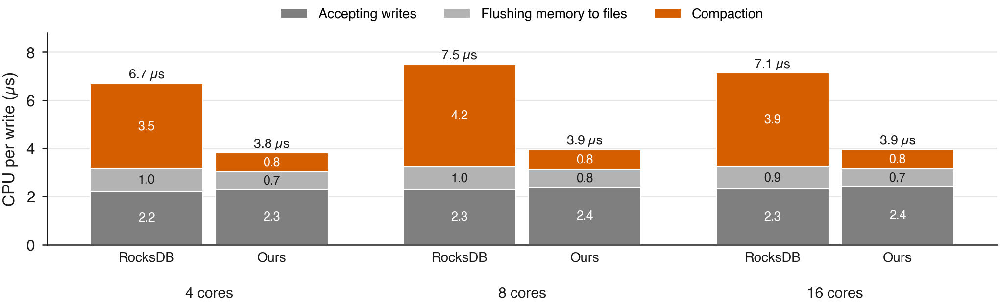
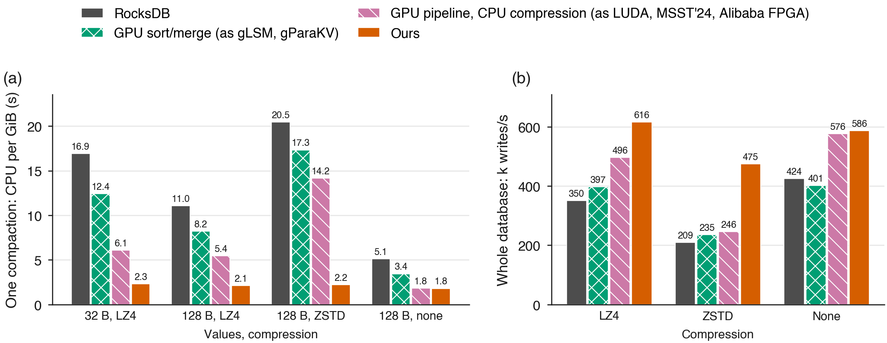
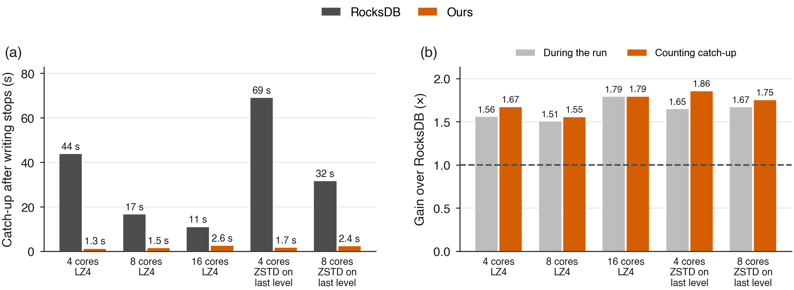
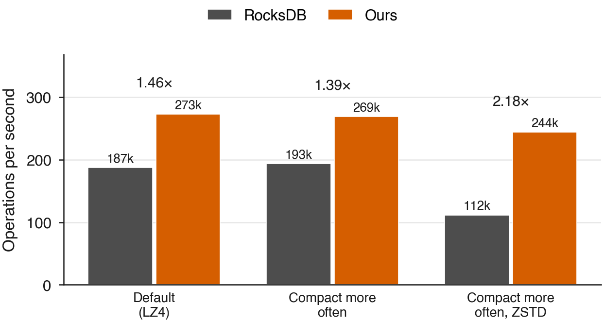
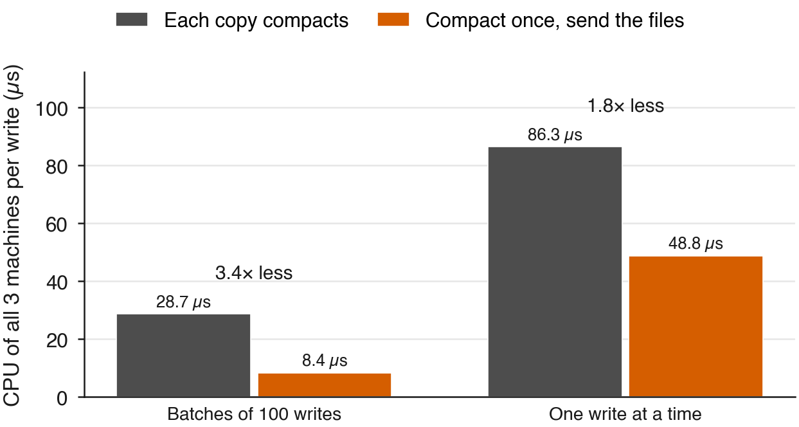

# LSM Lab: GPU-offloaded RocksDB compaction

RocksDB, the storage engine behind many databases and data services, keeps its data sorted by
constantly merging files in the background. This merging, called **compaction**, is the
largest CPU cost of a write-heavy database. **LSM Lab moves the whole compaction job in
RocksDB 11.8 onto an NVIDIA GPU**, and checks every result key by key against unmodified
RocksDB.

## The short answer

- **Compaction itself becomes about 10× cheaper and faster.** One GPU does the compaction
  work of 15–18 CPU cores.
- **The whole database gains less, about 1.5–1.8× more writes for half the CPU per write**,
  because RocksDB's remaining work of accepting writes is not offloaded.
- **It beats earlier GPU and FPGA designs** rebuilt in the same RocksDB, because it is the
  only one that also moves compression to the GPU.
- **Gains are largest for write-heavy work.** The gain holds on a drive too (1.60× on NVMe, 1.45× on a SATA SSD), with a CPU saving on top. Read-heavy work and
  data stored without compression see little or no gain.

## Key results

Unless a row says otherwise, ours is compared with RocksDB tuned for the same machine by
the same search, on the same CPU cores. The GPU is in addition to those cores.

| What was measured | Result |
|---|---|
| One compaction | **8–12× faster, 9–16× less CPU** (small values, compressed); 3–4× with 1 KB values or no compression |
| GPU capacity | **One GPU = 15–18 CPU cores** of compaction work |
| Whole database | **1.5–1.8× more writes, 1.8–2.2× less CPU per write**, and writers are never slowed down |
| Keeping up | After 5 minutes of writing, RocksDB needs **11–69 s** to finish postponed compaction, ours **1.3–2.6 s**; counting it, ours handles **1.55–1.86×** RocksDB's writes |
| Slowest writes (99.9th percentile) | **3.8× lower at 70% load, 9.6× lower at 90%** (1.75× at 50%) |
| On an NVMe drive | **1.60× more writes**, **1.70× less CPU per write**, and the slowest 1% of writes **29× faster** at 630k writes/s |
| A GPU in another machine, over RDMA | Each compaction **4.0–6.5× faster**; the whole database **1.75× more writes, 2.04× less CPU** |
| Against earlier GPU and FPGA designs | **2.0–6.5× less compaction CPU**; their database gains are 1.14–1.41× over RocksDB, ours 1.75× |
| Cost (AWS prices) | At high write rates, **half RocksDB's cost per write**: 2.26M writes/s on 16 cores + GPU, against RocksDB's best of 1.60M on 32 cores |

## How good is this?

**The compaction result is strong.** A 10× drop in compaction cost, and one GPU replacing
about 16 cores, hold across value sizes and compression types, and every compaction matches
RocksDB's output exactly.

**The whole-database result is solid but not 10×.** Once compaction is on the GPU, most of
the CPU left goes to RocksDB accepting writes, which this project does not change
(tuned runs, LZ4, median of 5):



So the database gains about 2×, and further gains would need the write path itself to be
faster. The gain is largest when the machine is busy: 9.6× lower worst-case latency near
full load, and 2.5× more writes when other programs take 80% of the database's cores.

**It does not help everywhere.** See [Where it does not help](#where-it-does-not-help).

## How it compares with other work

### Earlier work at a glance

| Work | What it moves off the database's CPU | How we compare with it |
|---|---|---|
| gLSM (ACM TOS'24), gParaKV (SC'25) | Sorting and merging, to a GPU; values kept outside the sorted files | Rebuilt in RocksDB ("GPU sort/merge"); gParaKV's own code also run |
| LUDA (arXiv'20), MSST'24 GPU compaction | Most of the compaction, to a GPU; compression stays on the CPU | Rebuilt in RocksDB ("GPU pipeline"); LUDA's own code also run |
| Alibaba's FPGA compaction (FAST'20) | Most of the compaction, to an FPGA; compression stays on the CPU | Same design as the GPU pipeline rebuild |
| GPComp (TPDS'25), GCLComp | Moving data between the SSD and the GPU | Not run; complementary to ours |
| Nova-LSM (SIGMOD'21), CaaS-LSM (SIGMOD'24) | Compaction, to other machines' CPUs | Our remote CPU server stands in; ours can send it to a remote GPU |
| Tebis (EuroSys'22), RubbleDB (ATC'23) | Compaction on replicas: compact once, send the result | Our compact-once replication stands in |
| **Ours** | **The whole compaction, including compression, to a GPU (local or remote)** | |

### Measured on the same machine

Earlier systems ran on different stores and hardware, so their published speedups cannot
be compared with ours. Instead, **we rebuilt each design inside the same RocksDB, on the
same machine**, giving it the benefit of the doubt where a choice mattered. Every rebuild
passes the same exact check against RocksDB.



*(a) One compaction, median of 3 runs. (b) Whole database, 4 cores, batched writes, the same
settings for every design, median of 3–5 runs; the gains below are the median of each run
paired with its RocksDB run.*

| Design | Gain over RocksDB, whole database (LZ4 / ZSTD / no compression) |
|---|---|
| GPU sort/merge (as gLSM, gParaKV) | 1.14× / 1.16× / 0.98× |
| GPU pipeline, CPU compression (as LUDA, MSST'24, Alibaba's FPGA design) | 1.41× / 1.17× / 1.34× |
| **Ours** | **1.75× / 2.27× / 1.40×** |

- **The difference is compression.** Earlier designs leave it on the CPU, where it becomes
  the bottleneck. With compression on, ours uses 2.0–6.5× less compaction CPU than the best
  of them.
- **It holds when every design is tuned.** With LZ4 on 4 cores, RocksDB reaches 498k
  writes/s, the best earlier design 592k (1.19×) and ours 756k (1.52×).
- **It holds with the write-ahead log on**, one write at a time: ours reaches 237k writes/s
  with LZ4, against 199k for the best earlier design and 177k for RocksDB.
- **Without compression, ours and the best earlier design are equal.** Production RocksDB
  rarely runs without compression, but this is the honest limit of the contribution.
- **Their own code.** gParaKV (SC'25) is faster than RocksDB with our offload under its own
  benchmark (238k against 182k ops/s), because it stores values outside the sorted files and
  so compacts far less data; ours uses about the same CPU. Combining the two is future work.
  LUDA's own code is 2.6× faster than the LevelDB it is built on, but still slower than plain
  RocksDB (a different store, so this is not a fair test of its compaction).

Details: [publication/RELATED-WORK.md](publication/RELATED-WORK.md).

## How it works

A compaction has five steps:

1. read and decompress the input files;
2. sort the entries and drop outdated versions;
3. pack the survivors into data blocks;
4. compress and checksum each block, and build the Bloom filter;
5. write the files with their index and metadata, and install them.

**Ours runs steps 1–4 on the GPU.** RocksDB keeps step 5 and every decision about where
files start and end, so the files are exactly what RocksDB would write. Offloading
compression alone gave only 1.2–1.3×; the large gains need the whole job on the GPU.
Details: [docs/gpu-compaction.md](docs/gpu-compaction.md).

## Results

Data in memory on one server (4 × Intel Xeon Gold 5220, NVIDIA RTX A6000) unless stated.
Every table and figure, with full setups and caveats, is in
[publication/FULL-RESULTS.md](publication/FULL-RESULTS.md).

### 1. One compaction: about 10× faster and cheaper


| Workload | Time, RocksDB → ours | CPU per GiB, RocksDB → ours |
|---|---|---|
| 32 B values, LZ4 | 11.8 → 1.0 s (**11.7×**) | 16.6 → 1.2 s (**14.2×**) |
| 128 B values, LZ4 | 7.0 → 0.9 s (**8.0×**) | 10.6 → 1.2 s (**8.8×**) |
| 128 B values, ZSTD | 11.8 → 1.1 s (**10.7×**) | 19.9 → 1.3 s (**15.5×**) |
| 1 KB values, LZ4 | 5.2 → 1.3 s (4.0×) | 5.3 → 1.2 s (4.4×) |

Ours costs about 1.2 CPU-seconds per GiB whatever the data. RocksDB's cost depends on it:
highest with small values and ZSTD, lowest with large values or no compression.

**One GPU replaces 15–18 cores.** Running eight compactions at once on 8 cores, the GPU
processes 1.42 GiB/s with LZ4 and 0.89 GiB/s with ZSTD, using 2.0 and 1.3 cores of its own.
One RocksDB core manages 0.094 and 0.050 GiB/s.


### 2. The whole database: 1.5–1.8× more writes for half the CPU


*50 million keys, 128-byte values, batches of 100 writes, 5 minutes measured, median of 5
runs.*

- **Writers are never slowed down.** RocksDB had to slow writers for up to 6% of the time
  because compaction fell behind; ours never did.
- **The slowest writes are much faster on more cores.** On 16 cores, the slowest 0.1% of
  writes take 8.9 ms with ours against 210 ms with RocksDB.

**Ours keeps up; RocksDB falls behind.** When writing is heavy, RocksDB postpones
compaction and carries on accepting writes, so a benchmark that stops the clock when
writing stops makes it look faster than it is. The postponed work still has to be done:
after 5 minutes of writing, RocksDB needs another 11–44 s of compaction (32–69 s with ZSTD
on the last level). Ours keeps up as it goes, and needs 1.3–2.6 s.



Counting the time to finish that postponed work, ours handles **1.55–1.86× RocksDB's
writes**, up from 1.51–1.79× during the run alone. Every throughput in this README is the
lower, during-the-run figure.

### 3. Write latency: the busier the database, the bigger the gain

*Writes arrive on a fixed schedule, and latency counts from when each write was due, so a
slow-down cannot hide. 8 cores, median of 5 runs. Left: the slowest 1% of writes; right: the
slowest 0.1%. Log scale.*


| Load | Slowest 0.1% of writes, RocksDB | Ours | Lower |
|---|---|---|---|
| 430k writes/s (50% of RocksDB's maximum) | 5.5 ms | 3.2 ms | 1.75× |
| 600k (70%) | 41.9 ms | 11.0 ms | **3.8×** |
| 770k (90%) | 251.7 ms | 26.2 ms | **9.6×** |

The closer the database runs to its limit, the more RocksDB's compaction gets in the way of
its writes.

### 4. Real workloads, reads and a busy machine

*Workloads modelled on real RocksDB users ([docs/workloads.md](docs/workloads.md)), Meta's
published production models, and the standard YCSB benchmark. Median of 3 runs.*


- **Write-heavy work gains 1.3–1.8×.** The gain follows how much of the work is writing.
- **A busy machine gains most: 2.1–2.5×.** When other programs take part of every core,
  RocksDB's compaction competes with them; ours runs on the GPU. It also uses **1.3–1.5×
  less energy per write** there (whole server, including the GPU for ours only).
- **Read-heavy work is unchanged (1.02–1.10×)**, and reads were not slower in any workload.
  With read-modify-write, read latency halves.

**Cheap compaction makes better settings affordable.** Settings that compact more often
(keeping the data in fewer levels) or compress harder (ZSTD, for smaller files) cost
RocksDB throughput. Ours barely notices. *Half reads, half writes, 4 cores, the same
untuned settings for both designs, median of 3 runs.*



Switching to ZSTD costs RocksDB 42% of its throughput, and ours 9%.

### 5. On real disks

*Data in memory and on the NVMe drive: a second server (10-core Intel Xeon Silver 4210R,
NVIDIA RTX PRO 6000 Blackwell), both designs tuned on it, 8 cores, median of 3 runs. SATA
SSD: the first server, 8 cores, median of 3 runs. Every key verified in every run.*


- **On a drive, the gain holds.** Ours reaches 1.60× the writes/s of RocksDB on the second server's NVMe drive, and 1.45× on the first server's SATA SSD.
- **The CPU saving stays: 1.7× less CPU per write on NVMe, 1.9× on the SATA SSD.**
- **On NVMe, latency is much lower when the database is busy.** At a fixed 630k writes/s,
  the slowest 1% of writes take 17 ms with ours against 503 ms with RocksDB (median of 2 runs
  per load; log scale):


A separate run on the NVMe drive reached 1.315M writes/s with ours (1.60× RocksDB), but its
raw data is not yet in the repository, so it is not counted here.

### 6. A GPU in another machine, over RDMA

The database can send each compaction over a 100 Gb/s RDMA network to a GPU server on
another machine, so the database machine needs no GPU. *A 96-core database machine and the
second server; median of 3 runs; every compaction matched RocksDB exactly.*


- **Each compaction is 4.0–6.5× faster, and the database machine spends 5.6–11× less CPU
  on it.** Of the remote GPU's 0.9–1.1 s, moving the data over the network takes only
  about 0.2 s.
- **The whole database** run this way takes **802k writes/s against 459k** (1.75×), with
  **2.04× less CPU per write** on the database machine (1.84× counting the GPU server's CPU).
- **A remote CPU server is not enough:** it saves the same CPU but each compaction takes
  9.6–17.6 s, slower than RocksDB locally.
- **Replicas:** with 2 backups, compacting once and sending the files to them cuts the CPU of
  all three machines per write 3.4× for batched writes and 1.8× for single writes (earlier
  testbed, compacting on the primary's CPU):



Details: [docs/remote-compaction.md](docs/remote-compaction.md).

### 7. Cost: where ours is cheaper

*Both designs tuned for each core count; median of 5 runs (RocksDB on 32 cores: 3). Priced at AWS on-demand rates: a
CPU core at $0.089/h and, for ours, one NVIDIA L4 GPU at $0.63/h.*


- **At the highest write rates, ours costs half as much per write.** RocksDB peaks at
  1.60M writes/s on 32 cores ($25.0k a year). Ours reaches 2.26M writes/s on 16 cores and a
  GPU ($18.0k a year): 1.41× more writes at $0.25 against $0.50 per billion.
- **At the same write rate, ours is slightly cheaper.** For 1.26M writes/s RocksDB needs
  16 cores; ours needs 8 cores and a GPU, 6% cheaper.

Below about 1.3M writes/s RocksDB is cheaper, because the GPU costs more than the cores it
saves ([Where it does not help](#where-it-does-not-help)). Every price and configuration is
in [publication/FULL-RESULTS.md](publication/FULL-RESULTS.md#7-what-it-costs-and-what-it-saves).

## Where it does not help

- **Read-heavy work:** 1.02–1.10× at 85–95% reads, because there is little compaction.
- **No compression:** ours and the best earlier design are equal.
- **Low write rates:** below about 1.3M writes/s, RocksDB costs less per write than ours
  with a GPU, because the GPU costs more than the cores it saves.
- **Extra writing:** ours writes about 1.4× more bytes to storage per byte of user data (5.5
  against 4.0 on NVMe), probably because its faster compactions start sooner on smaller
  batches.
- **Sharing one GPU:** four databases on one GPU kept 77% of their single-database
  throughput, below our 80% target.
- **Energy:** a saving is clear only on a busy machine (1.3–1.5× less per write). In the
  other whole-database runs, energy per write ranges from 0.69× to 1.19× RocksDB's, so no
  general saving is claimed.
- **Coverage:** two GPU models and RocksDB 11.8 only; the remote-GPU database run used one
  pair of machines and one setting.

## How we checked

- **Correct output:** every compaction is compared with RocksDB's, every stored version and
  200,000 lookups; every database run checks each read and all keys and values at the end.
  The GPU code passes NVIDIA's memory, race and synchronisation checkers.
- **Fair comparison:** both designs get their best settings from the same tuning search
  ([configs/system/tuned.json](configs/system/tuned.json)), runs last a fixed time, and
  their order is randomised.
- **Registered in advance:** hypotheses and thresholds were committed before the runs.
  Three were missed, and are reported as measured
  ([publication/PREREGISTRATION.md](publication/PREREGISTRATION.md)).
- **Problems recorded:** every flaw we found in our own measurements, and its fix, is in
  [publication/AUDIT.md](publication/AUDIT.md).

## Repository

| Path | Contents |
|---|---|
| `src/gpu/`, `include/lsm_lab/` | GPU merge and block building (`cuda_merge.cu`), CPU reference (`merge_cpu.cpp`), output compression (`cuda_transform.cu`), Metal backend, RocksDB integration headers |
| `src/remote/` | Remote compaction (`remote_merge`) and replication over TCP and RDMA |
| `cmake/ApplyEnginePatch.cmake` | Version-locked patch that adds the offload hooks to RocksDB |
| `apps/` | `lsm_compaction_bench`, `lsm_system_bench`, `lsm_compaction_server`, `lsm_replica_server`, `lsm_rpc_bench`, `lsm_burn`, and the harness services (`lsm_db`, `lsm_worker`, `lsm_loadgen`, `lsm_admin`, `lsm_telemetry`, `lsm_gpu_check`) |
| `tools/` | `labctl` harness: plans, runs, audits and analysis |
| `publication/` | Results, raw data, figures, and the scripts that produce them |
| `configs/` | Dataset and experiment configurations |
| `docs/` | Design and operating documentation |
| `tests/` | C++ (CTest) and Python tests |

## Build

```sh
bash scripts/bootstrap.sh
cmake --preset dev
cmake --build --preset dev
ctest --preset dev --output-on-failure
```

For the GPU build (Linux, CUDA 12, nvCOMP fetched by
`scripts/bootstrap-cuda.sh`) add `-DLSM_ENABLE_CUDA=ON
-DCMAKE_CUDA_ARCHITECTURES=native -DLSM_ROCKSDB_PORTABLE=0`. Prerequisites:
Git, curl, CMake 3.25+, a C++20 compiler and Python 3.12+. RocksDB is fetched
at the commit pinned in [toolchains.lock.json](toolchains.lock.json).

## Reproduce

On a Linux machine with an NVIDIA GPU, after the GPU build:

```sh
python3 publication/v3_grids.py configs/system/tuned.json   # experiment grids from the tuned settings
ONLY="isolated headline bottomzstd openloop stream metadata timeseries mixgraph ssd" \
  LSM_BUILD_DIR=build/dev publication/v3_chain.sh artifacts/v3   # about 30 hours
python3 publication/make_figures_v3.py                       # figures 17-21 from publication/data/v3/
python3 publication/make_figures.py                          # figures 10-16 and 22
python3 publication/make_readme_figures.py                   # figures 32, 33, 35-37 (README summaries)
python3 publication/make_readme_figures_more.py              # figures 38-41 (README summaries)
python3 publication/rdma/analyze_r7.py                       # figures 23 and 31 (remote GPU over RDMA)
```

## Documentation

- [publication/FULL-RESULTS.md](publication/FULL-RESULTS.md): every result in detail, with setups and caveats
- [docs/gpu-compaction.md](docs/gpu-compaction.md): what is offloaded, how it plugs into RocksDB, eligibility, configuration and limits
- [docs/remote-compaction.md](docs/remote-compaction.md): remote compaction and replication over TCP and RDMA, and their results
- [publication/RELATED-WORK.md](publication/RELATED-WORK.md): earlier GPU, FPGA and remote compaction designs, measured head to head on this harness
- [docs/runbook.md](docs/runbook.md): building, benchmarks, the `labctl` harness, hardware gates
- [docs/telemetry.md](docs/telemetry.md): resource and energy telemetry
- [publication/](publication/): results, methodology audit and data
