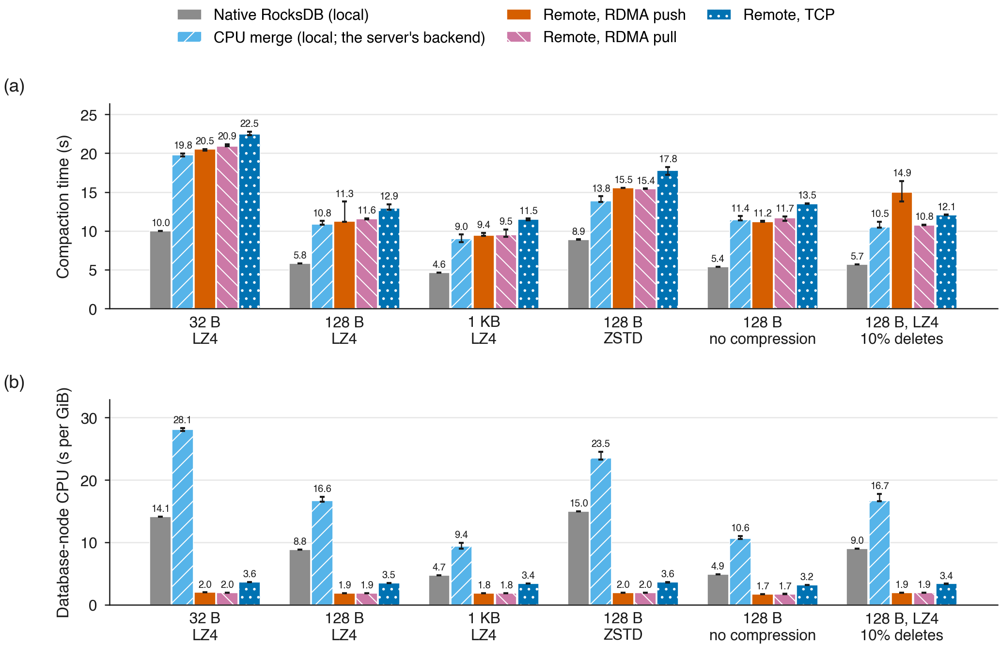
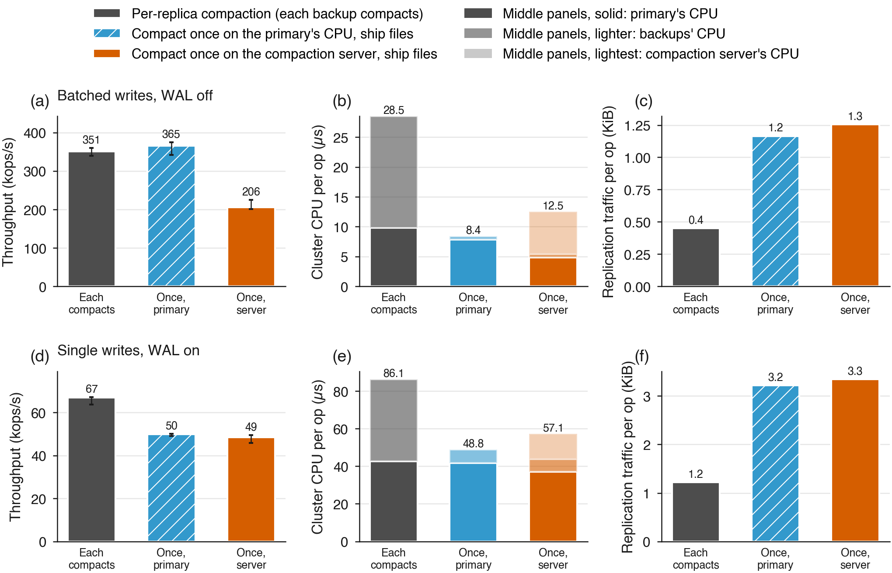
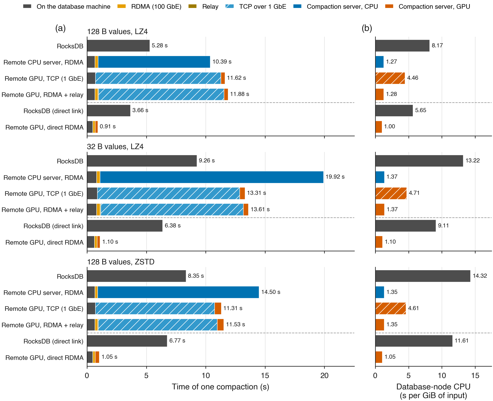

# Remote compaction and replication over RDMA

The GPU compaction in [gpu-compaction.md](gpu-compaction.md) runs inside the database
process. This document covers two extensions:

- **Remote compaction:** move compaction to a shared compaction server.
- **Replication:** replicate the database so compaction runs only once.

Both use TCP or RDMA. The plan and hypotheses (H13–H17) are in
[publication/PREREGISTRATION.md](../publication/PREREGISTRATION.md).

## Remote compaction

`remote_merge` is a compaction transform
([include/lsm_lab/remote_merge.hpp](../include/lsm_lab/remote_merge.hpp)). It plugs in where
`cuda_merge` does, through the same `MergeCompactionInput` hook, but sends the work over
the network.

1. RocksDB's `CompactionJob` runs on the database node as usual and builds the merge
   request: input blocks, key bounds, snapshots and output format.
2. The database node reads the input blocks straight into a registered buffer and sends
   the request with the blocks to `lsm_compaction_server`.
3. The server runs its backend, `cuda_merge` (GPU) or `cpu_merge` (CPU), on the received
   bytes. A thread-local `PreloadedMergeBlocks` stands in for the input files, so the
   merge engines are unchanged.
4. The server returns the finished data blocks, boundary keys and filter hashes. If the
   job cannot be built, it returns the merged entry stream instead.
5. The database node writes the files, index, filter and footer, and installs the result,
   exactly as for local GPU compaction.

Properties:

- **No shared filesystem:** the input travels with the request. RocksDB's own
  `CompactionService` (wrapped by the gRPC worker in
  [src/engine/remote_compaction.cpp](../src/engine/remote_compaction.cpp)) needs one.
- **Same output checks:** the output passes the same differential checks as local
  compaction (`tests/remote_compaction_test.sh`).
- **Falls back on failure:** if the server fails, disconnects or times out, that job runs
  on the CPU in the database process and is counted in `merge_fallbacks`.
  `lsm_compaction_server --crash-after N` injects failures for testing.
- **Relays:** `lsm_compaction_server --backend remote_merge` forwards every job to the
  server at its own `LSM_REMOTE_ENDPOINT`, sending the blocks it received. This joins two
  networks, e.g. an RDMA network and a GPU host that only the relay can reach.

### Transports

| Transport | Mechanism |
|---|---|
| `tcp://host:port` | Length-prefixed messages over one socket per connection. |
| `rdma://host:port` | RC queue pairs set up with librdmacm. Requests and replies move with one-sided RDMA operations between pre-registered buffers that are reused across jobs. |
| `unix://<socket path>` | Same machine. Control messages over a Unix-domain socket; requests and replies stay in shared memory (memfd) that the client owns and passes to the server once, so data is not copied through the kernel. |

RDMA protocol for one call:

1. **Request.**
   - *Push (default):* the client asks for a request buffer; the server advertises one;
     the client RDMA-WRITEs the request into it and sends "ready".
   - *Pull (`LSM_RDMA_PUSH=0`):* the client sends the address of its request buffer;
     the server RDMA-READs it.
2. **Reply.** The server RDMA-WRITEs the reply into the reply buffer the client
   advertised. If the reply is larger, it first asks for a bigger buffer.
3. **Done.** The server SENDs "done"; RC ordering makes the reply visible first.

Waits block on a completion channel (`LSM_RDMA_POLL=1` busy-polls instead). A client also
watches its connection events and gives up after `LSM_REMOTE_TIMEOUT_MS` (default 120 s)
without progress.

On ConnectX-6 Dx at 100 Gb/s, push reaches about 90 Gb/s for 128 MiB transfers, against
about 92 Gb/s for `ib_write_bw`. Pull is limited by RDMA READ to about 50 Gb/s
(`ib_read_bw` reaches 51 Gb/s). The client spends about 0.012 CPU-seconds per GiB moved
over RDMA, against about 0.7 over TCP.

### Configuration

| Variable | Effect |
|---|---|
| `LSM_REMOTE_ENDPOINT` | Server address for `remote_merge`. |
| `LSM_REMOTE_CONNECTIONS` | Concurrent remote jobs per database process (default 2). |
| `LSM_RDMA_PUSH` | `1` (default) pushes requests with RDMA WRITE; `0` lets the server pull them with RDMA READ. |
| `LSM_RDMA_POLL` | `1` busy-polls completions instead of blocking. |
| `LSM_REMOTE_TIMEOUT_MS` | Client timeout without progress (default 120000). |
| `LSM_TENANT` | Name of this database in a shared server's scheduler and statistics (default: the database path). |

### Sharing one GPU

One `lsm_compaction_server --backend cuda_merge` serves any number of databases from one CUDA
context and one set of engines, instead of each database process holding its own:

- `--engines K` (`LSM_GPU_MERGE_STREAMS`): jobs that run at once, each on its own engine
  (stream and buffers).
- `--scheduler fifo|fair|stall` (`LSM_GPU_SCHEDULER`): which waiting job gets the next free
  engine. `fifo` is arrival order. `fair` is start-time fair queuing over tenants, charged by
  input bytes. `stall` runs jobs that unblock writers first (writes stalled when the job was
  built, or a level-0 job with level 0 at or above its slowdown trigger), then fair order.
  Requests carry the tenant and these hints (metadata version 3).
- `LSM_GPU_MEMORY_BUDGET_MB` and `LSM_GPU_MEMORY_PER_INPUT`: a job starts only if the summed
  estimates (input bytes times the factor) of running jobs fit the budget; a job always starts
  when none is running. Measured device memory per job is 11–17 times its compressed input
  (6.4 times uncompressed); data in `publication/data/multiplex/memory`.
- Out of device memory: idle engines free their cached buffers and the job runs again once
  another job has finished (up to 8 times) instead of falling back to the CPU.
- Statistics (printed on exit, and in `transform` statistics in process): per tenant jobs,
  input bytes, queue wait, service time and re-queues; device memory per engine;
  `LSM_SCHEDULER_LOG=1` adds every completed job's start and end time.
- `LSM_GPU_FAIL_ALLOC_EVERY=N` (testing) makes every Nth engine allocation fail.

The same scheduler orders jobs when several databases share one process (`--shards`).

The transform's statistics add `merge_remote_ns` (the client's call), `merge_server_ns`
(the server's handler), `merge_sent_bytes` and `merge_received_bytes`. Through a relay they
also add `merge_upstream_remote_ns` (the relay's call to the next server) and
`merge_upstream_server_ns` (that server's handler), so each hop's time can be separated.

Tools:

- `lsm_rpc_bench` measures the transport alone with echo requests.
- `lsm_compaction_server` prints its backend's statistics on SIGTERM.

## Replication

`lsm_system_bench --replication physical|logical --replicate-to <endpoints>` replicates the
primary to backups (`lsm_replica_server`)
([include/lsm_lab/replication.hpp](../include/lsm_lab/replication.hpp)).

| Mode | Primary | Backups |
|---|---|---|
| `physical` (compact once) | A RocksDB `FileSystem` wrapper mirrors every file write in the database directory: WAL data on every WAL flush (before the write is acknowledged); SST and MANIFEST data in 4 MiB chunks and on sync and close; creates, renames and deletes as they happen. | Hold an exact copy of the primary's files and never compact. |
| `logical` (per-replica compaction) | Sends each write batch to every backup before applying it. | Run their own RocksDB with the primary's options (`lsm_lab/db_options.hpp`) and any compaction backend (`--replica-backend`), and compact independently. |

How a run proceeds:

1. **Bootstrap.** Before the run, the primary resets each backup and sends it the
   primary's files, so backups start identical.
2. **Run.** Writes are replicated as described above.
3. **Check.** After the run, the primary computes a digest of every key and value. Each
   backup computes the same digest:
   - a physical backup opens its copy read-only with stock RocksDB, as a failover would;
   - a logical backup first finishes its compaction.

   Any mismatch fails the run (`tests/replication_test.sh`).

Combined with `--mode remote_merge`, physical replication compacts once, on the
compaction server, for the whole replica set.

## Results so far (CPU compaction server)

These were measured on two machines linked at 100 Gb/s (ConnectX-6 Dx, RoCE), with the
compaction server running the CPU merge (`cpu_merge`). They are summarised in
[publication/FULL-RESULTS.md, section 10](../publication/FULL-RESULTS.md#10-compaction-on-another-machine-over-rdma).

- **Transport:** RDMA push reaches 92 Gb/s (the `ib_write_bw` ceiling) and costs the
  client about 0.012 CPU-seconds per GiB. TCP reaches 6–7 Gb/s at about 1 CPU-second
  per GiB.
- **Remote compaction:** the database node's CPU per GiB compacted falls to 1.7–2.0
  seconds over RDMA, against 4.7–15.0 for native RocksDB; TCP needs 3.2–3.6. RDMA adds
  2–12% to compaction time compared with running the same merge locally.
- **Replication with 2 backups:** compacting once and shipping the files cuts cluster CPU
  per write by 3.4× for batched writes (same throughput) and by 1.8× for single writes
  (25% lower throughput, see Limits), for about 3× more replication traffic.

### Remote compaction to a CPU server

One compaction per workload, run five ways: RocksDB on the database machine (dark grey);
the server's reference merge run locally (light blue), to show how fast that merge is on
its own; and the same job sent to the CPU server by RDMA push (orange), RDMA pull (pink)
and TCP (dark blue). Median of 3 runs.

- **(a) Time:** sent to the server, a compaction takes about twice as long as in RocksDB,
  because the reference merge itself is slow (the light-blue bars). The network adds 2 to 12%.
- **(b) Database machine's CPU per GiB:** 1.7 to 2.0 s over RDMA against 4.7 to 15.0 s for
  RocksDB compacting locally (2.6 to 7.6× less); over TCP 3.2 to 3.6 s.

### Replication with 2 backups

Three ways to keep 2 backups in step: every copy compacts its own data (grey); the
primary compacts once and ships the files (blue); a compaction server compacts once and
the files are shipped (orange). Top row batched writes with the WAL off, bottom row single
writes with the WAL on. Columns: (a, d) throughput; (b, e) CPU of all machines per write,
split into primary (solid), backups (lighter) and compaction server (lightest); (c, f)
replication traffic per write. Median of 5 runs.

| Writes | Design | Writes/s | CPU of all machines per write | Network per write |
|---|---|---:|---:|---:|
| Batches of 100 | Each copy compacts | 351k | 28.5 µs | 459 B |
| Batches of 100 | Compact once on the primary | **365k** | **8.4 µs** | 1,193 B |
| Batches of 100 | Compact once on a CPU server | 206k | 12.5 µs | 1,287 B |
| One at a time | Each copy compacts | **67k** | 86.1 µs | 1,250 B |
| One at a time | Compact once on the primary | 50k | **48.8 µs** | 3,296 B |
| One at a time | Compact once on a CPU server | 49k | 57.1 µs | 3,422 B |

- **Compacting once on the primary** saves the most CPU: 3.4× with batched writes at the
  same throughput, 1.8× with single writes.
- **Compacting once on the CPU server** is slower with batched writes (206k against
  351k), because the server's reference merge cannot keep up.
- **Single writes are slower when compacting once** because every WAL append is shipped
  inside RocksDB's write path (see Limits).

## Results: GPU compaction over RDMA (through a relay)

This was the first GPU testbed, before a machine with both a GPU and an RDMA link was
found; the direct-link results are in [publication/FULL-RESULTS.md](../publication/FULL-RESULTS.md#10-compaction-on-another-machine-over-rdma), section 10. Here `rdma_campaign.py r7` chains three machines: the
database node (AMD EPYC 7662, 4 cores) sends each job over RDMA (ConnectX-6 Dx, 100 Gb/s)
to a relay (`--backend remote_merge`), which forwards it over TCP on 1 Gb/s Ethernet to a
`cuda_merge` server on the A6000 host (8 cores of the GPU's NUMA node). The same
workloads also run directly over TCP to the GPU host, over RDMA to a CPU server, and on the
GPU host itself (local GPU, and a loopback server). Every run matched native RocksDB.
Medians of 3 warm runs ([data](../publication/data/rdma/r7/summary.md),
`publication/rdma/analyze_r7.py`):

| Workload | Native (database node) | Measured through the relay | Hops: database node / RDMA / relay / 1 GbE / GPU | GPU over RDMA, estimate | Database-node CPU (s/GiB): native → remote GPU |
|---|---:|---:|---|---:|---|
| 128 B, LZ4 | 5.28 s | 11.88 s | 0.67 / 0.24 / 0.05 / 10.57 / 0.34 s | 1.26 s | 8.17 → 1.28 |
| 32 B, LZ4 | 9.26 s | 13.61 s | 0.81 / 0.29 / 0.05 / 12.02 / 0.43 s | 1.54 s | 13.22 → 1.37 |
| 128 B, ZSTD | 8.35 s | 11.53 s | 0.67 / 0.23 / 0.05 / 10.01 / 0.56 s | 1.47 s | 14.32 → 1.35 |

- **Measured:** the database node's CPU per GiB (6.4–10.6× less than native), close to the
  local GPU's (1.17–1.28 on the GPU host) and 3.4–3.5× less than sending the same jobs over
  TCP (4.46–4.71). The RDMA hop costs 0.23–0.29 s per compaction (about 1.2 GB in both
  directions together); loopback TCP on one machine costs 1.0–1.2 s for the same data.
- **Estimated:** the compaction time on a host with both a GPU and RDMA, i.e. the measured
  end-to-end time minus the measured relay and 1 GbE hops. The GPU server's time is
  measured after the request has arrived, so it does not depend on the network that
  delivered it.
- **Whole database (r8):** `lsm_system_bench` on the database node (50 M keys, batches of
  100, WAL off, 4 clients, 4 background jobs, 30 s warm-up, 120 s measured, 3 runs), every
  compaction through the chain. All runs verified every key and value with no fallbacks.
  The 1 GbE hop limits compaction, so writes stall 18% of the time (native 1%): 210k
  writes/s against 545k, at 3.99 µs of database-node CPU per write against 6.40 (a CPU
  server over RDMA: 363k writes/s, 14% stalled, 3.82 µs).
- **Remote CPU server:** 1.7–2.2× slower than native, with the server host idle or
  shared (its load average, recorded before each run, was 0.1–21): the reference CPU
  merge is slower than RocksDB's own compaction.

Both testbeds side by side (rows above the dashed line: this relay testbed; below it: the
direct link of FULL-RESULTS.md section 10, on different machines, so compare rows within a
testbed):

## Limits

- **No failover protocol.** If a backup fails during a run, the primary's write fails and
  RocksDB stops accepting writes. Recovery is out of scope; the read-only open checks
  only that a backup's copy is complete.
- **Parallel replication, one round trip per operation.** Each operation goes to all
  backups at once and waits for every reply, so latency is set by the slowest backup.
- **WAL shipping is serialised.** Physical replication ships each WAL append inside
  RocksDB's write path, where only one write group holds the WAL at a time. With single
  writes, the network round trips therefore serialise, and throughput is 25% below
  logical replication. Shipping the WAL asynchronously with group commit would remove
  this.
- **Slow CPU merge on the server.** The server's CPU backend (`cpu_merge`) is a
  reference implementation about 2× slower than RocksDB's own compaction. CPU-server
  results are therefore a lower bound for remote CPU compaction.
- **Extra hops for SSTs.** With remote compaction plus physical replication, each output
  file crosses the network twice: server to primary, then primary to each backup.
- **GPU over RDMA was first estimated, then measured.** On the relay testbed, GPU-over-RDMA
  times were estimates from measured hops. On a second testbed with a direct 100 Gb/s link
  they are measured (publication/FULL-RESULTS.md, section 10).
- **GPUDirect RDMA is not used.** On the server, received data passes through host memory
  before the GPU. Data-center GPUs could receive directly with GPUDirect RDMA.
