# Detailed results

The [README](../README.md) summarises these results. This file keeps every current
measurement, setup and caveat behind them.

**Reading the numbers.**

- **Ratios compare ours with RocksDB**, worded so a bigger number is better for ours: "3×
  less CPU" means RocksDB used three times as much. A ratio below 1× means ours was worse.
- **CPU per write** is CPU time divided by completed writes. The original v3 comparisons
  use thread-accounting totals; the NVMe follow-ups and new CPU-usage figure use whole-process
  counters. Thread-accounting totals can omit threads that exited between samples.
- **99th and 99.9th percentile** latency, written p99 and p99.9, is the time within which
  99% and 99.9% of writes finished. They show the slowest writes, which averages hide.
- **A stall** is RocksDB deliberately slowing writers because compaction has fallen behind.
- **Cores** are the physical CPU cores the database is limited to. The GPU is in addition.
- **Median of N runs:** each configuration was run N times and the middle result is shown.

Measured on one server: 4 × Intel Xeon Gold 5220, NVIDIA RTX A6000, data in memory
(`/dev/shm`) unless stated.

## 1. One compaction

**A single compaction runs 8 to 12× faster and uses 9 to 16× less CPU with small values.
With 1 KB values or no compression, RocksDB is already cheaper, and the gain is 3 to 4×.**

*Setup:* one full compaction of a bottom level plus 8 overlapping newer files (0.6–0.7 GiB),
16-byte keys. Median of 3 runs; the figure uses a log scale.

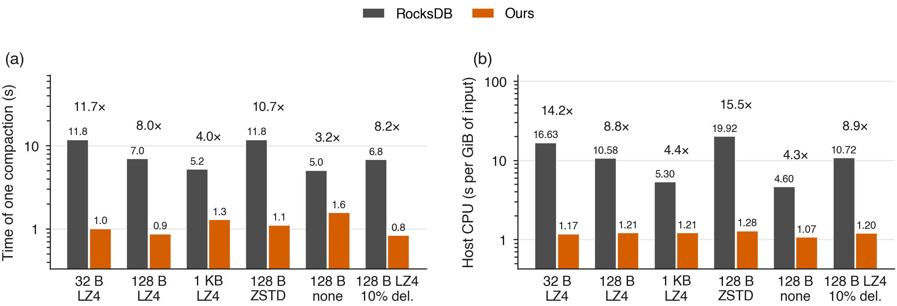

| Workload | Time, RocksDB | Time, ours | Faster | CPU-s per GiB, RocksDB | CPU-s per GiB, ours | Less CPU |
|---|---|---|---|---|---|---|
| 32 B values, LZ4 | 11.77 s | 1.01 s | **11.7×** | 16.6 | 1.17 | **14.2×** |
| 128 B values, LZ4 | 6.96 s | 0.87 s | **8.0×** | 10.6 | 1.21 | **8.8×** |
| 128 B values, ZSTD | 11.81 s | 1.11 s | **10.7×** | 19.9 | 1.28 | **15.5×** |
| 128 B values, LZ4, 10% deletes | 6.80 s | 0.83 s | 8.2× | 10.7 | 1.20 | 8.9× |
| 1 KB values, LZ4 | 5.18 s | 1.29 s | 4.0× | 5.3 | 1.21 | 4.4× |
| 128 B values, no compression | 5.05 s | 1.57 s | 3.2× | 4.6 | 1.07 | 4.3× |

Our cost stays near 1.2 CPU-seconds per GiB in every case. RocksDB's cost depends on the
data:

- it is highest with small values, where it has more keys to handle per byte;
- it is highest with ZSTD, the most expensive codec;
- with large values or no compression it is already cheap, so the gain is smaller.

## 2. One GPU replaces 15–18 CPU cores

*Setup:* eight compactions at once on 8 cores (2.5–2.6 GiB of input).

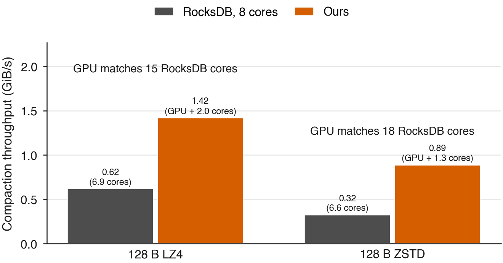

- **The GPU's rate:** 1.42 GiB/s with LZ4 and 0.89 GiB/s with ZSTD, using 2.0 and 1.3
  CPU cores.
- **One RocksDB core's rate:** 0.094 and 0.050 GiB/s.
- **So one GPU does the work of 15 (LZ4) and 18 (ZSTD) CPU cores.**

## 3. The whole database

**The whole database handles 1.5 to 1.8× more writes and uses 1.8 to 2.2× less CPU per
write.**

*Setup:* 50 million keys with 128-byte values, writes in batches of 100. Two minutes of
warm-up, then five minutes measured. Median of 5 runs.

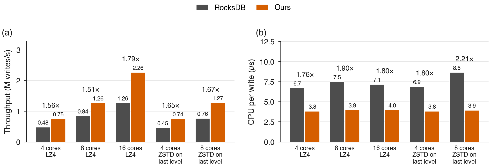

| Compression | Cores | Writes/s, RocksDB | Writes/s, ours | More writes | CPU per write, RocksDB | CPU per write, ours | Less CPU |
|---|---|---|---|---|---|---|---|
| LZ4 | 4 | 480k | 748k | **1.56×** | 6.7 µs | 3.8 µs | 1.76× |
| LZ4 | 8 | 837k | 1,260k | **1.51×** | 7.5 µs | 3.9 µs | 1.90× |
| LZ4 | 16 | 1,262k | 2,260k | **1.79×** | 7.1 µs | 4.0 µs | 1.80× |
| LZ4, ZSTD on the last level | 4 | 452k | 745k | **1.65×** | 6.9 µs | 3.8 µs | 1.80× |
| LZ4, ZSTD on the last level | 8 | 759k | 1,268k | **1.67×** | 8.6 µs | 3.9 µs | 2.21× |

Where the CPU goes, per write:

| | RocksDB | Ours |
|---|---|---|
| Compaction | 3.5–5.5 µs | 0.8 µs |
| Flushing memory to files | 1.0 µs | 0.7 µs |
| Accepting the write | 2.3 µs | 2.3 µs |

- RocksDB had to slow writers down for up to 6% of the time; ours never did.
- With 16 cores, 99.9% of writes finished within 9 ms with ours, against 210 ms with
  RocksDB.

**How many cores are busy?** The figure below uses whole-process CPU time over the
measurement window, averaged over the five runs. At 8 cores, RocksDB uses 7.44 cores and
ours 5.65; at 16, they use 10.48 and 10.01 respectively, while ours completes more writes.
The role counters miss some short-lived threads, so their difference from process CPU
is shown as unattributed. The outline is unused process core budget, not machine idle time.
The earlier per-role CPU accounting and this process-level total are distinct measures.

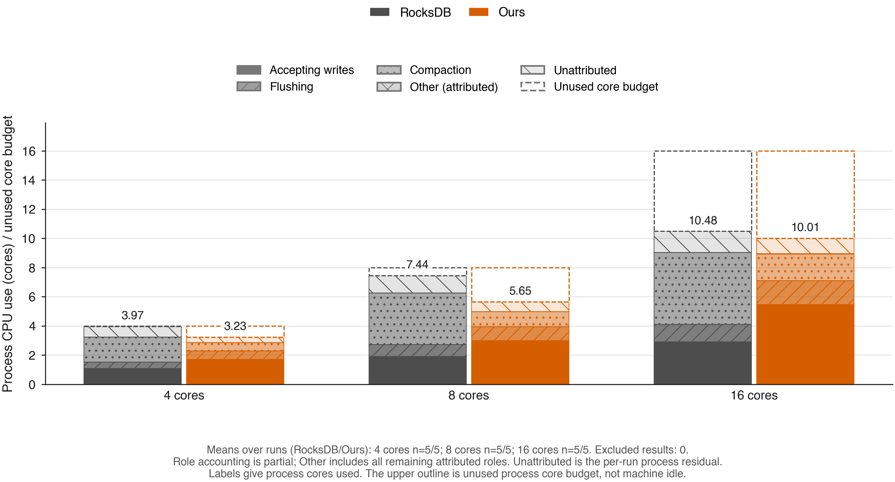

**Remaining write-path bottleneck.** Separate instrumented runs at 8 cores used 30 s of
warm-up and a 60 s measured window; both verified all 50 M keys. Mean sampled timings
per batch of 100 writes were:

| Sampled wall time per batch | RocksDB | Ours |
|---|---|---|
| Whole write call | 1.833 ms | 1.190 ms |
| Write-thread queue wait | 1.562 ms | 0.997 ms |
| Memtable insertion | 0.167 ms | 0.173 ms |

These timers overlap and are not an additive CPU breakdown. CPU sampling found memtable
skip-list traversal to be a large remaining hotspot with offload. Off-CPU tracing was
unavailable, and some library stack frames could not be decoded; the raw profiles are
retained on the host. Instrumentation affects performance, so these runs explain the
write path rather than replace the throughput results above. Summaries and commands:
[publication/data/profiles/phase-c/](data/profiles/phase-c/).

## 4. Write latency at a fixed load

**The slowest writes finish 1.75 to 9.6× sooner at p99.9, and the gap grows as the database
gets busier.**

*Setup:* writes arrive on a fixed schedule, and latency counts from when each write was
due, so a slow-down cannot hide. 8 cores, 3 minutes measured, 5 runs per point.

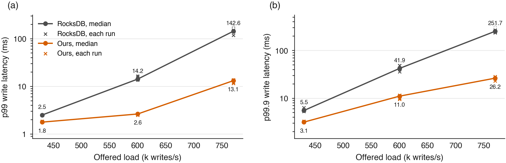

| Load | p99, RocksDB | p99, ours | Lower | p99.9, RocksDB | p99.9, ours | Lower |
|---|---|---|---|---|---|---|
| 430k writes/s (50% of RocksDB's maximum) | 2.5 ms | 1.8 ms | 1.4× | 5.5 ms | 3.2 ms | 1.75× |
| 600k (70%) | 14.2 ms | 2.6 ms | 5.4× | 41.9 ms | 11.0 ms | 3.8× |
| 770k (90%) | 142.6 ms | 13.1 ms | 10.9× | 251.7 ms | 26.2 ms | 9.6× |

The closer the database runs to its limit, the more compaction gets in the way of RocksDB's
writes, and the bigger the gap.

## 5. Reads

**Moving compaction does not hurt reads.** Read-heavy work is unchanged, and where
compaction is busy, reads get faster.

*Setup:* YCSB, a standard key-value benchmark, on 4 cores. Median of 3 runs. The Bloom
filters are built on the GPU and checked by 200,000 point lookups after every compaction.

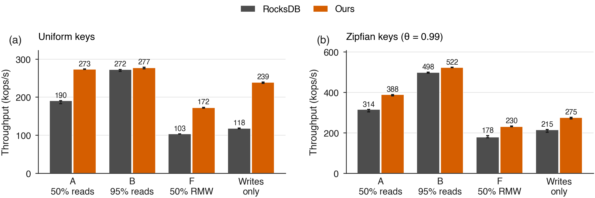

| Workload | Ops/s, RocksDB | Ops/s, ours | More ops | p99 read, RocksDB | p99 read, ours |
|---|---|---|---|---|---|
| B, read-heavy (95% reads), uniform | 272k | 277k | 1.02× | 0.025 ms | 0.025 ms |
| B, read-heavy, Zipfian | 498k | 522k | 1.05× | 0.019 ms | 0.018 ms |
| A, half reads, uniform | 190k | 273k | 1.44× | 0.029 ms | 0.027 ms |
| A, half reads, Zipfian | 314k | 388k | 1.24× | 0.022 ms | 0.020 ms |
| F, read-modify-write, uniform | 103k | 172k | 1.67× | 0.147 ms | 0.074 ms |
| F, read-modify-write, Zipfian | 178k | 230k | 1.31× | 0.090 ms | 0.051 ms |

- **Read-heavy work is unchanged:** within 5% on throughput and equal on read latency. This
  was registered in advance as a no-harm check.
- **Read latency improves where compaction is busy.** With read-modify-write it halves,
  because RocksDB's reads no longer compete with compaction for the same cores.

**Cheap compaction buys a read-friendlier database.** Reads get faster if the database keeps
fewer, more tightly merged levels, but that costs more compaction, which is why RocksDB does
not do it by default. On the GPU it is affordable (4 cores, median of 3 runs):

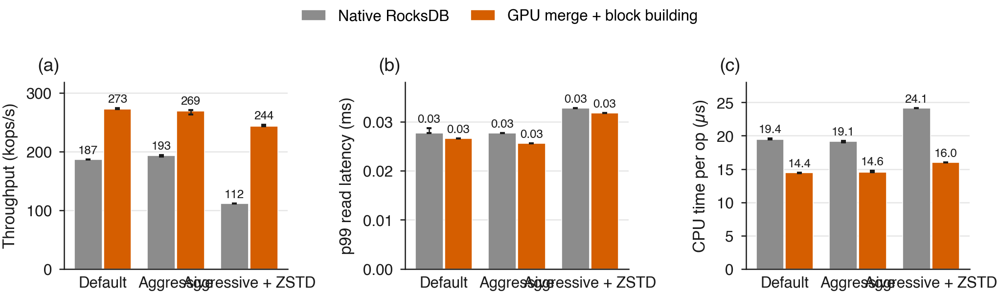

| Settings | Ops/s, RocksDB | Ops/s, ours | More ops | p99 read, RocksDB | p99 read, ours |
|---|---|---|---|---|---|
| Default | 187k | 273k | 1.46× | 0.028 ms | 0.027 ms |
| Read-optimised (L0 trigger 2, level multiplier 6) | 193k | 269k | 1.39× | 0.028 ms | 0.026 ms |
| Read-optimised, ZSTD | 112k | 244k | 2.18× | 0.033 ms | 0.032 ms |

## 6. A machine shared with other work

**When other programs compete for the same cores, the gain grows: 2.17× with 40% of each
core taken, 2.48× with 80%.**

*Setup:* benchmarks usually get the whole machine; real databases do not. Here a separate
process burns a fixed share of every core the database is pinned to. 4 cores, median of 3
runs.

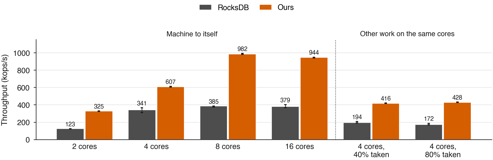

| Other work | RocksDB | Ours | More writes | RocksDB stalled | Ours stalled |
|---|---|---|---|---|---|
| 40% of each core | 194k writes/s | 416k | **2.17×** | 6% | 0% |
| 80% of each core | 172k | 428k | **2.48×** | 10% | 2% |

- **The busier the machine, the more the offload is worth.** On the same 4 cores with no
  competing process the gain is 1.80× (the `main` campaign, run separately), against 2.48×
  under heavy competition.
- **Ours barely notices.** Going from 40% to 80% stolen CPU costs RocksDB 11% of its
  throughput and ours nothing measurable, because its compaction is not on those cores.
- **This is the one place energy clearly favours the GPU:** 0.58–0.68× RocksDB's energy per
  operation here, against 0.69–1.19× in the `main`, `equal-cost`, `ycsb` and prior-design
  campaigns.

## 7. What it costs, and what it saves

**Tuned, every core count.** Both designs tuned for each core count by the same search;
median of 5 runs; RocksDB on 32 cores from 3 five-minute runs. Priced as below, with ours
including one L4 GPU. The README shows only the two comparisons where ours is cheaper.

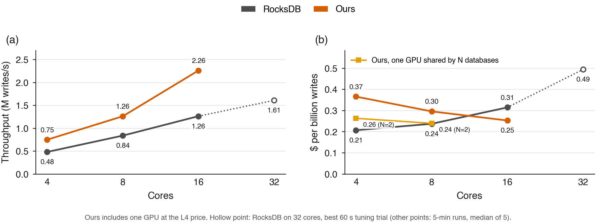

| Design | Cores | Writes/s | $/hour | $ per billion writes |
|---|---|---|---|---|
| RocksDB | 4 | 480k | 0.357 | 0.207 |
| RocksDB | 8 | 837k | 0.714 | 0.237 |
| RocksDB | 16 | 1,262k | 1.428 | 0.314 |
| RocksDB | 32 | 1,598k | 2.856 | 0.496 |
| Ours + L4 | 4 | 748k | 0.983 | 0.365 |
| Ours + L4 | 8 | 1,260k | 1.340 | 0.296 |
| Ours + L4 | 16 | 2,260k | 2.054 | 0.253 |

**Untuned.** The comparison below was run earlier with the same hand-chosen settings for
both designs.

**Eight cores with the GPU write as much as thirty-two cores without it, for less than
half the cost: $11,741 against $25,019 per node per year. If 667k writes/s is enough,
RocksDB on a few cores is cheaper.**

*Setup:* the `equal-cost` campaign, run before the tuning search of
[section 3](#3-the-whole-database), so neither design is tuned: both use the same
hand-chosen settings, including at most 4 parallel threads per compaction
(`max_subcompactions` = 4) at every core count. Batched LZ4 writes, 30 s warm-up then 2
minutes measured, median of 5 runs. Priced at AWS EC2 on-demand rates (Linux, us-east-1,
retrieved 2026-11-09 from [ec2instances.info](https://instances.vantage.sh/aws/ec2/c7i.xlarge),
which republishes the AWS Price List API): a physical core is $0.08925/h (c7i.xlarge, $0.1785/h
for 2 physical cores), and the GPU is an NVIDIA L4 at $0.6263/h (its instance less its two
cores). Every input is in [publication/prices.json](prices.json).

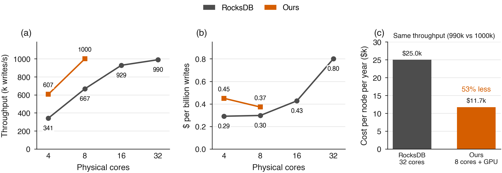

- **(a) Throughput.** RocksDB stops scaling past 16 cores (929k to 990k writes/s): it runs
  one level 0 to level 1 compaction at a time, split across at most 4 threads, so extra
  cores sit idle. Ours reaches 1,000k on 8 cores.
- **(b) Cost per write.** RocksDB on 4 or 8 cores is the cheapest per write, but tops out
  at 667k writes/s. Past that, ours on 8 cores is the cheapest way to go faster: $0.372 per
  billion, against $0.427 for RocksDB on 16 cores and $0.801 on 32.
- **(c) Same throughput, per year.** At full use and list price, 8 cores with a GPU cost
  $11,741 a year against $25,019 for 32 cores: **$13,278, or 53%, saved per node.**

**The matched comparison:**

| | RocksDB, 32 cores | Ours, 8 cores + L4 | |
|---|---|---|---|
| Writes/s | 990k | 1,000k | same |
| Cost per hour | $2.856 | $1.340 | **2.13× cheaper** |
| Cost per billion writes | $0.801 | $0.372 | **2.15× cheaper** |
| 99th-percentile write | 37.75 ms | 2.23 ms | **16.9× lower** |
| CPU per write | 9.69 µs | 5.91 µs | 1.64× less |

**Every configuration measured**, cheapest per write first:

| Design | Cores | Writes/s | $/hour | $ per billion writes |
|---|---|---|---|---|
| RocksDB | 4 | 341k | 0.357 | 0.291 |
| RocksDB | 8 | 667k | 0.714 | 0.297 |
| **Ours + L4** | **8** | **1,000k** | **1.340** | **0.372** |
| RocksDB | 16 | 929k | 1.428 | 0.427 |
| Ours + L4 | 4 | 607k | 0.983 | 0.450 |
| RocksDB | 32 | 990k | 2.856 | 0.801 |

**The GPU choice does not change the answer.** The measured card is an RTX A6000, which AWS
does not rent, so the figures price the cheapest current NVIDIA GPU instance. Dearer cards
still pay:

| GPU priced | $/hour total | $ per billion | Cheaper than RocksDB on 32 cores | Saved per node per year |
|---|---|---|---|---|
| L4, 24 GiB ([g6.xlarge](https://instances.vantage.sh/aws/ec2/g6.xlarge)) | 1.340 | 0.372 | **2.15×** | $13,278 |
| A10G, 24 GiB ([g5.xlarge](https://instances.vantage.sh/aws/ec2/g5.xlarge)) | 1.542 | 0.428 | 1.87× | $11,515 |
| L40S, 48 GiB ([g6e.xlarge](https://instances.vantage.sh/aws/ec2/g6e.xlarge)) | 2.397 | 0.666 | 1.20× | $4,025 |

The GPU would have to cost **$2.17/hour** before the advantage disappears, more than any of
these cards.

**When it does not pay.** If 667k writes/s or less is enough, RocksDB on 4 to 8 cores is
the cheapest choice measured ($0.291 per billion on 4 cores). The GPU pays once the target
is beyond what RocksDB reaches by adding cores. On a SATA SSD, where the disk saturates for
both designs, it does not pay at all ([section 8](#8-real-world-workloads-and-a-real-disk)).

**New tuned comparison, pending clean confirmation.** Three five-minute runs on 12 cores
with the GPU reached a median 1.785M writes/s. Tuned RocksDB on 32 cores reached 1.598M
with its original trigger and 1.407M with trigger 8, so the stronger 1.598M result is the
comparison. Every run verified all 50 M keys. Under the same CPU/GPU pricing model,
12 cores plus a GPU cost $1.697/h against $2.856/h, about 41% less while exceeding that
throughput target. Some 12-core runs overlapped a build or smoke test on another NUMA
node, so this is not yet a final H30 result. These are modeled resource costs applied to
lab hardware, not measured AWS performance or a complete cloud bill.
The comparison covers the tested configurations, not every possible core count or a
globally cheapest deployment.

## 8. Real-world workloads and a real disk

**Write-heavy workloads modelled on real RocksDB users run 1.4 to 1.8× faster; read-heavy
ones gain little. On a SATA SSD the disk becomes the limit, and only the CPU saving
remains.**

*Setup:* workloads modelled on real RocksDB users ([docs/workloads.md](../docs/workloads.md)),
and the same database on a SATA SSD. Median of 3 runs.

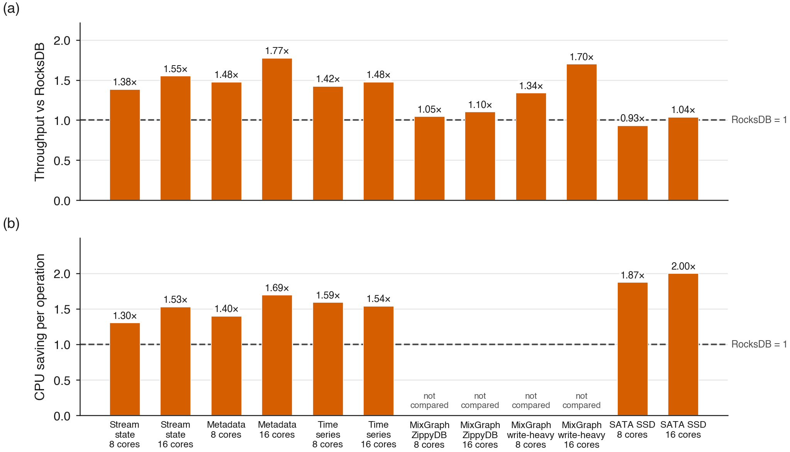

| Workload | 8 cores: more ops | 8 cores: less CPU | 16 cores: more ops | 16 cores: less CPU |
|---|---|---|---|---|
| Stream-processing state (as in Flink, Kafka Streams) | 1.38× | 1.30× | 1.55× | 1.53× |
| Storage metadata (as in Ceph, TiKV) | 1.48× | 1.40× | 1.77× | 1.69× |
| Time series, with old data deleted | 1.42× | 1.59× | 1.48× | 1.54× |
| Meta's ZippyDB model (85% reads) | 1.05× | not compared | 1.10× | not compared |
| Meta's ZippyDB model, write-heavy (50% writes) | 1.34× | not compared | 1.70× | not compared |
| SATA SSD (disk 100% busy for both) | 0.93× | 1.87× | 1.04× | 2.00× |

- **Meta's models** come from Meta's published study of its RocksDB workloads (FAST'20).
  They run in RocksDB's own `db_bench` with our compaction plugged in. Its clients keep
  every core busy in both designs, so only throughput is compared.
- **Who gains most:** gains follow how much of the work is writing; read-heavy work gains
  little.
- **On the SSD:** the disk sets the speed for both designs. Ours still halves the CPU,
  and with 16 cores 99.9% of writes finished within 84 ms against 336 ms.

**On NVMe.** These runs use a server with one 10-core Xeon Silver 4210R, an NVIDIA RTX PRO
6000 Blackwell and a 477 GB NVMe drive.
Both designs were tuned on this machine by the same registered search, at 8 cores (the
machine has 10). Batched writes, LZ4, 50 million keys, two minutes of warm-up then five
measured, every key verified. Median of 3 runs, paired 95% bootstrap intervals.

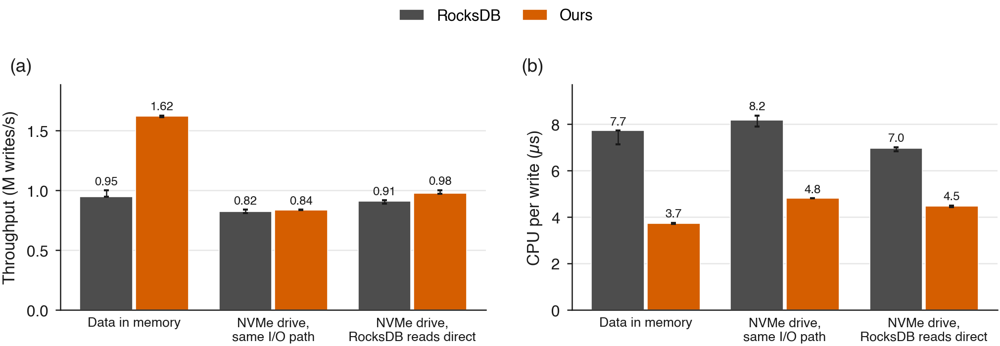

| Same machine, 8 cores | RocksDB | Ours | |
|---|---|---|---|
| **Data in memory:** writes/s | 0.948M | 1.620M | **1.70×** [1.62, 1.72] |
| **Data in memory:** CPU per write | 7.73 µs | 3.72 µs | **2.06× less** [1.91, 2.08] |
| **NVMe drive, same I/O path:** writes/s | 0.822M | 1.315M | **1.60×** |
| **NVMe drive, same I/O path:** CPU per write | 8.19 µs | 4.81 µs | **1.70× less** [1.64, 1.74] |

The NVMe rows use the same I/O path for both designs (reads and writes through the page
cache).

- **Throughput on the NVMe drive.** With data in memory, ours gains 1.70×. On the NVMe
  drive with the same I/O path, ours gains 1.60× in writes/s (an independent test by the
  author; the 0.822M RocksDB figure is from the registered runs above). In an earlier run
  where RocksDB read compaction input directly from the drive, ours gained only 1.07×
  (0.909M against 0.975M writes/s), and both designs reached about the drive's measured
  limit (`fio`, same read/write mix: 922 MB/s at RocksDB's mix, 741 MB/s at ours).
- **CPU saving on NVMe:** 1.70× less CPU per write with the
  same I/O path, and 1.55× (6.96 against 4.48 µs) when RocksDB read directly from the
  drive in the earlier configuration.
- **Costs on the drive.** Ours writes more bytes per byte of user data: write
  amplification 5.5 against 4.0 with the same I/O path (3.8 against 3.2 with direct reads).
  Compaction scheduling is a candidate explanation, not an isolated cause; the trigger
  experiments below change level sizing too. Its 99.9th-percentile write latency was
  54.5 against 52.4 ms in the direct-read run.
- **Correct on this hardware:** every key was verified in every run, and a separate
  single-compaction check matched RocksDB in all 16 repetitions with no CPU fallback.

**What reached the drive in the archived N6 runs.** These device measurements belong to
the registered 0.822M versus 0.838M writes/s campaign, not the independent 1.315M/s run
reported above. The figure separates bandwidth, IOPS and device busy time. The top row
shows block 0; the bottom row shows medians of the three per-run means. Samples are
aligned to each recorded measurement window at approximately one-second resolution.

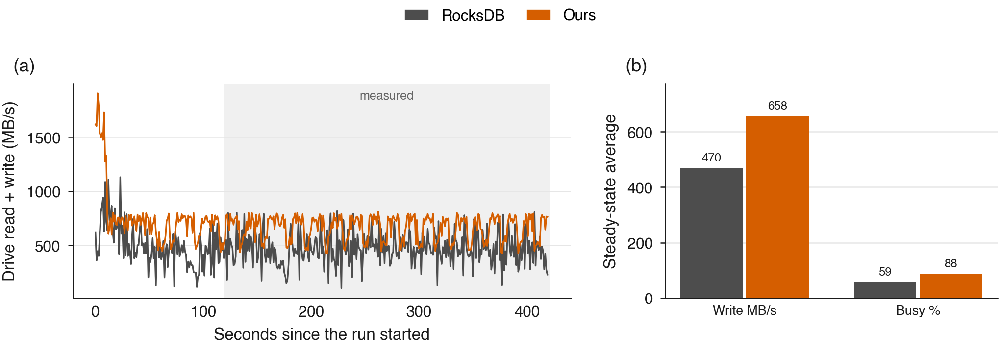

RocksDB writes about 471 MiB/s at 3,928 write IOPS and 59% device busy time; ours writes
656 MiB/s at 5,339 write IOPS and 88% busy time. Physical reads are almost zero because
the working set is cached. These data do not establish that both designs saturate the
drive, and the earlier mixed-read/write fio ceiling is not a matching limit for this run.

**NVMe with less CPU or different compaction settings (H31).** Two runs per design and
cell, 60 s warm-up plus 180 s measured, buffered I/O for both and WAL off. All 12 runs
verified 50 M keys with no GPU merge fallbacks. Four-core settings are scaled from the
8-core tuning, not separately tuned. ZSTD is enabled only on the last level; the starting
database was preloaded with LZ4, so these are short-run results, not a steady-state claim.

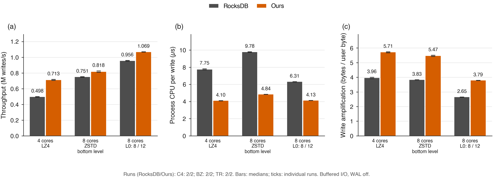

| Configuration | Writes/s, RocksDB / ours | More writes | CPU µs/write, RocksDB / ours | Write amplification, RocksDB / ours |
|---|---|---|---|---|
| 4 cores, LZ4 | 498k / 713k | 1.43× | 7.75 / 4.10 | 3.96 / 5.71 |
| 8 cores, ZSTD on last level | 751k / 818k | 1.09× | 9.78 / 4.84 | 3.83 / 5.47 |
| 8 cores, L0 trigger 8 for RocksDB, 12 for ours | 956k / 1,069k | 1.12× | 6.31 / 4.13 | 2.65 / 3.79 |

The throughput gain appears with a smaller CPU budget on this NVMe device. Raising the
trigger reduces writing for both designs; ours still writes more. These tests change the
L0 trigger and level-size target together, so they do not isolate a single scheduling cause.

**Fixed-rate NVMe latency (N5).** Both designs receive the same offered rate, and latency
includes time waiting behind the schedule. Medians of two runs per design and rate,
60 s warm-up plus 180 s measured; all 12 runs verified every key.

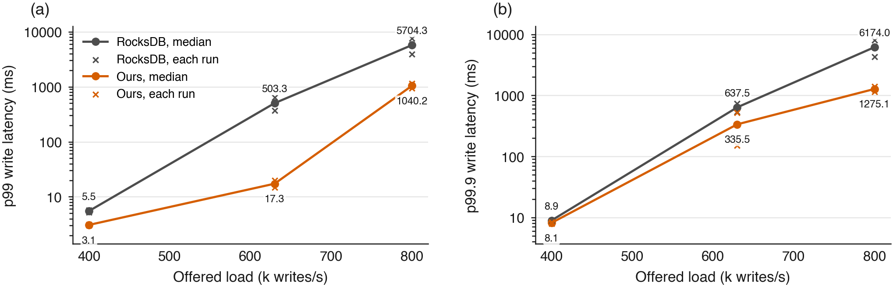

| Offered writes/s | p99 ms, RocksDB / ours | p99.9 ms, RocksDB / ours | CPU µs/write, RocksDB / ours |
|---|---|---|---|
| 400k | 5.51 / 3.08 | 8.91 / 8.13 | 12.6 / 7.54 |
| 630k | 503 / 17.3 | 638 / 336 | 9.65 / 5.97 |
| 800k | 5,704 / 1,040 | 6,174 / 1,275 | 8.27 / 5.04 |

Both designs reach approximately the offered rates, but the multi-second tails at 800k
show that matching average throughput is not enough to meet a latency target.

Raw data, iostat samples and the drive measurements are in
[publication/data/malphite-nvme/](data/malphite-nvme/).

## 9. Compared with earlier GPU and FPGA designs

**In production RocksDB with compression on, ours uses 2.0 to 6.5× less compaction CPU than
earlier GPU and FPGA designs and reaches up to 1.99× their writes, because it also moves
compression to the GPU.**

*Setup:* earlier GPU and FPGA compaction systems run on other databases and hardware, so
their published numbers cannot be compared with ours directly. We rebuilt each design
inside RocksDB 11.8, on this machine, with RocksDB's normal LZ4 or ZSTD compression:

- **Their GPU steps** use our GPU code.
- **Their CPU steps** use RocksDB's own code, including compression, which none of them
  moves to the GPU.
- **Benefit of the doubt:** where the choice matters, the rebuild favours the earlier
  design (for example, it decompresses on 4 parallel threads).
- **Same checks:** every design passes the same exact check against RocksDB.

The designs are listed in [How it works](../README.md#how-it-works).

**One compaction** (median of 3 runs):

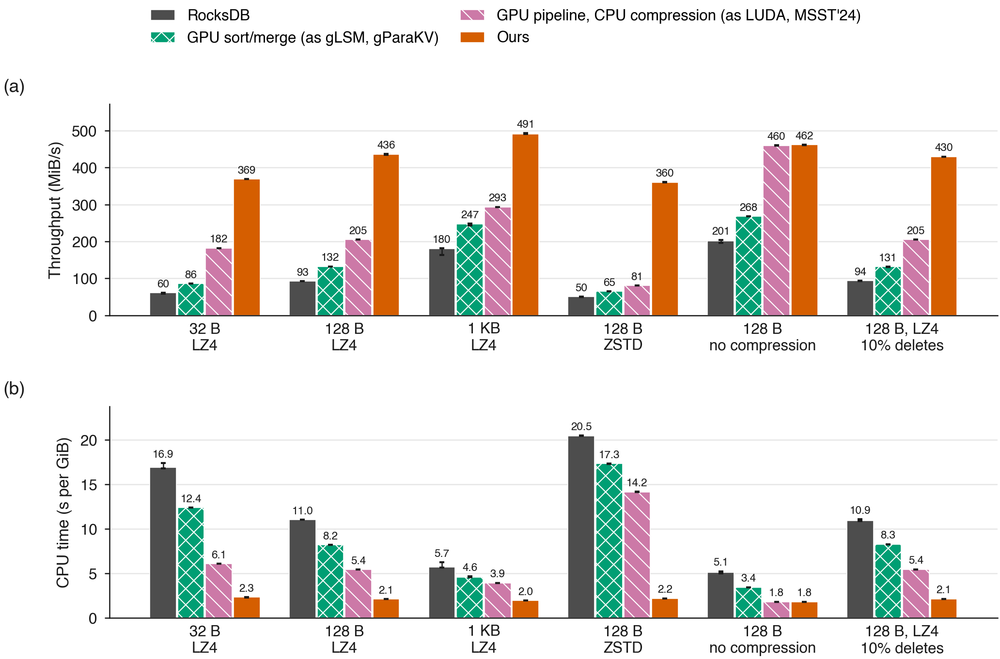

| Workload | CPU-s per GiB, best earlier design | CPU-s per GiB, ours | Less CPU |
|---|---|---|---|
| 32 B values, LZ4 | 6.1 | 2.3 | **2.7×** |
| 128 B values, LZ4 | 5.4 | 2.1 | **2.6×** |
| 128 B values, ZSTD | 14.2 | 2.2 | **6.5×** |
| 1 KB values, LZ4 | 3.9 | 2.0 | 2.0× |

**The whole database** (4 cores; each earlier design run with RocksDB's tuned settings and
with ours, best shown; median of 3 runs, every run verified):

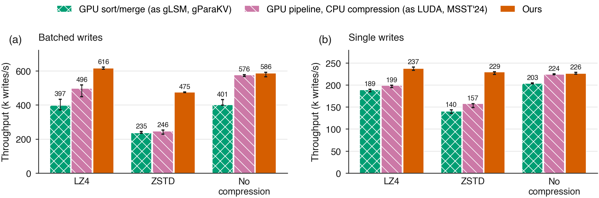

| Writes | Compression | Best earlier design | Ours | Ours vs best earlier |
|---|---|---|---|---|
| Batches of 100 | LZ4 | 592k writes/s | 756k | **1.28×**, 1.56× less CPU per write |
| Batches of 100 | ZSTD | 293k | 583k | **1.99×** |
| One at a time | LZ4 | 199k | 237k | **1.19×** |
| One at a time | ZSTD | 157k | 229k | **1.46×** |

The batched LZ4 results are the tuned rerun. The batched ZSTD results, in the table and
the figure, are estimates: each design's default-settings ZSTD run scaled by its measured
LZ4 gain from tuning (1.19× for the pipeline design, 1.23× for ours); the tuned ZSTD run
will replace them. One-at-a-time writes, the sort/merge design and the runs without
compression use default settings for every design.

Compression is most of what the earlier designs leave on the CPU, so the gap is widest
with ZSTD. Our advantage depends on compression being on (see
[What this does not show](#11-what-this-does-not-show)).

Runs of gParaKV's and LUDA's own code are not in production RocksDB (both are built on
LevelDB and run without compression), so they are reported in
[publication/RELATED-WORK.md](RELATED-WORK.md) rather than here.

## 10. Compaction on another machine over RDMA

**Sending each compaction to a GPU in another machine over RDMA makes it 4.0 to 6.5× faster
than RocksDB on the database machine, which spends 5.6 to 11× less CPU on it. Run this way,
the whole database takes 1.75× more writes with 2.04× less CPU per write.**

*Setup:* the database runs on one machine (pyke, 96 cores) and sends each compaction over a
100 Gb/s RDMA link to a GPU server on another (malphite, RTX PRO 6000 Blackwell). The link
measured 92 Gb/s, the same as the network card vendor's own test. Moving data over our RDMA
transport costs the sending machine about 0.012 CPU-seconds per GiB (measured on the
earlier testbed below). Median of 3 runs; every compaction matched
RocksDB exactly. How it works: [docs/remote-compaction.md](../docs/remote-compaction.md).

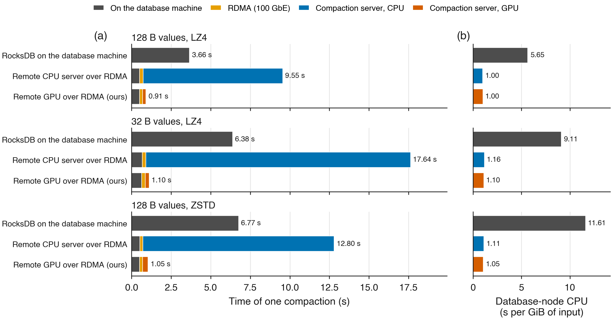

| Workload | RocksDB on the database machine | Remote GPU over RDMA | Faster | Database machine's CPU per GiB, RocksDB → remote GPU | Less CPU |
|---|---|---|---|---|---|
| 128 B values, LZ4 | 3.66 s | **0.91 s** | **4.0×** | 5.65 → 1.00 s | **5.6×** |
| 32 B values, LZ4 | 6.38 s | **1.10 s** | **5.8×** | 9.11 → 1.10 s | **8.3×** |
| 128 B values, ZSTD | 6.77 s | **1.05 s** | **6.5×** | 11.61 → 1.05 s | **11×** |

- **Where the time goes:** about 0.5–0.6 s on the database machine (reading the input
  files and writing the new ones), 0.2 s on the network, and 0.2–0.35 s on the GPU.
- **A remote CPU is not enough.** Sent to malphite's 10-core CPU over the same link, the
  same compactions take 9.6 to 17.6 s, slower than RocksDB locally, because the server's
  merge is a simple reference version. The database machine saves the same CPU either way.

**The whole database.** Every compaction is sent to the GPU server. Same settings for both
(50 M keys, 4 writer threads, 4 background jobs, 4 subcompactions, batches of 100, WAL off,
30 s warm-up plus 120 s); median of 3 runs in shuffled order. All 50 million keys and
values were correct after every run, and no compaction fell back to the database machine.

| | RocksDB on pyke | Remote GPU over RDMA | |
|---|---:|---:|---:|
| Writes/s | 459k | **802k** | **1.75×** |
| Database machine's CPU per write | 8.23 µs | **4.04 µs** | **2.04× less** |
| Database machine's compaction CPU | 421 s | **143 s** | **2.95× less** |
| Including the GPU server's CPU (51 s) | 8.23 µs | **4.46 µs** | **1.84× less** |

**An earlier testbed** had no machine with both a GPU and an RDMA card, so compactions went
over RDMA to a relay machine and then over 1 Gb/s Ethernet to the GPU. The database
machine saved the same CPU (6.4 to 10.6× less than RocksDB), but the slow hop made each
compaction take 11.5 to 13.6 s and held the whole database to 210k writes/s. The direct
link removes that hop. Those results, with a figure of both testbeds, are in
[docs/remote-compaction.md](../docs/remote-compaction.md).

**Remote CPU servers and replication** (earlier testbed, details in
[docs/remote-compaction.md](../docs/remote-compaction.md)):

- **A remote CPU compaction server** cuts the database machine's compaction CPU 2.6 to
  7.6× over six workloads, but each compaction takes about twice as long as in RocksDB,
  because the server's merge is a simple reference version.
- **Compacting once for 2 backups** and shipping the files cuts the whole cluster's CPU
  per write 3.4× for batched writes (8.4 against 28.5 µs, at the same throughput), for
  about 3× more network traffic. With single writes it cuts CPU 1.8× but is 25% slower,
  because every log write is shipped to the backups inside RocksDB's write path, one
  write group at a time.

## 11. What this does not show

- **Storage-bound systems.** Most results put the data in memory (`/dev/shm`). On a SATA
  SSD, where the drive is the limit, throughput is equal (0.93× on 8 cores, 1.04× on 16).
  On NVMe, the gain was 1.60× in writes/s.
  The CPU saving remains (1.70 to 2.0×).
- **Costs.** Higher write amplification, including 3.79 against 2.65 in H31's trigger
  comparison (section 8); 1 GiB of
  pinned host memory per GPU engine plus GPU memory; and four databases sharing one GPU
  kept 77.1% of their throughput at 4 cores each (62% at 8 cores each, under MPS), below our
  registered 80% target.
- **Compaction without compression.** Our advantage over earlier designs comes from moving
  compression to the GPU. With compression off, which production RocksDB rarely runs,
  ours and the best earlier design use the same CPU.
- **Energy.** Energy is recorded per trial, but no claim is made. Whole-run energy per
  operation ranges from 0.69× to 1.19× RocksDB's across the `main`, `equal-cost`, `ycsb`
  and prior-design campaigns, depending on codec and write pattern, and the measurement
  window ends before RocksDB's 68 s of catch-up compaction, which favours RocksDB. A fair
  figure needs energy integrated to the end of catch-up.
- **Remote compaction, one pair of machines.** The whole database over direct RDMA was run
  on one pair of machines with one setting (4 cores' worth of threads, LZ4). Sharing one
  remote GPU among several databases, and RDMA against TCP on the direct link, are
  untested.
- **Key-value separation.** Designs that keep values outside the sorted files, such as
  gParaKV, move far fewer bytes through compaction. They are not part of production
  RocksDB's default path, and combining value separation with our offload is untested.
- **Read-heavy work.** The gain tracks how much compaction a workload creates. Meta's
  read-heavy model (85% reads) gains 1.05×, against 1.70× for its write-heavy variant.
- **Hardware coverage.** The primary experiments use an RTX A6000; NVMe and direct-RDMA
  follow-ups also use an RTX PRO 6000 Blackwell. The servers differ in CPU and storage,
  so this is not a controlled GPU-only comparison. Other GPU classes and RocksDB versions
  remain untested.
- **Registered thresholds we missed.** Three preregistered predictions did not hold, and
  the numbers above are the measured outcome rather than the registered one. 99.9th
  percentile write latency at 430k writes/s was 1.75× lower against a registered 2.5×.
  Compact-once replication cut cluster CPU 1.8× for single writes against a registered 2×.
  Parallel broadcast replication did not change throughput at all. All three are recorded
  with their reasons in [publication/PREREGISTRATION.md](PREREGISTRATION.md).

## How we measured

- **Same tuning for the v3 comparisons:** RocksDB and ours each get the best settings from the same
  search over threads, background jobs and RocksDB options
  ([configs/system/tuned.json](../configs/system/tuned.json)). Untuned and inherited settings
  in other campaigns are identified in their setup paragraphs.
- **Protocols and amendments:** the main campaigns were registered before measurement.
  Later changes and their timing are recorded in [publication/PREREGISTRATION.md](PREREGISTRATION.md),
  including H31's local registration before launch and public commit after launch.
- **Fixed duration:** runs last a fixed time, and the order of runs is randomised.
- **Every problem recorded:** problems we found in our own measurements, and their fixes,
  are in [publication/AUDIT.md](AUDIT.md).
- **Where the numbers come from:** the main campaigns in
  [publication/data/v3/summary.md](data/v3/summary.md); the others in their
  own folders under [publication/data/](data/), linked from each section.

## Correctness

- **Single compactions:** every run compares every stored key version, and 200,000 point
  lookups (which use the GPU-built Bloom filters), against RocksDB. All match.
- **Whole database:** every run checks each read as it happens, and all keys and values
  at the end.
- **Edge cases:** tests cover snapshots, parallel compactions, uncompressed data, long
  keys, large values and deletes.
- **GPU code:** passes NVIDIA's `compute-sanitizer` memory, race and synchronisation checks
  with no errors.

