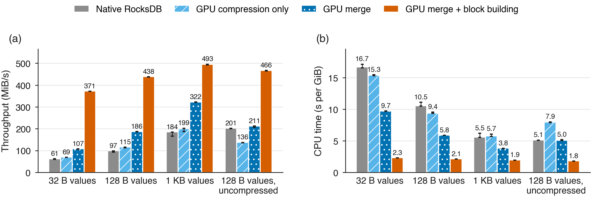

# GPU-offloaded RocksDB compaction: results

## Summary

We moved RocksDB 11.8 compaction onto an NVIDIA RTX A6000 in three steps and
measured each against a tuned native CPU baseline:

1. output compression and checksums only;
2. the input merge;
3. the merge plus building the output blocks.

Output is identical to native RocksDB in every run: every stored key version
and up to 200,000 point lookups match.

1. **Offloading the whole compaction pays; offloading pieces barely does.**
   On a single compaction:
   - compression and checksums only: at most 1.22× faster;
   - adding the input merge: 1.5–2.0× faster;
   - adding output block building: **2.3–6.1× faster, with 2.9–7.3× less
     CPU**.

   The gain is largest for small values, where per-key CPU work dominates.
2. **When compaction limits the database, the whole database gets faster.**
   With batched writes on 4 CPU cores, native RocksDB spends 71% of its CPU
   on compaction and stalls writers. Full offload raises throughput, counted
   to the end of all resulting compaction, from 349k to **602k ops/s
   (1.72×)**. It also cuts p99 write latency from 7.1 ms to **1.1 ms**, CPU
   per operation by 1.6×, and removes write stalls. With single writes,
   throughput rises 1.92× (121k to 232k ops/s).
3. **Short runs overstate native RocksDB.** Native RocksDB postpones
   compaction: after a 2.5-minute run it still needs 68–114 s to catch up.
   Throughput measured only during the run is 34–74% higher than throughput
   counted to the end of that catch-up. The GPU version catches up in 3–4 s.
   Comparisons must count deferred compaction.

The whole-database results are single runs. Energy has not yet been measured
through the end of catch-up compaction. Section 6 lists what remains.

## 1. System under test

| | |
|---|---|
| Host | Zyra (Rift cluster): 4 × Xeon Gold 5220 (72 cores, 144 threads), 192 GB RAM, NVIDIA RTX A6000 (48 GB) attached to NUMA node 0 |
| Storage | `/dev/shm` (tmpfs), so compaction is CPU-bound rather than I/O-bound |
| Software | RocksDB 11.8.1 (`abeebd96`) built with `-march=native` (hardware CRC32C), GCC 12.1, CUDA 12.3, nvCOMP 5.3.0.16 |
| Table format | Block-based, format version 6, CRC32C, 4 KiB blocks, LZ4, 10 bits/key Bloom filter |
| GPU settings | `LSM_DISABLE_GPU_INPUT=1`, `LSM_CUDA_SYNC=blocking`, `LSM_GPU_OUTPUT_MIN_BLOCK_BYTES=1024`, `LSM_MERGE_READ_THREADS=4` |

The designs compared ([docs/gpu-compaction.md](../docs/gpu-compaction.md)):

| Design | GPU does | CPU still does |
|---|---|---|
| Native RocksDB | nothing | everything |
| GPU compression only | LZ4 + CRC32C of output blocks | merge, garbage collection, block building |
| GPU merge | reading, decompression, parsing, sorting, dropping hidden versions; output compression | `CompactionIterator`, per-key block building |
| GPU merge + block building | all of the above, plus sequence zeroing, block cutting, key encoding, compression, checksums, filter hashes | file cuts, one index entry per block, filter construction, metadata, file writes |

## 2. Methods

**Isolated compaction (`lsm_compaction_bench`).** Each mode builds the same
database: a bottom level holding every key, then 8 overlapping L0 files of
random overwrites, each covering half the key space. One `CompactRange` merges
them into the bottom level in two jobs, reading 0.64–0.97 GiB. Workloads:

- 10 M keys with 32 B values;
- 4 M keys with 128 B values;
- 1 M keys with 1 KB values;
- 4 M keys with 128 B values and no compression.

Keys are 16 bytes. We measure wall time and whole-process CPU, so GPU helper
threads are counted. Each mode runs 4 times; repetition 0 includes one-time
GPU buffer allocation and is excluded, and we report the median of the other
3. After each run the benchmark compares a digest of every internal version
(key, sequence, type, value) and the results of up to 200,000 point lookups
against the first mode. Point lookups exercise the GPU-built Bloom filters.

**Whole database (`lsm_system_bench`).**
- **Data:** 50 M keys with 16-byte keys and 128-byte values, about 7 GB
  logical and 4.4 GB on disk. A verified golden copy is cloned for every run.
- **Placement:** RocksDB and its clients are confined to 4 physical cores on
  the GPU's NUMA node.
- **Load:** four closed-loop client threads (one per core) issue uniform
  random overwrites for 30 s of warm-up plus 120 s of measurement, either
  one put at a time with the write-ahead log on, or in batches of 100 puts
  with it off. The write-ahead log (WAL) is RocksDB's crash-recovery log:
  every write is appended to it before being acknowledged, so writes not
  yet in data files can be replayed after a crash. Disabling it, as bulk
  loads and replicated systems do, removes that per-write cost and makes
  compaction the dominant work.
- **Metric:** after the run the benchmark waits for all pending compaction
  and reports *ingest-and-compact throughput*: all operations divided by the
  time to issue them plus the time to finish the compaction they caused.
  CPU per operation covers the same interval.
- **Verification:** every key and value is checked after each run; reads are
  checked online.

**Fair tuning.** Each design is run with 2 and 4 background jobs (batched
writes), and reported at its best setting. Native RocksDB uses RocksDB's
default output verification settings (no `paranoid_file_checks`, no
`verify_compression`), the same as the GPU paths. Client threads are not
oversubscribed (see [AUDIT.md](AUDIT.md)).

## 3. Results

### 3.1 Single compactions



**Figure 1.** Isolated compaction. (a) Compaction throughput in MiB of input per second; (b) whole-process CPU time per GiB of input. Bars are medians of 3 warm runs; whiskers span min-max. 16-byte keys, 4 KiB blocks, LZ4 unless marked uncompressed.

| Workload | Native CPU s/GiB | Full offload CPU s/GiB | Speed-up | CPU reduction |
|---|---|---|---|---|
| 32 B values | 16.65 | 2.29 | 6.06× | 7.30× |
| 128 B values | 10.51 | 2.09 | 4.63× | 5.19× |
| 1 KB values | 5.55 | 1.94 | 2.70× | 2.89× |
| 128 B, no compression | 5.09 | 1.77 | 2.32× | 2.87× |

All designs: [data/summary.md](data/summary.md).

- **Small values benefit most.** Native CPU cost per GiB grows as values
  shrink, because most of the work is per key: comparing, garbage-collecting,
  encoding and hashing. Full offload costs about 2 CPU-seconds per GiB
  whatever the value size. What remains on the CPU is reading input files,
  writing output files, and one index entry and filter insertion per block.
- **Compression alone is a small part of the work.** Offloading only LZ4 and
  CRC32C cuts CPU by at most 14%, and costs more CPU than it saves when
  there is nothing to compress (0.94×).
- **Each stage adds a real gain.** Moving the merge doubles speed at most.
  Most of the gain comes from also building the output blocks, which removes
  RocksDB's per-key `CompactionIterator` and table-builder work.

### 3.2 Whole database, batched writes


**Figure 2.** Whole database with batched writes (100 puts per batch, WAL off) on 4 cores, 50 M keys with 128-byte values. (a) Throughput including the time to finish all resulting compaction; (b) compaction still pending when writes stop; (c) p99 write latency; (d) CPU time per operation. Background jobs: native 4, GPU compression only 2, GPU merge + block building 4. Single runs.

| Design | Bg jobs | Ops/s incl. catch-up | Catch-up | CPU/op | p99 write | Writers stalled |
|---|---|---|---|---|---|---|
| Native RocksDB | 4 | 349,389 | 68.5 s | 9.06 µs | 7.08 ms | 7% |
| GPU compression only | 2 | 162,752 | 111.8 s | 9.65 µs | 24.1 ms | 17% |
| GPU merge + block building | 4 | **602,465** | **3.4 s** | **5.59 µs** | **1.11 ms** | **0%** |

With 100 puts per batch and no write-ahead log, foreground work per put is
small, so compaction becomes most of the work. In the native run with 2
background jobs, compaction used 275 of 385 CPU-seconds (71%), and writers
were stalled 19% of the time. This is the regime where offload pays: full
offload keeps compaction caught up, so writers never stall.

GPU compression only was measured with 2 background jobs only. At that
setting it beat native (163k vs 124k ops/s); its 4-job setting was not run.

### 3.3 Deferred compaction and single writes


**Figure 3.** Throughput measured only while writes run (light) and including catch-up compaction (solid), for (a) single writes with the WAL on and (b) batched writes with the WAL off.

With single puts and the write-ahead log on, the GPU version looks only 13%
faster than native RocksDB during the run (237k vs 210k ops/s). Counted to
the end of catch-up, it is 1.92× slower (121k vs 232k ops/s): it left 114 s of
compaction for later, against 3.5 s for the GPU version. In the batched runs,
native RocksDB's run-only throughput is 34% above its end-to-end throughput.
The GPU version's differs by 2%. CPU per operation falls from 22.1 to
16.2 µs. Here client and write-path work, not compaction, is most of the CPU.

### 3.4 Energy (not yet conclusive)

The campaign integrates RAPL package and DRAM energy (all four sockets) and
GPU board power over the 120-second measurement window only:

| Batched writes, per operation | Host CPU + DRAM | GPU | Total |
|---|---|---|---|
| Native RocksDB (4 jobs) | 421 µJ | 63 µJ | 483 µJ |
| GPU merge + block building (4 jobs) | 327 µJ | 232 µJ | 559 µJ |

This comparison favours native RocksDB, whose 68 s of catch-up compaction
falls outside the window. Host energy is mostly the idle power of the three
unused sockets. A fair figure needs energy integrated to the end of catch-up;
until then, no energy claim is made.

## 4. Correctness

- **Isolated compactions:** in every run, every design's version digest and
  point-lookup digest equal native RocksDB's (`matches_reference` in
  [data/compaction/](data/compaction/)).
- **Whole database:** every run verified all 50 M keys and values after
  catch-up compaction ([data/database/](data/database/)).
- **Differential matrix** (CPU reference and GPU against native): with and
  without snapshots, with 4 subcompactions, uncompressed, with 1 KB and 5 KB
  values, with 24- and 200-byte keys, and with deletes. In the last case,
  jobs with deletes fall back correctly to the merge-only path. All runs
  matched. The GPU path also passed `compute-sanitizer` with no errors.
- **Test suite:** CTest (9 suites) passes on Zyra. The Python tests pass
  locally; on Zyra the two that draw plots fail only because `matplotlib` is
  not installed there.

## 5. Threats to validity

- **Single runs:** the whole-database results are one run per
  configuration; isolated compaction uses 3 repetitions. Five randomized
  repetitions are needed before reporting confidence intervals.
- **Unequal settings:** native single writes were run only with 2 background
  jobs, and GPU compression only only with 2 background jobs under batched
  writes.
- **One machine, memory-backed storage:** the results are from one host with
  data on tmpfs. On SSDs, I/O may limit compaction before CPU does, which
  would shrink the gains.
- **Synthetic data:** keys are uniformly random overwrites with 16-byte keys
  and synthetic values (half random, half repeating); there are no reads in
  the whole-database runs.
- **Incomplete coverage:**
  - jobs containing deletes run the merge-only path;
  - ZSTD is not offloaded;
  - in one run (batched, 2 background jobs), nvCOMP rejected some very large
    compaction jobs, which fell back to the CPU (56 jobs). That run was
    correct but slower and is not the reported best setting.
- **Energy:** see 3.4.

## 6. Next steps

1. Repeat each whole-database configuration 5 times in randomized order;
   add native single writes with 4 background jobs.
2. Integrate energy from the start of the run to the end of catch-up
   compaction.
3. Split nvCOMP compression of very large jobs into smaller batches to remove
   the CPU fallback.
4. Repeat on SATA/NVMe storage and with mixed read/write workloads.
5. Offload tombstone dropping, so jobs with deletes use the full path.

## 7. Earlier design: compression and checksums only

The project first offloaded only output compression and checksums, and
evaluated it with the gRPC harness (open-loop load, 122 trials). The full
analysis is in git history (commit `a97ae43`, `publication/RESULTS.md`).
Its conclusions still hold and agree with 3.1:

- compaction jobs were 16–21% faster;
- whole-process CPU did not fall (+3%);
- energy rose 17–27%;
- foreground latency and capacity were unchanged;
- offloading input decoding on its own made jobs 35–45% slower.

## 8. Reproducing

```sh
publication/compaction_sweep.sh artifacts/compaction            # section 3.1
LSM_BUILD_DIR=build/dev python3 publication/system_campaign.py artifacts/database \
  --golden /dev/shm/$USER/sys/golden --grid configs/system/batched-ingest.json   # 3.2-3.4
python3 publication/make_figures.py                              # figures and data/summary.md
```

See [docs/runbook.md](../docs/runbook.md) for the build and the golden
database.
