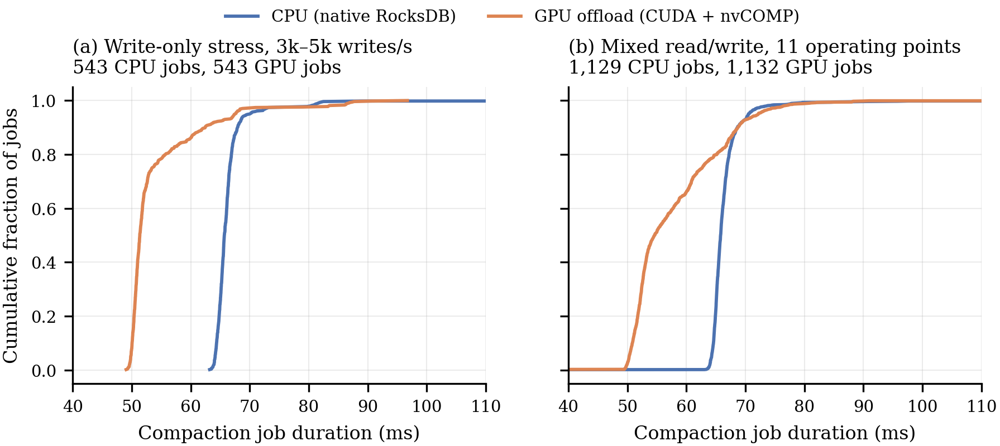
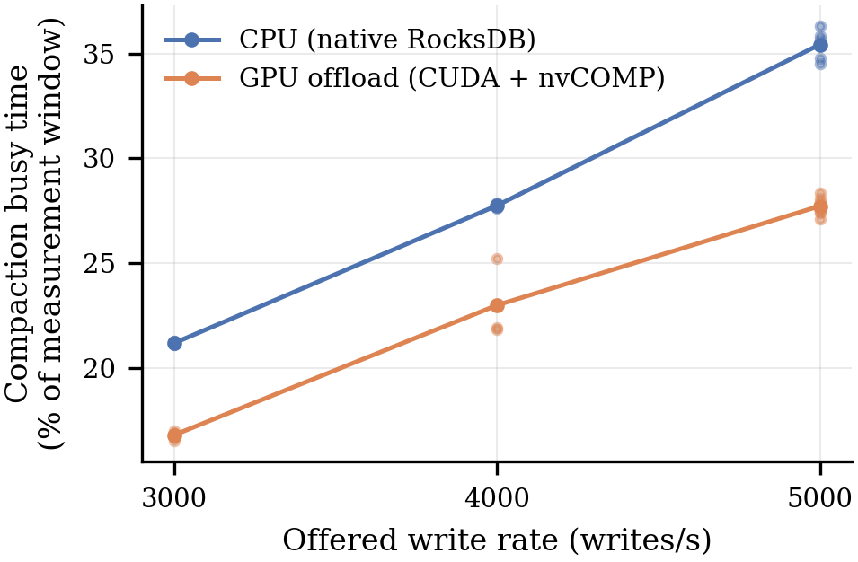
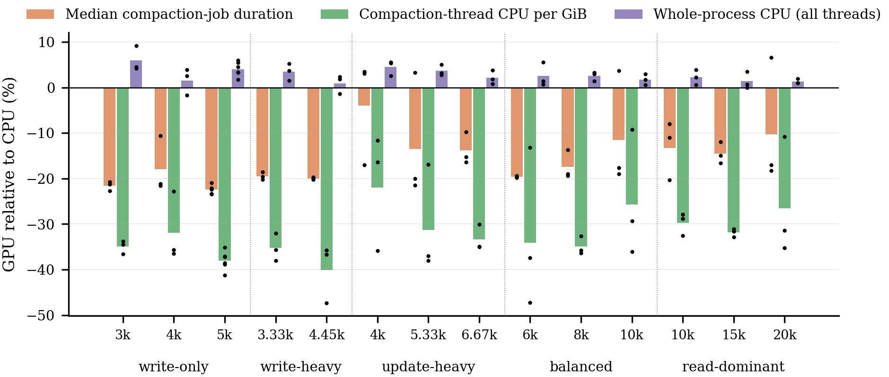
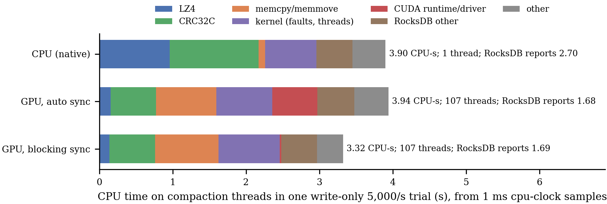
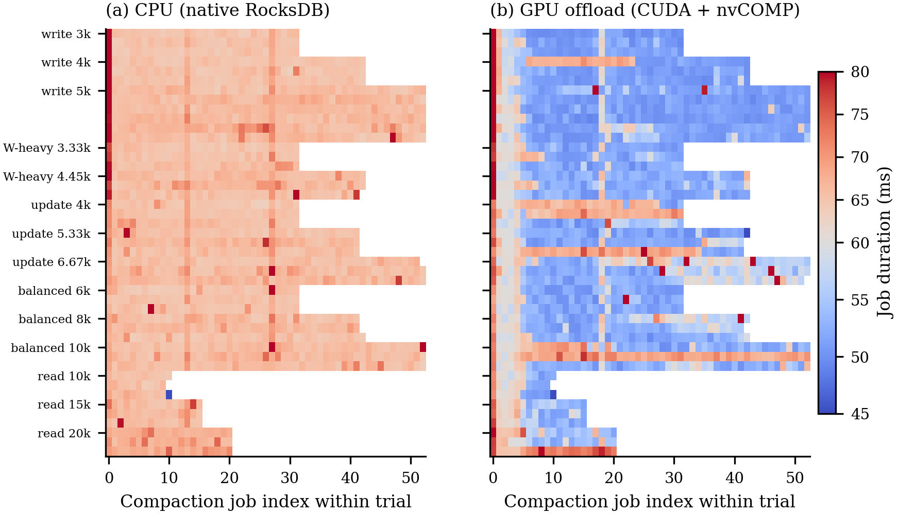
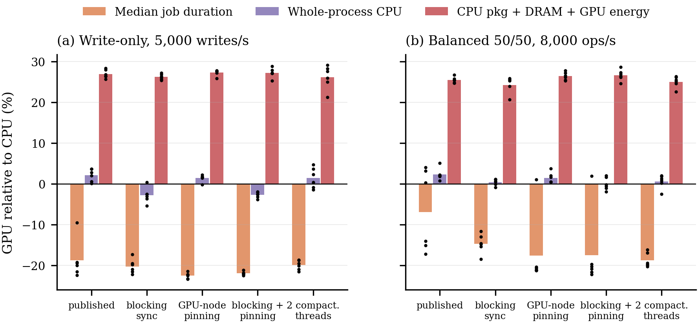
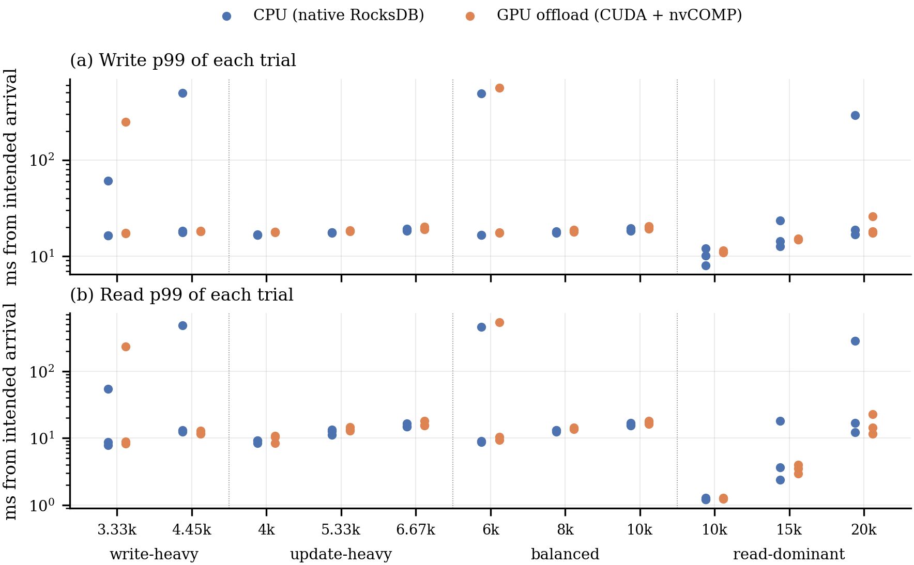

# Faster compactions, not cheaper ones: GPU offload of RocksDB compaction output

*Publication results package. Every number is regenerated by
[`analyze.py`](analyze.py) from the per-trial data in [`data/`](data/). The
audit of earlier claims is in [`AUDIT.md`](AUDIT.md).*

> **Status (2026-10-06).** Final. All campaigns, including the revision
> ablation and scale-up run on Zyra on 2026-10-06, are included.

## Summary

We offload the byte-level tail of RocksDB compaction (LZ4 compression and
CRC32C of each finished output data block) to an NVIDIA RTX A6000 via
CUDA/nvCOMP. All key, merge, snapshot, and file-layout logic stays on the CPU.
The primary evidence is 45 paired CPU-vs-GPU trials (1,672 CPU and 1,675 GPU
compaction jobs, five read/write mixes, 1k–5k writes/s). Every trial passed
full-payload and native-checksum verification.

1. **Compaction jobs get faster.** Across all 45 pairs, median job time fell by
   **16.3%** (95% CI 14.0–18.5%; GPU faster in 40/45 pairs). Treating each of the
   14 operating points as one observation gives −15.8% [−18.6, −12.9], GPU faster
   at 14/14 points (Wilcoxon p < 0.001).
2. **CPU is moved, not saved.** RocksDB's own counter says compaction CPU fell
   ~33%. Profiling shows this is an accounting artifact: the GPU path runs its
   output pipeline on ~107 short-lived helper threads that the counter does not
   see. Counting every compaction thread, CPU was **3.90 CPU-s natively vs
   3.94 CPU-s** with GPU offload under CUDA's default synchronization. Whole-process
   CPU rose 2.1% [1.3, 2.8] (GPU higher in 38/45 pairs).
3. **The overhead is in host plumbing, and only part of it is fixable by
   configuration.** The ~1.3 CPU-s of LZ4 and output-CRC work removed is replaced by:
   - staging copies (0.82 CPU-s);
   - kernel work for page faults and thread creation (0.76 CPU-s);
   - CUDA spin-waiting (0.62 CPU-s).

   In a 66-pair randomized ablation (§3.4), blocking synchronization lowered
   GPU whole-process CPU by 4.3% (write-only, 6/6 blocks). Combined with pinning
   `lsm_db` to the GPU's NUMA node, the GPU path then used **2.7% less**
   (write-only) and **0.0%** (balanced) whole-process CPU than native. That is
   parity, not a saving.
4. **Placement matters more than offload.** Pinning `lsm_db` to one NUMA node
   cut whole-process CPU by 8% (write-only) and 16% (balanced) for *both*
   backends (6/6 blocks each). That is a larger CPU effect than GPU offload in
   any configuration.
5. **No foreground, capacity, or energy benefit.** Foreground p50 is
   unchanged; p99 differences are not significant at the point level.
   Saturation throughput is identical. Whole-host energy (CPU packages + DRAM +
   GPU, from RAPL and NVML) was **24–27% higher with the GPU** in every
   condition (0/65 pairs lower). CPU package power did not fall (176.6 vs
   175.9 W), and the GPU added ~58 W.
6. **At larger scale the picture holds.** On a 2 GiB database with 60 s
   windows, compaction wall time per GiB fell **17.5%** [15.0, 19.9] (3/3), while
   process CPU rose 3.3% and whole-host energy rose 17.1% (0/3). Foreground
   writes were stall-bound (p99 1.4–2.5 s) for both backends (§3.7).
7. **Offloading compaction *input* decompression as well is harmful.** With
   the GPU input path enabled, jobs were **35–45% slower than CPU** in all 66
   pairs (§3.8). The published results required `LSM_DISABLE_GPU_INPUT=1`, a
   setting that was not recorded with the results (§4).

**Claim the paper can make:** offloading compaction output encoding to a GPU
shortens compaction jobs by ~16–22%, achieving about 55% of the ideal latency
gain. However, host-side costs (staging copies, per-submission threads,
spin-waiting) consume the CPU it frees. Even with blocking sync and GPU-local
placement it reaches only CPU parity, at 24–27% higher energy, with no
foreground or capacity benefit. A bimodal slow regime appears in 11% of
trials (§3.3). Offloading compaction input as well is harmful (§3.8).

---

## 1. System under test

| Component | CPU baseline | GPU offload |
|---|---|---|
| Key parsing, merge, snapshots, tombstones, filters, index, file layout | RocksDB (CPU) | RocksDB (CPU), unchanged |
| Input block read, CRC verification, LZ4 decompression | RocksDB (CPU) | RocksDB (CPU) — GPU input path disabled (`LSM_DISABLE_GPU_INPUT=1`) |
| Output data-block LZ4 compression + CRC32C | RocksDB (CPU) | nvCOMP LZ4 + custom CRC32C kernel |
| Pipeline | synchronous per block | 64-block (≤ 8 MiB) batches, ≤ 2 in flight on 2 streams, strict FIFO completion, one `std::async` task per submission |

**Output compatibility.** GPU-compressed blocks are standard LZ4 that decode
to exactly the original bytes. CRC32C values match RocksDB's masked
checksums. Compressed bytes are not guaranteed identical to CPU LZ4 output, so
SST files are format-compatible rather than byte-identical. Every database
written in an experiment was reopened and fully verified by an unmodified
native reader.

## 2. Experimental setup

**Host.** A single node ("Zyra"):
- CPU: 4-socket Intel Xeon Gold 5220 (144 hardware threads, 2.2 GHz, 4 NUMA nodes), 187 GiB RAM.
- GPU: NVIDIA RTX A6000 (driver 555.42.06, PCIe Gen3 ×16 measured at 12 GB/s, attached to NUMA node 0).
- Storage: Micron 5200 SATA SSD with Btrfs.
- Software: Ubuntu 20.04 (kernel 5.15), GCC 12.1 `-O3`, CUDA 12.3.107 (`sm_86`), nvCOMP 5.3.0.16, RocksDB 11.8.1 (`abeebd96`).

**Database.** 16,000 keys (16 B) × 1 KiB synthetic values, LZ4, 128 KiB
blocks, 256 KiB write buffer, 8 MiB target files, 4 levels, 64 MiB block cache,
and one background job. Each job merges ~9 MiB. A 2 M-record, 16 MiB-memtable
scale-up is in §3.7.

**Load.** An open-loop, coordinated-omission-safe generator with 2 s warm-up
and 8 s measurement. Latency is measured from *intended* arrival.

| Campaign | Mix (read/write) | Offered rates (ops/s) | Pairs | Pair order |
|---|---|---|---:|---|
| Stress (Sep 29) | 0/100 | 3,000; 4,000; 5,000 | 9 | GPU first in 8/9 |
| Stress replication (Sep 29) | 0/100 | 5,000 | 3 | CPU first in 3/3 |
| Mixed (Oct 1) | 10/90, 25/75, 50/50, 90/10 | 3,334 – 20,000 (11 points) | 33 | randomized |
| Capacity / screening (Oct 1) | 10–90% reads | up to 50,000 | 16 (n = 1) | randomized |
| Revision ablation (Oct 6) | 0/100 @ 5,000; 50/50 @ 8,000; 10/90 @ 5,556 | — | 66 cells × 1 pair | randomized blocks |
| Scale-up (Oct 6) | 0/100 @ 5,000, 2 M records | — | 3 | randomized |

**Metrics.**
- Job duration and RocksDB-reported job CPU come from `CompactionJobInfo`.
- Process CPU comes from `/proc` at 1 Hz, interpolated to the window.
- GPU energy is the NVML cumulative counter. CPU package and DRAM energy come
  from RAPL via `perf stat` on the same monotonic clock (revision runs only).
- CPU attribution uses system-wide `perf` `cpu-clock` sampling with a fixed
  1 ms period.
- Foreground latency comes from HDR histograms.

**Statistics.** The unit is a *pair* (CPU and GPU trial with the same seed,
rate, and repetition). We report:
- the geometric mean of GPU/CPU ratios with a t-based 95% CI, the median ratio,
  pairs favoring the GPU, and exact Wilcoxon signed-rank and sign tests;
- a point-level analysis that gives each operating point one mean log ratio,
  so between-point variation sets the uncertainty;
- Holm-adjusted p-values across all 20 tests in the summary table, with five
  primary endpoints declared;
- a sensitivity analysis for the two analysis choices made after seeing the
  data (the slow-job threshold and warm-up exclusion).

Tail-sensitive foreground metrics are summarized by median ratios, never by
means of p99s.

## 3. Results

### 3.1 Compaction job time



*Figure 1. Distribution of every compaction job. Under GPU offload, most jobs
shift from ~65 ms to ~51 ms; a minority remain at CPU speed (§3.3).*

| Metric (GPU vs CPU) | All 45 pairs [95% CI] (GPU lower) | Point level, 14 points [95% CI] (GPU lower) | Point-level p |
|---|---|---|---:|
| Median job duration | −16.3% [−18.5, −14.0] (40/45) | −15.8% [−18.6, −12.9] (14/14) | < 0.001 |
| Compaction wall time per GiB | −14.5% [−16.8, −12.2] (41/45) | −14.1% [−16.8, −11.3] (14/14) | < 0.001 |
| Slowest job in trial | −4.2% [−18.6, +12.8] (13/45) | −3.3% [−13.5, +8.0] (6/14) | 0.81 |

The GPU shortens the typical job but not the slowest one. Under the write-only
stress at 5,000 writes/s, compaction occupies 35.4% of the window with CPU
and 27.7% with the GPU (Figure 4).

**Ceiling.** In a native trial, `LZ4_compress` and output CRC32C account for
~1.33 CPU-s over 53 jobs (~25 ms per 66 ms job). Removing them for free would
give ~41 ms jobs (−38%). The measured 51–52 ms realizes about 55% of that
ceiling.



*Figure 4. Compaction busy time under the write-only stress, measured between
the 1 Hz engine snapshots that bracket the measurement window (an 8.0 s
interval starting ~0.25 s before it).*

### 3.2 CPU accounting: moved, not removed



*Figure 2. Paired GPU-vs-CPU change at each operating point. "Compaction-thread
CPU" is RocksDB's per-job counter; Figure 7 shows that it misses the GPU path's
helper threads.*

| Metric (GPU vs CPU) | All 45 pairs [95% CI] (GPU lower) | Point level [95% CI] (GPU lower) |
|---|---|---|
| RocksDB-reported compaction CPU per GiB | −32.7% [−35.1, −30.2] (45/45) | −32.3% [−35.0, −29.4] (14/14) |
| Whole-process CPU, measurement window | **+2.1% [+1.3, +2.8]** (7/45) | **+1.9% [+0.9, +3.0]** (1/14) |



*Figure 7. CPU time on all threads named `rocksdb:low` (the compaction thread
plus the GPU path's `std::async` helpers) in one paired write-only 5,000/s
trial per configuration, measured with fixed-period `cpu-clock` sampling.
RocksDB's per-job counter (right-hand labels) sees only the compaction thread
itself.*

The 45-pair medians tell the same story. Per ~8 s interval, the compaction
thread's own CPU falls by 0.57 CPU-s, but the process uses 0.30 CPU-s more, so
other threads add ~0.85 CPU-s.

The profile shows where that time goes:
- **Removed:** `LZ4_compress` (0.74 CPU-s) and about half of the CRC32C work
  (1.21 → 0.62 CPU-s; input-block verification stays on the CPU).
- **Added:** `memmove` into and out of pinned staging buffers (0.82 CPU-s);
  kernel time for page faults, memory-cgroup charging, and creating ~107
  threads (0.76 vs 0.70 CPU-s); and CUDA spin-waiting (0.62 CPU-s).

Blocking synchronization removes the spin (0.02 CPU-s), giving 3.32 CPU-s,
15% below native. These profiles are single paired trials; the 6-block
campaign in §3.4 provides the replicated test.

### 3.3 A bimodal regime



*Figure 5. Every compaction job (columns) of every trial (rows); blue = faster
than 60 ms. (a) CPU jobs are uniformly ~65 ms. (b) GPU jobs are ~51 ms
except for the first ~5 jobs of every trial (warm-up) and five trials that stay
at CPU speed throughout.*

Five of the 45 GPU trials ran almost entirely at CPU speed:
- balanced 10k rep 1;
- read-dominant 20k rep 2;
- update-heavy 4k reps 0 and 1;
- update-heavy 5.3k rep 2.

In those trials, GPU kernel time per block (~77.5 µs) and GPU power were
unchanged, while host CPU per GiB on the compaction thread rose from ~3.7 to
~5.0 CPU-s. The slowdown is on the host side.

The normal-regime estimate does not depend on the two choices made after
seeing the data ([`tables/sensitivity.md`](tables/sensitivity.md)). Across
slow-job thresholds of 55–62 ms and 0–8 excluded warm-up jobs, the
normal-regime reduction ranges from 18.5% to 20.8%, with every CI inside
[17.3, 21.3]%. The number of CPU-speed trials ranges from 5 to 16.

### 3.4 Ablation: synchronization, NUMA placement, and an equal-resource baseline

Six randomized blocks were run, each containing every combination of:
- workload: {write-only 5,000/s, balanced 8,000/s};
- synchronization: {CUDA default (`auto`), blocking};
- placement: {unpinned, `lsm_db` bound to NUMA node 0, which hosts the GPU};
- plus a configuration with **two** compaction threads (`max_background_jobs = 3`)
  and the write-heavy 5,556 ops/s point.

Every cell is a randomized CPU/GPU pair (66 pairs, all valid). Every
condition sets `LSM_DISABLE_GPU_INPUT=1`.



*Figure 6. GPU-vs-CPU paired change within each condition (bars: geometric
mean of 6 blocks; dots: blocks).*

**GPU vs CPU within each condition** (geo-mean [95% CI], blocks with GPU lower):

| Workload | Condition | Median job | Whole-process CPU | Host+GPU energy |
|---|---|---|---|---|
| Write-only 5k | published (auto, unpinned) | −18.8% [−23.3, −13.9] (6/6) | +2.1% [+0.5, +3.8] (0/6) | +26.9% (0/6) |
| Write-only 5k | blocking sync | −20.2% [−22.0, −18.4] (6/6) | −2.8% [−4.7, −0.8] (5/6) | +26.2% (0/6) |
| Write-only 5k | GPU-node pinning | −22.5% [−23.2, −21.7] (6/6) | +1.4% [+0.6, +2.3] (1/6) | +27.3% (0/6) |
| Write-only 5k | blocking + pinning | −21.9% [−22.4, −21.4] (6/6) | **−2.7% [−3.4, −1.9]** (6/6) | +27.2% (0/6) |
| Balanced 8k | published (auto, unpinned) | −6.9% [−16.7, +4.1] (3/6) | +2.3% [+0.8, +3.8] (0/6) | +25.5% (0/6) |
| Balanced 8k | blocking sync | −14.6% [−17.0, −12.2] (6/6) | +0.4% [−0.4, +1.2] (2/6) | +24.2% (0/5) |
| Balanced 8k | GPU-node pinning | −17.6% [−25.8, −8.4] (5/6) | +1.5% [+0.1, +2.9] (0/6) | +26.4% (0/6) |
| Balanced 8k | blocking + pinning | −17.5% [−26.0, −8.0] (5/6) | **+0.0% [−1.6, +1.6]** (4/6) | +26.7% (0/6) |

Full tables: [`tables/revision-paired.md`](tables/revision-paired.md).

**Factor effects within one backend** (treated vs control in the same block;
[`tables/revision-effects.md`](tables/revision-effects.md)):

| Effect on whole-process CPU | Write-only 5k, GPU | Write-only 5k, CPU | Balanced 8k, GPU | Balanced 8k, CPU |
|---|---|---|---|---|
| Blocking vs default sync (unpinned) | **−4.3%** [−5.3, −3.2] (6/6) | +0.6% (3/6) | −2.0% [−4.3, +0.4] (5/6) | −0.1% (4/6) |
| GPU-node pinning vs unpinned (default sync) | −8.2% (6/6) | −7.6% (6/6) | −16.1% (6/6) | −15.4% (6/6) |
| Two compaction threads vs one | −0.8% (5/6) | −0.1% (3/6) | −1.8% (5/6) | −0.1% (3/6) |

- **Blocking sync** affects only the GPU backend, as it should. The CPU
  backend acts as a negative control and shows no effect. This confirms
  spin-waiting as a real GPU-path cost.
- **NUMA pinning** helps both backends equally. The unpinned baseline loses
  8–16% of process CPU to cross-socket placement on this 4-socket host.
- **A second compaction thread** changes nothing for native RocksDB here: median
  job +0.6% and +0.1%, process CPU 0%. The flush-driven L0→L1 compactions do
  not run in parallel.

**Equal-resource comparison.** GPU offload with one compaction thread vs native
RocksDB with two ([`tables/revision-equal-resource.md`](tables/revision-equal-resource.md)):
- write-only: median job −18.8% [−24.1, −13.2] (6/6), compaction busy share
  −18.7% (6/6), process CPU +2.3% [−0.6, +5.2], energy +26.2%;
- balanced: median job −7.4% [−17.6, +4.0] (3/6, not significant).

**CPU-speed regime.** Among GPU trials in the balanced workload, it occurred in
3/6 with default sync and no pinning, and in 0–1/6 under each other condition.
It never occurred under the write-only workload (0/30). The counts are too
small to attribute it to a single factor.

### 3.5 Foreground latency and capacity



*Figure 3. Write and read p99 of every mixed-campaign trial (log scale). The
isolated 200–600 ms points are transient stalls that occur in both backends.*

| Metric (GPU vs CPU) | Median pair ratio | All pairs (GPU lower) | Point level [95% CI] | Point-level p |
|---|---:|---:|---|---:|
| Write p50 | 1.005 | 18/45 | +1.6% [−1.9, +5.2] | 0.33 |
| Read p50 | 0.997 | 18/33 | −0.7% [−2.1, +0.7] | 0.37 |
| Write p99 | 1.046 | 11/45 | −8.6% [−27.7, +15.5] | 0.72 |
| Read p99 | 1.039 | 11/33 | −13.1% [−38.9, +23.5] | 0.77 |

In the typical pair, GPU p99 is ~4% higher. That difference is not
significant at the point level, and after Holm correction no foreground metric
is significant (mixed write p99: p = 0.027 → 0.21).

**Capacity.** For read-dominant traffic, both backends are clean at 20,000
ops/s and overloaded at 25,000 ops/s (91.2% vs 91.4% of requests completed
in-window).

**Write-heavy 5,556 ops/s.** This point was previously excluded after a single
screening trial in which the GPU stalled (queue p99 467 ms) while the CPU did
not. Six randomized re-run pairs show **no stall in either backend**: all
trials completed ≥ 99.91% in-window, with queue p99 of 14.3–19.8 ms (GPU) and
13.6–19.0 ms (CPU). Median job was −10.6% [−21.4, +1.7] (4/6), with two GPU
trials in the CPU-speed regime. Write p99 was −8.3% [−33.7, +26.7]. The
original exclusion is therefore not supported; the point belongs in the
results ([`tables/revision-write-heavy-5556.md`](tables/revision-write-heavy-5556.md)).

### 3.6 Energy

**Original campaigns (NVML only).** GPU board power averaged **73.96 W**
(69.2–76.1) during GPU trials and **15.94 W** (13.8–17.7) during CPU trials.
That is ~464 J of incremental GPU energy per 8 s window (~1.6 kJ per GiB
compacted).

**Revision campaign (RAPL + NVML, whole host).** Median power during the
measurement window, published configuration:

| Workload | Backend | CPU packages | DRAM | GPU | Whole-process CPU |
|---|---|---:|---:|---:|---:|
| Write-only 5k | CPU | 175.9 W | 25.8 W | 14.9 W | 15.1 CPU-s |
| Write-only 5k | GPU | 176.6 W | 26.1 W | 72.8 W | 15.4 CPU-s |
| Balanced 8k | CPU | 186.5 W | 26.3 W | 15.7 W | 20.9 CPU-s |
| Balanced 8k | GPU | 186.6 W | 26.5 W | 73.5 W | 21.3 CPU-s |

The idle host draws 156.8 W (packages) and 25.3 W (DRAM). GPU offload leaves
CPU package power unchanged and adds ~58 W of GPU power. Whole-host energy is
therefore **24–27% higher in every condition and every block** (0/65 pairs
lower). One balanced/blocking pair lacked RAPL coverage. GPU-node pinning
lowers package power for both backends (e.g., balanced native 186.5 W unpinned →
177.0 W with blocking + pinning).

### 3.7 Scale-up

Setup: a 2 M-record database (~2 GiB; 16 MiB memtables and target files;
64 MiB block cache), 10 s warm-up and **60 s** measurement windows, 3 randomized
pairs at 5,000 writes/s, published configuration. All 6 trials were valid.

| Metric (GPU vs CPU) | Geo-mean [95% CI] | Pairs with GPU lower |
|---|---|---:|
| Compaction wall time per GiB | **−17.5% [−19.9, −15.0]** | 3/3 |
| RocksDB-reported compaction CPU per GiB | −25.7% [−26.9, −24.6] | 3/3 |
| Whole-process CPU (window) | +3.3% [+1.8, +4.9] | 0/3 |
| CPU pkg + DRAM + GPU energy (window) | +17.1% [+13.1, +21.3] | 0/3 |
| Write p99 | +11.0% [−47.2, +133.3] | 1/3 |

The per-GiB efficiency gain carries over to 50–200 MiB compactions on a
deeper tree. So do the CPU and energy penalties.

Three differences from the small database:

1. **Work is not equivalent.** GPU trials ran fewer, larger jobs (16–17 vs
   22–28 per trial) and compacted 11–41% more input bytes. Median job duration
   is therefore not comparable (+2.6%, CI −25 to +40%). Per-GiB time is the
   appropriate metric.
2. **The longest compactions got longer.** The slowest GPU job was
   2.6–2.9 s vs 1.0–1.4 s natively.
3. **The foreground is write-stall-bound for both backends.** Write p99 was
   1.4–2.5 s and 96.8–98.8% of requests completed in-window, with no GPU
   benefit. At this scale 5,000 writes/s exceeds what one background job
   sustains, and faster per-GiB compaction does not relieve the stalls.

Table: [`tables/scale.md`](tables/scale.md).

### 3.8 Offloading compaction input as well

With the GPU input path enabled (GPU CRC verification and LZ4 decompression of
compaction input blocks, plus job-wide prefetch), the same 66-cell randomized
campaign gave GPU jobs that were **35–45% slower than CPU in all 66 pairs**:

| Workload | Median-job change, by condition | Process CPU change |
|---|---|---|
| Write-only 5k | +34.5% to +35.9% | +7.7% to +12.6% |
| Balanced 8k | +38.7% to +45.0% | +5.6% to +10.0% |
| Write-heavy 5,556 | +42.9% | +11.7% |

GPU kernel time also rose from 77.5 to 91 µs per output block. Full tables:
[`tables/revision-gpu-input-paired.md`](tables/revision-gpu-input-paired.md).

### 3.9 Per-operating-point results (Table 2)

| Workload | Ops/s | Writes/s | Pairs | Median job, CPU → GPU (ms) | Median job Δ | Wall/GiB Δ | Compaction CPU/GiB Δ | Process CPU Δ | Write p99, CPU → GPU (ms) | Read p99, CPU → GPU (ms) |
|---|---:|---:|---:|---|---:|---:|---:|---:|---|---|
| write-only | 3,000 | 3,000 | 3 | 65.1 → 51.4 | -21.6% (3/3) | -18.0% (3/3) | -34.9% (3/3) | +6.0% (0/3) | 17.4 → 18.2 | — |
| write-only | 4,000 | 4,000 | 3 | 65.1 → 51.4 | -18.0% (3/3) | -15.4% (3/3) | -31.9% (3/3) | +1.5% (1/3) | 20.5 → 21.2 | — |
| write-only | 5,000 | 5,000 | 6 | 66.2 → 51.5 | -22.4% (6/6) | -20.5% (6/6) | -38.1% (6/6) | +4.0% (0/6) | 24.8 → 29.1 | — |
| write-heavy | 3,334 | 3,001 | 3 | 65.1 → 52.4 | -19.5% (3/3) | -16.4% (3/3) | -35.3% (3/3) | +3.4% (0/3) | 16.4 → 17.5 | 8.7 → 8.9 |
| write-heavy | 4,445 | 4,000 | 3 | 66.0 → 53.0 | -20.0% (3/3) | -22.2% (3/3) | -40.1% (3/3) | +0.9% (1/3) | 18.2 → 18.0 | 13.2 → 11.9 |
| update-heavy | 4,000 | 3,000 | 3 | 65.2 → 66.8 | -4.0% (1/3) | -5.5% (2/3) | -22.0% (3/3) | +4.5% (0/3) | 16.5 → 17.7 | 9.1 → 10.4 |
| update-heavy | 5,334 | 4,000 | 3 | 65.6 → 52.3 | -13.4% (2/3) | -12.8% (3/3) | -31.3% (3/3) | +3.6% (0/3) | 17.5 → 18.2 | 12.7 → 13.7 |
| update-heavy | 6,667 | 5,000 | 3 | 66.0 → 56.0 | -13.8% (3/3) | -12.1% (3/3) | -33.4% (3/3) | +2.1% (0/3) | 18.6 → 19.0 | 15.0 → 15.8 |
| balanced | 6,000 | 3,000 | 3 | 65.1 → 52.3 | -19.6% (3/3) | -16.1% (2/3) | -34.0% (3/3) | +2.5% (0/3) | 16.6 → 17.5 | 9.1 → 10.4 |
| balanced | 8,000 | 4,000 | 3 | 65.8 → 53.7 | -17.4% (3/3) | -15.2% (3/3) | -35.0% (3/3) | +2.6% (0/3) | 17.6 → 18.5 | 13.0 → 14.0 |
| balanced | 10,000 | 5,000 | 3 | 65.9 → 54.0 | -11.6% (2/3) | -9.1% (2/3) | -25.7% (3/3) | +1.8% (0/3) | 18.5 → 20.2 | 15.9 → 17.4 |
| read-dominant | 10,000 | 1,000 | 3 | 65.5 → 57.9 | -13.3% (3/3) | -11.2% (3/3) | -29.8% (3/3) | +2.2% (0/3) | 10.1 → 11.0 | 1.2 → 1.3 |
| read-dominant | 15,000 | 1,500 | 3 | 66.1 → 56.2 | -14.5% (3/3) | -13.5% (3/3) | -31.8% (3/3) | +1.4% (1/3) | 14.3 → 14.8 | 3.7 → 3.5 |
| read-dominant | 20,000 | 2,000 | 3 | 67.4 → 55.9 | -10.2% (2/3) | -7.4% (2/3) | -26.5% (3/3) | +1.3% (0/3) | 18.8 → 18.0 | 16.9 → 14.4 |

*Δ is the geometric mean of paired GPU/CPU ratios; parentheses give pairs
favoring the GPU. "Compaction CPU/GiB" is RocksDB's counter (see §3.2).
Latency columns give medians across repetitions.*

## 4. Correctness and reproducibility

* **Integrity.** All 122 original trials, and every revision trial, completed
  full-payload verification of every key and native RocksDB checksum
  verification. There were 0 payload mismatches and 0 failed compaction jobs.
  All GPU output batches executed on the GPU (0 CPU fallbacks), and no trial
  ended with pending compaction bytes. Failed requests occurred only at
  overloaded screening points (≥ 30,000 ops/s), which are excluded from paired
  analysis.
* **Hidden configuration.** The published GPU numbers reproduce exactly a week
  later — with the *archived* binary or the current build, 51.6 / 51.2 ms median
  job, 77.4 µs per block — but **only with `LSM_DISABLE_GPU_INPUT=1`**. Without it,
  the same binary gives 88 ms. The runner now records all `LSM_*` variables in
  each run's `build.json`.
* **Builds.**
  - Original campaigns: `lsm_db` `81081e0d` (stress) and `39ceaa7e` (mixed),
    both from commit `792cf59`.
  - Input-enabled revision campaign: `e2cdb7f3`, which adds the opt-in
    `LSM_CUDA_SYNC` switch.
  - Ablation, scale-up, and profiles: `7838d0db`, which also adds the
    decode-buffer guard below.

  The working-tree source on Zyra matches this repository's (SHA-256 checked).
  An interleaved A/B showed the archived `39ceaa7e` and current `7838d0db`
  builds give the same GPU job time under the published configuration.
* **Malformed-input robustness (fixed).** At commit `792cf59`,
  `blocks.transforms` failed in 16/25 runs. With a malformed LZ4 back-reference,
  `compute-sanitizer` shows nvCOMP 5.3.0.16's decompression kernel reading
  1 byte *before* the destination buffer. That faults whenever the preceding
  page is unmapped and poisons the CUDA context.
  - Fix: a 64 KiB device guard before the decode buffer. LZ4 back-references
    cannot exceed 65,535 bytes, so the stray read stays in bounds and nvCOMP
    reports corruption normally.
  - Result: 0/25 failures, 0 sanitizer errors over the full block suite, and
    CTest 9/9 under default and blocking sync.
  - This path (input decompression) is not used by the published
    configuration.

## 5. Threats to validity

* **Scale (critical).** The primary database fits entirely in cache, so there
  is effectively no storage I/O. §3.7 (2 GiB, 60 s, 3 pairs) is a first step;
  it still fits in RAM, and its compaction schedules diverge between backends.
* **Duration.** 8 s windows and 10–53 jobs per trial; no steady-state level
  shape. §3.7 uses 60 s windows.
* **Baseline strength.** LZ4 only. A two-compaction-thread CPU baseline is in
  §3.4. ZSTD and larger thread counts are untested.
* **Profiles are single paired trials** (Figure 7). Replicated evidence comes
  from the §3.4 campaign's `/proc` and RAPL measurements.
* **Order.** The original stress sweep was not randomized; the randomized mixed
  and revision campaigns show the same effect in both orders.
* **Single host, single GPU, synthetic keys and values.**

## 6. Discussion and next steps

The host-side costs identified here are not inherent to GPU offload. Three
engineering changes are directly motivated by Figure 7:
- a persistent submission thread instead of one `std::async` task per batch;
- building blocks directly in pinned memory instead of staging copies;
- reusing output buffers to avoid page faults.

Together with blocking synchronization and GPU-local placement (§3.4), these
target every source of overhead measured. Evidence for a top-tier venue
still requires:
- databases larger than RAM on NVMe storage;
- ZSTD, where compression dominates CPU cost;
- standard workloads (YCSB, `db_bench`);
- a second GPU and CPU platform;
- positioning against prior GPU and FPGA compaction offload (e.g., LUDA;
  FPGA-accelerated compaction for X-Engine, FAST '20; verify citations).

## 7. Reproducing this package

```sh
.venv/bin/python publication/analyze.py extract artifacts/zyra-final \
    --revision artifacts/zyra-revision/rev-campaign \
    --revision artifacts/zyra-revision/rev-campaign-gpu-input \
    --revision artifacts/zyra-revision/rev-scale \
    --profile artifacts/zyra-revision/rev-profile3-auto \
    --profile artifacts/zyra-revision/rev-profile3-blocking
.venv/bin/python publication/analyze.py report
```

The experiment drivers are [`campaign.py`](campaign.py) (randomized ablation
with RAPL capture) and [`profile.sh`](profile.sh) (fixed-period CPU
attribution); see [`../docs/runbook.md`](../docs/runbook.md). Raw bundles must be
deposited in an archival store with a DOI before submission.
